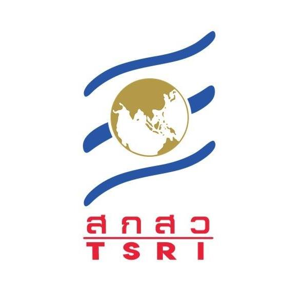

รายงานฉบับสมบูรณ์

การพัฒนาระบบรวบรวมข้อมูลขนาดใหญ่ พยากรณ์และแจ้งเตือนภัยจากอุทกภัย-ภัยแล้งในพื้นที่ลุ่มน้ำพรมโหด และเขตเศรษฐกิจพิเศษสระแก้ว

Implementation of Big data collection system Forecasts and alerts from floods - droughts in the Phromhod Basin and Sa Kaeo Special Economic Zone

อาจารย์ชวลิต โควีระวงศ์ และคณะ

คณะวิทยาศาสตร์และเทคโนโลยี

โครงการนี้ได้รับงบประมาณจาก

มหาวิทยาลัยราชภัฏวไลยอลงกรณ์  ในพระบรมราชูปถัมภ์

สำนักงานคณะกรรมการส่งเสริมวิทยาศาสตร์ วิจัยและนวัตกรรม (สกสว.)

ปีงบประมาณ 2567

รายงานฉบับสมบูรณ์

การพัฒนาระบบรวบรวมข้อมูลขนาดใหญ่ พยากรณ์และแจ้งเตือนภัยจากอุทกภัย-ภัยแล้งในพื้นที่ลุ่มน้ำพรมโหด และเขตเศรษฐกิจพิเศษสระแก้ว

Implementation of Big data collection system Forecasts and alerts from floods - droughts in the Phromhod Basin and Sa Kaeo Special Economic Zone

คณะผู้วิจัย

อาจารย์ชวลิต โควีระวงศ์

ผู้ช่วยศาสตราจารย์ ดร.รัตถชล อ่างมณี

ผู้ช่วยศาสตราจารย์ไพรินทร์ มีศรี

อาจารย์ ดร. ดาวรถา วีระพันธ์

อาจารย์นิธิพนธ์ น้อยเผ่า

คณะวิทยาศาสตร์และเทคโนโลยี

โครงการนี้ได้รับงบประมาณจาก

มหาวิทยาลัยราชภัฏวไลยอลงกรณ์  ในพระบรมราชูปถัมภ์

สำนักงานคณะกรรมการส่งเสริมวิทยาศาสตร์ วิจัยและนวัตกรรม (สกสว.)

ปีงบประมาณ 2567

หัวข้อวิจัย	การพัฒนาระบบรวบรวมข้อมูลขนาดใหญ่ พยากรณ์และแจ้งเตือนภัยจากอุทกภัย-ภัยแล้งในพื้นที่ลุ่มน้ำพรมโหด และเขตเศรษฐกิจพิเศษสระแก้ว

ชื่อผู้วิจัย	อาจารย์ชวลิต โควีระวงศ์

ผู้ช่วยศาสตราจารย์ ดร.รัตถชล อ่างมณี

ผู้ช่วยศาสตราจารย์ไพรินทร์ มีศรี

อาจารย์ ดร. ดาวรถา วีระพันธ์

อาจารย์นิธิพนธ์ น้อยเผ่า

หน่วยงาน	คณะวิทยาศาสตร์และเทคโนโลยี

ปีงบประมาณ	2567

## บทคัดย่อ

**งานวิจัยนี้มีวัตถุประสงค์เพื่อพัฒนาระบบสารสนเทศสำหรับการจัดการข้อมูลน้ำในพื้นที่ลุ่มน้ำห้วยพรมโหดและเขตเศรษฐกิจพิเศษสระแก้ว โดยบูรณาการข้อมูลระดับน้ำย้อนหลังจากสถานีตรวจวัดอุทกวิทยาและอุตุนิยมวิทยา ร่วมกับข้อมูลสถานการณ์น้ำท่วมและภัยแล้งจากสื่อออนไลน์ และข้อมูลพื้นที่เชิงภูมิศาสตร์ เพื่อสร้างระบบที่รองรับการวิเคราะห์เชิงลึก การแจ้งเตือนภัย และการรายงานสถานการณ์ผ่านเว็บไซต์และแอปพลิเคชัน LINE Official Account ระบบที่พัฒนาขึ้นประกอบด้วยฐานข้อมูล Hybrid สำหรับ Big Data และ Workflow อัตโนมัติในการประมวลผลข้อมูล โดยใช้เทคนิคเว็บสแครปปิ้ง (Selenium, BeautifulSoup) ร่วมกับการประมวลผลภาษาธรรมชาติ (NER – WangchanBERTa) เพื่อตรวจจับเวลาและสถานที่จากข่าวน้ำท่วมปี 2567 จำนวน 555 ข่าว ซึ่งผลการวิเคราะห์พบว่าเหตุการณ์ส่วนใหญ่เกิดขึ้นในไตรมาส 3 (79%) และไตรมาส 4 (20%) โดยมีการระบุถึงจังหวัดเชียงรายและเชียงใหม่รวมกันคิดเป็น 29% ของข่าวทั้งหมด ข้อมูลถูกสรุปด้วย DataFrame, PivotTable และ Heatmap ทำให้ระบุพื้นที่เสี่ยงเชิงพื้นที่ได้ชัดเจน กระบวนการทั้งหมดใช้เวลาไปทั้งสิ้น 92 นาที โดย 99% ใช้ไปกับการสกัดและประมวลผลข้อมูล พร้อมผลการทดสอบคาดการณ์ระดับน้ำล่วงหน้า 5–60 นาที ที่มีความแม่นยำสูงในระยะสั้น (R² ≈ 0.95, RMSE ต่ำ) ทั้งนี้ การประเมินประสิทธิภาพและความพึงพอใจของผู้ใช้ระบบอยู่ในระดับ มากที่สุด (ค่าเฉลี่ย 4.62 ) สะท้อนว่าระบบที่พัฒนาขึ้นมีประสิทธิภาพในการสนับสนุนการจัดการน้ำและการแจ้งเตือนภัยล่วงหน้า และสามารถต่อยอดไปสู่การบริหารจัดการภัยพิบัติในพื้นที่อื่นได้อย่างมีศักยภาพ**

**คำสำคัญ: การจัดการน้ำ, การแจ้งเตือนภัย, การประมวลผลภาษาธรรมชาติ, ระบบสารสนเทศ,**
เว็บสแครปปิ้ง

Research Title	  	Implementation of Big data collection system Forecasts and

alerts  from floods - droughts in the Phromhod Basin and
                           	SaKaeo Special Economic Zone

Author			Chavalit Koweerawong

Assistant Professor Dr. Rattachon Angmanee

Assistant Professor Phairin Meesri

Dr. Daorathar Weerapan

Nithiphon Noipao

Faculty		Faculty of Science and Technology

Budget Year 		2024

## Abstract
This research aimed to develop an information system for water data management in the Huai Phrom Hot River Basin and the Sa Kaeo Special Economic Zone. The system integrates historical water level data from hydrological and meteorological monitoring stations, online flood and drought news, and geographic location data to create a system that supports in-depth analysis, disaster warnings, and situation reporting via a website and the LINE Official Account application. The developed system comprises a hybrid database for Big Data and an automated workflow for data processing, using web scraping techniques (Selenium, BeautifulSoup) and natural language processing (NER – WangchanBERTa) to detect time and location from 555 flood news stories in 2024. The analysis revealed that the majority of events occurred in the third quarter (79%) and the fourth quarter (20%), with Chiang Rai and Chiang Mai provinces accounting for 29% of all news stories. The data was summarized using DataFrames, PivotTables, and Heatmaps, providing a clear view of spatially at-risk areas. The entire process took only 92 minutes, with 99% of the data extracted and processed. From the test results of predicting water levels in advance for 5-60 minutes with high short-term accuracy (R² ≈ 0.95, low RMSE), the evaluation of the efficiency and satisfaction of the users of the system was at the "highest" level (average 4.62), reflecting that the developed system is effective in supporting water management and early warning of disasters and can be extended to disaster management in other areas with potential.

**Keywords: water management, disaster warning, natural language processing,**
information systems, web scraping

## กิตติกรรมประกาศ
รายงานการวิจัยเรื่อง การพัฒนาระบบรวบรวมข้อมูลขนาดใหญ่ พยากรณ์และแจ้งเตือนภัยจากอุทกภัย-ภัยแล้งในพื้นที่ลุ่มน้ำพรมโหด และเขตเศรษฐกิจพิเศษสระแก้ว สามารถดำเนินการจนประสบความสำเร็จลุล่วงไปด้วยดี เนื่องจากได้รับความอนุเคราะห์และสนับสนุนเป็นอย่างดียิ่งจากมหาวิทยาลัยราชภัฏวไลยอลงกรณ์ ในพระบรมราชูปถัมภ์ จังหวัดปทุมธานี, สำนักงานคณะกรรมการส่งเสริมวิทยาศาสตร์ วิจัยและนวัตกรรม (สกสว.) ที่ให้การสนับสนุนทุนวิจัย ปีงบประมาณ 2567

คณะผู้วิจัยขอขอบพระคุณ องค์การบริหารส่วนจังหวัดสระแก้ว  สำนักงานทรัพยากรธรรมชาติและสิ่งแวดล้อมจังหวัดสระแก้ว   สำนักงานป้องกันและบรรเทาสาธารณภัยจังหวัดสระแก้ว และโครงการชลประทานสระแก้ว ที่ให้การสนับสนุนช่วยเหลือ ให้คำปรึกษา ความรู้ ข้อคิด ข้อแนะนำ รวมถึงอำนวยความสะดวกและช่วยเหลือในการดำเนินโครงการวิจัยครั้งนี้  ผู้วิจัยขอกราบขอบพระคุณเป็นอย่างสูงไว้ ณ ที่นี้

อาจารย์ชวลิต โควีระวงศ์และคณะ

## สารบัญ
หน้า

| บทคัดย่อภาษาไทย..................................................................................................................... | ก |
| :--- | :--- |
| บทคัดย่อภาษาอังกฤษ................................................................................................................ | ข |
| กิตติกรรมประกาศ..................................................................................................................... | ค |
| สารบัญ........................................................................................................................................ | ง |
| สารบัญตาราง............................................................................................................................. | จ |
| สารบัญภาพ................................................................................................................................ | ฉ |
| บทที่ 1 บทนำ.............................................................................................................................. | 1 |
| 1.1 .............................................................. | 1 |
| 1.2 ...................................................................................... | 3 |
| 1.3 ขอบเขตการวิจัย .................................................................................................... | 3 |
| 1.4 คำจำกัดความที่ใช้ในการวิจัย ................................................................................ | 4 |
| 1.5 ประโยชน์ที่คาดว่าจะได้รับ .................................................................................... | 5 |
| บทที่ 2 แนวคิด ทฤษฎี เอกสารและงานวิจัยที่เกี่ยวข้อง......................................................... | 6 |
| 2.1 ข้อมูลลำน้ำและแหล่งน้ำตามธรรมชาติ จังหวัดสระแก้ว........................................ | 6 |
| 2.2 สถานการณ์น้ำแล้งในจังหวัดสระแก้ว..................................................................... | 12 |
| 2.3 สถานการณ์น้ำในจังหวัดสระแก้ว........................................................................... | 15 |
| 2.4 แผนยุทธศาสตร์การบริหารจัดการทรัพยากร......................................................... | 22 |
| 2.5 ระบบสารสนเทศรวบรวมองค์ความรู้บริการ Big Data........................................... | 27 |
| 2.6 แนวคิดเกี่ยวกับแอปพลิเคชันไลน์........................................................................... | 30 |
| 2.7 แนวคิด และทฤษฎีเกี่ยวกับเว็บไซต์........................................................................ | 36 |
| 2.8 งานวิจัยที่เกี่ยวข้อง................................................................................................. | 42 |

# บทที่ 3 วิธีการดำเนินการวิจัย.....................................................................................................	  45

## 3.1  ประชากรและกลุ่มตัวอย่าง.....................................................................................	  45	3.2  การเก็บรวบรวมข้อมูล.............................................................................................	  47	3.3  เครื่องมือในการวิจัยและการตรวจสอบคุณภาพเครื่องมือ........................................   52	3.4  การวิเคราะห์ข้อมูล...................................................................................................   54บทที่ 4 ผลการวิจัย....................................................................................................................	  57

## 4.1  ผลการพัฒนาระบบการพยากรณ์ฝนล่วงหน้าจากข้อมูลตรวจวัดของเรดาห์
ตรวจวัดฝน แบบหลากหลายช่วงเวลา รายชั่วโมง รายวัน รายสัปดาห์

รายเดือน...................................................................................................................  57

สารบัญ (ต่อ)

หน้า

| 4.2 ผลการพัฒนาโครงข่ายระบบระบายน้ำในพื้นที่ศึกษาโดยการประยุกต์ ใช้แบบจำลองคณิตศาสตร์ และ ใช้จักรกลเรียนรู้เพื่อปรับปรุงความเร็ว ในการประมวลผลและใช้ Server สมรรถนะที่ต่ำเพื่อประหยัดการลงทุน…………… | 63 |
| :--- | :--- |
| 4.3 ผลการรวบรวมข้อมูล Big Data เกี่ยวกับระดับน้ำ และข่าว เพื่อใช้ประกอบการ ตัดสินใจในด้านนโยบายและการรับมือภัยพิบัติ………………………………………………… | 72 |
| 4.4 ผลการพัฒนาระบบแจ้งเตือนภัยและรายงานสถานการณ์ ผ่านระบบเว็บไซต์ และ แอปพลิเคชันไลน์ OA.............................................................................................. | 75 |
| บทที่ 5 สรุปผลการวิจัย อภิปรายผล และข้อเสนอแนะ.......................................................... | 85 |
| 5.1 สรุปผล.................................................................................................................... | 85 |
| 5.2 อภิปรายผล ............................................................................................................ | 86 |
| 5.2 ข้อเสนอแนะ .......................................................................................................... | 90 |
| บรรณานุกรม.............................................................................................................................. | 91 |
| ภาคผนวก ................................................................................................................................. | 93 |
| ภาคผนวก ก................................................................................................................... | 94 |
| แบบสัมภาษณ์…………………………………………………………………................................... | 95 |
| แบบประเมินประสิทธิภาพ………………………………………………………………………......... | 98 |
| แบบประเมินความพึงพอใจการใช้งานระบบ……………………………………………………… | 100 |
| แบบประเมินความพึงพอใจต่อการดำเนินการถ่ายทอด............................................... | 103 |
| ภาคผนวก ข................................................................................................................... | 105 |
| หนังสือขออนุญาตลงพื้นที่........................................................................................... | 106 |
| หนังสือแต่งตั้งผู้ทรงคุณวุฒิ......................................................................................... | 110 |
| ภาคผนวก ค .................................................................................................................. | 113 |
| ภาพกิจกรรม................................................................................................................ | 114 |
| ประวัติผู้วิจัย............................................................................................................................... | 117 |

## สารบัญตาราง

| ตารางที่ | คอลัมน์ 2 | หน้า |
| :--- | :--- | :--- |
| 3.1 | การปกครองส่วนท้องถิ่นประกอบด้วย เทศบาล และองค์การบริหารส่วนตำบล อยู่ในเขตพื้นที่ลุ่มน้ำห้วยพรมโหด ......................................................... | 46 |
| 3.2 | การปกครองส่วนท้องถิ่นประกอบด้วย เทศบาล และ องค์การบริหารส่วนตำบลอยู่ในเขตพื้นที่พื้นที่เศรษฐกิจพิเศษสระแก้ว…………………………………….. | 46 |
| 4.1 | ผลการเปรียบเทียบความแม่นยำระบบคาดการณ์สถานการณ์อุทกภัย เมื่อนำเหตุการณ์ต่อเนื่องจากข้อมูลแผนที่น้ำท่วมในอดีต................................. | 61 |
| 4.2 | ข้อมูลทิศทางการไหลในลุ่มน้ำพรมโหด............................................................. | 66 |
| 4.3 | ข้อมูลทิศทางการไหลในลุ่มน้ำพรมโหด............................................................. | 67 |
| 4.4 | คลองชลประทานและระบบส่งน้ำ เส้นทางการไหลของน้ำเพื่อการเกษตร และการอุปโภคบริโภค...................................................................................... | 67 |
| 4.5 | สถานีตรวจวัดน้ำ ตำแหน่งสถานี ข้อมูลระดับน้ำย้อนหลัง และแนวโน้ม การเปลี่ยนแปลงจังหวัดสระแก้ว....................................................................... | 68 |
| 4.6 | สถานีตรวจอากาศในจังหวัดสระแก้ว................................................................ | 69 |
| 4.7 | สรุปจังหวัดที่มีจำนวนเหตุการณ์น้ำท่วมที่รายงานในแหล่งออนไลน์ปี 2567 มากที่สุด 10 อันดับแรกแบ่งตามภูมิภาคและรายไตรมาส................................ | 73 |
| 4.8 | สรุปจำนวนเหตุการณ์น้ำท่วมที่รายงานในแหล่งออนไลน์ปี 2567 แบ่งตาม ภูมิภาคและรายไตรมาส.................................................................................... | 73 |
| 4.9 | ตารางเปรียบเทียบผลการทำงาน: เว็บไซต์ vs LINE OA…………………………… | 78 |
| 4.10 | ผลการประเมินประสิทธิภาพระบบแจ้งเตือนภัยและรายงานสถานการณ์ เว็บไซต์และ แอปพลิเคชันไลน์ OA............................................................... | 79 |
| 4.11 | ผลการประเมินความพึงพอใจที่มีต่อการใช้งานระบบแจ้งเตือนภัยจากอุทกภัย-ภัยแล้งในพื้นที่ลุ่มน้ำพรมโหดและเขตเศรษฐกิจพิเศษสระแก้ว ผ่านระบบเว็บไซต์............................................................................................. | 81 |
| 4.12 | ผลการประเมินความพึงพอใจที่มีต่อการใช้งานระบบแจ้งเตือนภัยจากอุทกภัย ภัยแล้งในพื้นที่ลุ่มน้ำพรมโหดและเขตเศรษฐกิจพิเศษสระแก้ว แอปพลิเคชันไลน์ ............................................................................................ | 83 |
| 4.13 | ผลการประเมินความพึงพอใจที่มีต่อการดำเนินการถ่ายทอดความรู้................ | 84 |

## สารบัญภาพ

| ภาพที่ | คอลัมน์ 2 | หน้า |
| :--- | :--- | :--- |
| 1.1 | แสดงกราฟพื้นที่ลุ่มน้ำย่อยโตนเลสาบ.................................................................. | 2 |
| 2.1 | แผนที่แสดงขอบเขตลุ่มน้ำหลักและลุ่มน้ำย่อยจังหวัดสระแก้ว……………………….. | 7 |
| 2.2 | สภาพภูมิประเทศและลำน้ำในลุ่มน้ำโตนเลสาบ................................................... | 9 |
| 2.3 | ขอบเขตลุ่มน้ำโตนเลสาบ...................................................................................... | 10 |
| 2.4 | พื้นที่เสี่ยงภัยแล้งในลุ่มน้ำโตนเลสาบ................................................................... | 13 |
| 2.5 | พื้นที่เสี่ยงต่อการเกิดภัยแล้ง จังหวัดสระแก้ว....................................................... | 14 |
| 2.6 | แสดงตำแหน่งที่ตั้งของ กปภ.สาขา ในจังหวัดสระแก้ว......................................... | 16 |
| 2.7 | รายงานสถานการณ์น้ำโครงการชลประทานจังหวัดสระแก้ว................................ | 18 |
| 2.8 | รายงานสถานการณ์น้ำอ่างเก็บน้ำคลองพระสะทึง................................................ | 18 |
| 2.9 | โครงการชลประทานขนาดกลาง ในปัจจุบันจังหวัดสระแก้ว................................ | 19 |
| 2.10 | พื้นที่เสี่ยงภัยน้ำท่วม จังหวัดสระแก้ว.................................................................... | 20 |
| 2.11 | แผนงานโครงการขนาดกลางและขนาดใหญ่ ระยะ 20 ปี จังหวัดสระแก้ว........... | 26 |
| 2.12 | แผนภาพกระบวนการจัดเก็บข้อมูล Big Data....................................................... | 27 |
| 2.13 | ขั้นตอนการประมวลผลข้อมูลจากข่าว.................................................................. | 29 |
| 2.14 | การจัดทำ Dashboard ด้วย Data Visualization................................................ | 30 |
| 2.15 | สถิติการใช้งานแพลตฟอร์มโซเชียลมีเดียในประเทศไทย...................................... | 32 |
| 2.16 | การจัดทำ Line Messaging Framework.......................................................... | 33 |
| 2.17 | การทำงานของ Line Notify API.......................................................................... | 34 |
| 3.1 | หลักการทำงานของเครื่องมือสกัดข้อมูลจากเว็บไซต์ที่ชื่อว่า Scrapy................... | 49 |
| 4.1 | แผนที่แสดงสภาพและข้อมูลการท่วม................................................................... | 58 |
| 4.2 | แผนที่แสดงสภาพคลังข้อมูลน้ำ............................................................................. | 58 |
| 4.3 | โปรแกรม Task Schedule เพื่อจัดการคำสั่งที่ทำงานตามปฏิทินเวลา................. | 59 |
| 4.4 | Overlay ผลการวิเคราะห์และวางบน GIS Map................................................... | 59 |
| 4.5 | กราฟแสดงผลการพัฒนาระบบคาดการณ์สถานการณ์อุทกภัยโดยใช้ Machine Learning............................................................................................................. | 60 |
| 4.6 | กราฟแสดงความแม่นยำระบบคาดการณ์สถานการณ์อุทกภัยระหว่างค่า root mean square error (RMSE) และ coefficient of determination (R²)....... | 62 |
| 4.7 | รูปภาพในการนำเข้าแบบจำลองและผลลัพธ์ที่แบบจำลองให้กลับคืนมา.............. | 62 |
| 4.8 | แผนที่ภูมิประเทศที่ใช้ในการศึกษา....................................................................... | 63 |
สารบัญภาพ (ต่อ)

| ภาพที่ | คอลัมน์ 2 | หน้า |
| :--- | :--- | :--- |
| 4.9 | แผนที่ภาพถ่ายดาวเทียมที่ใช้ในการศึกษา……………………………………………………. | 64 |
| 4.10 | แผนที่โครงข่ายการไหลของน้ำที่ใช้ในการศึกษา……………………………………………. | 65 |
| 4.11 | แผนที่ลักษณะทางอุทกธรณีวิทยาที่ในการศึกษา.................................................. | 69 |
| 4.12 | แผนที่ลักษณะทางธรณีวิทยาที่ใช้ในการศึกษา..................................................... | 70 |
| 4.13 | แผนที่การใช้ประโยชน์ที่ดินที่ใช้ในการศึกษา........................................................ | 71 |
| 4.14 | แผนภาพความภูมิร้อนจำนวนรายงานน้ำท่วม (ซ้าย) รายงานไตรมาส 1 และ 2 (กลาง) รายงานไตรมาส 3 (ขวา) รายงานไตรมาส 4................................. | 74 |
| 4.15 | เว็บแพลตฟอร์มรายงานสถานการณ์น้ำแลระบบคาดการณ์ สถานการณ์อุทกภัย.............................................................................................. | 77 |
