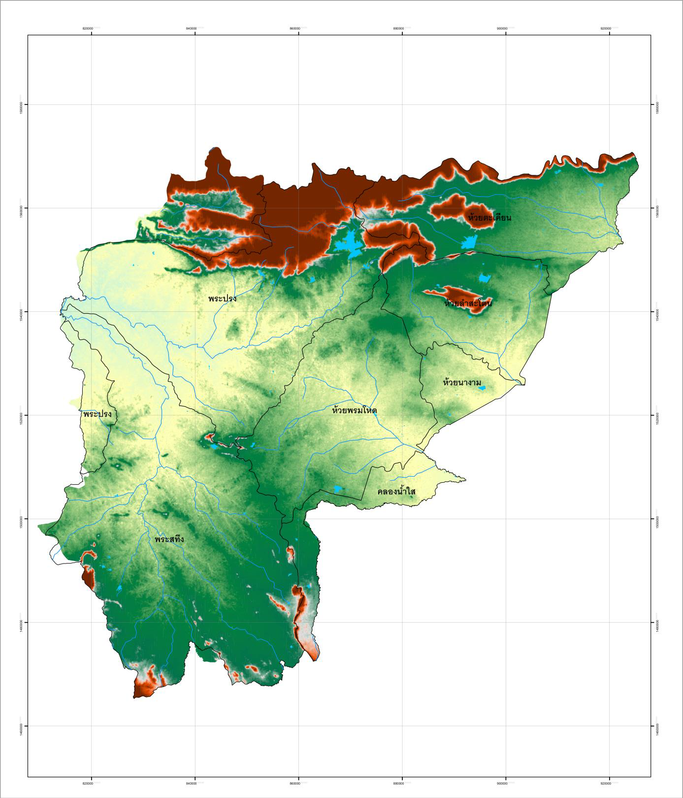

# บทที่ 1 บทนำ

## 1.1 ความเป็นมาและความสำคัญ
ในปี 2559 ได้มีการประกาศเขตพัฒนาเศรษฐกิจพิเศษสระแก้วอยู่ในกลุ่มเขตพัฒนาเศรษฐกิจพิเศษ ระยะที่ 1 ใน 5 จังหวัด รวมถึงในเขตจังหวัดสระแก้ว ได้แก่ตำบลผักขะ อำเภอวัฒนานคร ตำบลบ้านด่าน ตำบลป่าไร่ และตำบลท่าข้าม อำเภออรัญประเทศ รวมพื้นที่ประมาณ 332 ตร.กม เพื่อการสนับสนุนภาคการผลิตในเชิงอุตสาหกรรมและเศรษฐกิจการค้าชายแดนไทย-กัมพูชา พื้นที่ดังกล่าวจึงมีการพัฒนาและขยายตัวของชุมชนเมืองและสถานประกอบการในด้านต่างๆเป็นจำนวนมาก การขยายตัวดังกล่าวส่งผลกระทบในหลายด้าน รวมถึงความต้องการน้ำเพื่อการอุปโภคบริโภค และการจัดหาน้ำเพื่อใช้ในการประกอบการด้านอุตสาหกรรมการผลิตที่เพิ่มสูงขึ้นมาก ด้วยข้อจำกัดของสภาพพื้นที่ลุ่มน้ำ ซึ่งได้แก่ลุ่มน้ำพรมโหด ซึ่งเป็นพื้นที่ลุ่มน้ำขนาดเล็ก แต่เป็นแหล่งน้ำต้นทุนที่สำคัญเพียงหนึ่งเดียวในการใช้เพื่อตอบสนองความต้องการน้ำในพื้นที่เขตเศรษฐกิจพิเศษและชุมชนข้างเคียง จึงเกิดปัญหาขาดแคลนน้ำต้นทุน โดยเฉพาะในช่วงเวลาแล้ง ในทางกลับกัน ข้อจำกัดของลุ่มน้ำที่ไม่สามารถพัฒนาอ่างเก็บน้ำขนาดใหญ่ จึงทำให้เกิดปัญหาน้ำไหลหลากและเกิดอุทกภัยขึ้นบ่อยครั้ง โดยเฉพาะพื้นที่ด่านการค้าอรัญประเทศซึ่งเป็นพื้นที่ปลายน้ำและเป็นพื้นที่ต่ำ ทำให้เกิดความเสียหายด้านเศรษฐกิจเป็นมูลค่าหลายร้อยล้านบาท ในแต่ละเหตุการณ์

ปี พ.ศ. 2560 จังหวัดสระแก้วมีจำนวนครัวเรือนทั้งหมด 192,442 ครัวเรือน โดยเป็นครัวเรือนเกษตร 58,677 ครัวเรือน จำนวนประชากรรวมทั้งสิ้น 561,938 คน แนวโน้มจำนวนประชากรในอนาคตของจังหวัดสระแก้ว เมื่อทำการคำนวณมีอัตราการเจริญเติบโตเฉลี่ย ร้อยละ 8.62 ทำให้ พ.ศ. 2565 คาดว่ามีประชากรอยู่ราว ๆ 573,673 คน สระแก้วมีพื้นที่ประมาณ 4.5 ล้านไร่ แบ่งเป็น เกษตรกรรม 67% ป่าไม้ 24% ที่อยู่อาศัย 5% ลุ่มน้ำ 2% และอื่น ๆ 2% สำหรับลุ่มน้ำพรมโหดนั้นมีพื้นที่อยู่ราว 0.5 ล้านไร่ (11% ของทั้งจังหวัดสระแก้ว) แนวทางเลือกการพัฒนาแหล่งน้ำ

1. มุ่งเน้นแก้ไขปัญหาในพื้นที่เป้าหมายหลักลุ่มน้ำย่อยห้วยสะโตน โดยเฉพาะพื้นที่เกษตรตามแนวลำห้วย สะโตน ประมาณ 20,000 ไร่

2. พิจารณาโครงการพัฒนาแหล่งน้ำประเภทต่างๆ ที่มีศักยภาพมากเพียงพอในการแก้ไขปัญหา โดยไม่ ส่งผลกระทบหรือส่งผลกระทบน้อยที่สุด ต่อพื้นที่อุทยานแห่งชาติตาพระยา เป็นลำดับแรก อาทิ ฝาย แก้มลิง โครงการผันน้ำ เป็นต้น

แนวทางการดำเนินการเกี่ยวกับการบริหารจัดการน้ำ เพื่อแก้ไขปัญหาของพื้นที่ ที่มีข้อจำกัดดังกล่าว จึงควรใช้แนวทางการบริหารจัดการน้ำแบบบูรณาการ โดยการใช้ศักยภาพทั้งระบบน้ำผิวดินและระบบน้ำใต้ดินให้เต็มประสิทธิภาพ รวมทั้งบูรณาการการใช้น้ำโดยคำนึงถึงสมดุลน้ำในแต่ละระบบให้อย่างเหมาะสม ในแนวทางดังกล่าวนี้ จำเป็นต้องมีการศึกษาในรายละเอียด งบดุลของน้ำ ระบบการไหล รวมถึงงบดุลความต้องการการใช้น้ำในพื้นที่ โดยเป็นทั้งจากข้อมูลการสำรวจจริง ข้อมูลจากการประเมินด้วยระบบสารสนเทศภูมิศาสตร์ และแบบจำลอง จะช่วยให้สามารถเสนอแนวทางการพัฒนาแหล่งน้ำต้นทุนได้อย่างเหมาะสม การศึกษาดังกล่าวะช่วยให้เข้าใจถึงรูปแบบ
การไหลของน้ำในลำน้ำในแต่ฤดูกาล ความสามารถในการซึมผ่านลงในระบบน้ำบาดาล ซึ่งจะช่วยให้สามารถประเมินถึงความเสี่ยงภัย และแนวทางการบริหารจัดการเพื่อเตือนภัย และลดผลกระทบ จากการเกิดอุทกภัยในพื้นที่ชุมชนเมือง และพื้นที่ปลายน้ำที่เป็นจุดต่ำสุดของพื้นที่ลุ่มน้ำได้

**ภาพที่ 1.1 แสดงกราฟพื้นที่ลุ่มน้ำย่อยโตนเลสาบ**
ที่มา : สำนักบริหารโครงการกรมชลประทาน, (2562)

## 1.2 วัตถุประสงค์ของการวิจัย

### 1.2.1 เพื่อพัฒนาระบบการพยากรณ์ฝนล่วงหน้าจากข้อมูลตรวจวัดของเรดาห์ตรวจวัดฝน แบบหลากหลายช่วงเวลา รายชั่วโมง รายวัน รายสัปดาห์ รายเดือน

### 1.2.2 เพื่อพัฒนาโครงข่ายระบบระบายน้ำในพื้นที่ศึกษาโดยการประยุกต์ใช้แบบจำลองคณิตศาสตร์ และ ใช้จักรกลเรียนรู้เพื่อปรับปรุงความเร็วในการประมวลผล และใช้ Server สมรรถนะที่ต่ำลงเพื่อประหยัดการลงทุน

### 1.2.3 เพื่อรวบรวมข้อมูล Big Data เกี่ยวกับระดับน้ำ และข่าว เพื่อใช้ประกอบการตัดสินใจในด้านนโยบายและการรับมือภัยพิบัติ

### 1.2.4 พัฒนาระบบแจ้งเตือนภัยและรายงานสถานการณ์ ผ่านระบบเว็บไซต์ 
แอปพลิเคชันไลน์ OA (line official Account)

## 1.3 ขอบเขตการวิจัย
ขอบเขตของการวิจัยเป็นการบูรณาการเพื่อจัดการและบริหารจัดการน้ำร่วมกัน ระหว่างการจัดการน้ำในระบบน้ำดินและน้ำท่า กับระบบน้ำใต้ดินทั้งในระดับลึกและตื้น โดยใช้แนวทางดังกล่าวจะช่วยลดข้อจำกัดในการบริหารจัดการน้ำ และเพิ่มประสิทธิภาพและศักยภาพในการพัฒนาแหล่งน้ำ โดยการคำนึงถึงสมดุลน้ำในแต่ละระบบ การลดผลกระทบด้วยการผันน้ำ และจากการประเมินอย่างแม่นยำด้วยโปรแกรมคอมพิวเตอร์และแบบจำลองและการสำรวจในพื้นที่จริง ซึ่งจะทำให้ทราบถึงต้นตอที่แท้จริงของสภาพปัญหาเกี่ยวกับน้ำในพื้นที่ สามารถเสนอแนวทางการแก้ไขที่เหมาะสมชัดเจน และเป็นที่ยอมรับของชุมชน ผู้ประกอบการ และหน่วยงานที่เกี่ยวข้องในการผลักดันแผนการบริหารจัดการได้อย่างเป็นรูปธรรม

### 1.3.1 ขอบเขตด้านพื้นที่ 	พื้นที่ลุ่มน้ำพรมโหด และเขตเศรษฐกิจพิเศษสระแก้ว

#### 1.3.2.1 พื้นที่ลุ่มน้ำห้วยพรมโหดซึ่งมีพื้นที่ของ 3 อำเภอ ประกอบด้วย อำเภอคลองหาดประมาณ 60.83 ตารางกิโลเมตร อำเภอวัฒนานคร 417.17 ตารางกิโลเมตร และอำเภออรัญประเทศ 570.04 ตารางกิโลเมตร ปริมาณน้ำท่าตามธรรมชาติรายปีเฉลี่ยประมาณ 415.48 ล้านลูกบาศก์เมตร ครอบคลุมพื้นที่ส่วนใหญ่ของอำเภออรัญประเทศ และบางส่วนของอำเภอวัฒนานคร โดยมีลำน้ำสายสำคัญของลุ่มน้ำย่อย ได้แก่
1. ห้วยพรมโหด   ต้นน้ำเกิดจากบริเวณบ้านโนนหมากเค็ง  ในเขตอำเภอวัฒนานคร   มีสาขาย่อยไหลมารวมกัน คือห้วยพรหมโหดน้อย  ห้วยกุดตาโป้ ห้วยประพาน ห้วยพะใยไหลผ่านบ้านต่างๆ ตามลำดับดังนี้  บ้านบุกะสัง บ้านวังติ้ว บ้านหนองบัวเหนือ บ้านนาโพธิ์ บ้านใหม่หนองไทร บ้านสะพานดำ มีน้ำห้วยไผ่ไหลมารวมกันด้วยที่อรัญประเทศ แล้วไหลมาเรียบตามชายแดนระหว่างไทยกับกัมพูชา โดยไหลเข่าสู่ประเทศกัมพูชาประชาธิปไตย ที่บ้านหนองเอียน อำเภออรัญประเทศ

2. ห้วยไผ่   ต้นน้ำเกิดจากบริเวณเทือกเขาแถวหมู่บ้านไผ่ล้อม ระหว่าง
เขตแดนอำเภอวัฒนานคร กับ อำเภออรัญประเทศไหลผ่านบ้านวังยาว บ้านเมืองไผ่ แล้วไหลไปรวมห้วยพรหมโหดที่ อำเภออรัญประเทศไหลเข้าสู่ประเทศกัมพูชา

#### 1.3.2.2  พื้นที่เศรษฐกิจพิเศษสระแก้ว กลุ่มเขตพัฒนาเศรษฐกิจพิเศษ ระยะที่ 1 ใน 5 จังหวัด รวมถึงในเขตจังหวัดสระแก้ว ได้แก่ ตำบลผักขะ อำเภอวัฒนานคร ตำบลบ้านด่าน ตำบลป่าไร่ และตำบลท่าข้าม อำเภออรัญประเทศ รวมพื้นที่ประมาณ 332 ตร.กม

### 1.3.2  ขอบเขตเนื้อหา

#### 1.3.2.1 	ศึกษาสภาพแวดล้อมทั่วไป เช่น การเปลี่ยนแปลงสภาพภูมิอากาศ ปริมาณน้ำฝน  สถานการณ์ภัยแล้ง และสถานการณ์น้ำท่วม  เป็นต้น

#### 1.3.2.2  ศึกษาพื้นที่ลุ่มน้ำห้วยพรมโหดซึ่งมีพื้นที่ของ 3 อำเภอ ประกอบด้วย อำเภอคลองหาดประมาณ 60.83 ตารางกิโลเมตร อำเภอวัฒนานคร 417.17 ตารางกิโลเมตร และอำเภออรัญประเทศ 570.04 ตารางกิโลเมตร และพื้นที่เศรษฐกิจพิเศษสระแก้ว (ตำบลท่าข้าม ตำบลบ้านด่าน และตำบลป่าไร่ อำเภออรัญประเทศ และตำบลผักขะ อำเภอวัฒนานคร)				1.3.2.3  ศึกษา รวบรวม ประมวล ข้อมูลและปัจจัยที่มีผลต่อกระบวนระบบเตือนภัย ล่วงหน้า ระบบพยากรณ์ น้ำท่วม น้ำแล้ง รวบรวมข้อมูล Big Data เกี่ยวกับระดับน้ำ และข่าว เพื่อใช้ประกอบการตัดสินใจในด้านนโยบายและการรับมือภัยพิบัติ

#### 1.3.2.4 นโยบาย ยุทธศาสตร์ แผน กรอบความร่วมมือต่าง ๆ แผนยุทธศาสตร์การบริหารจัดการทรัพยากรน้ำ ของจังหวัด

#### 1.3.2.5 วิเคราะห์ข้อมูลโดยใช้บทวิเคราะห์ที่ได้จากข้อมูลทางสถิติและกรอบการ วิเคราะห์ที่เกี่ยวข้อง และนำมาสังเคราะห์เพื่อเป็นแนวทางต่อการพัฒนาระบบเตือนภัย น้ำท่วม 
น้ำแล้ง และปริมาณน้ำ ล่วงหน้า ในพื้นที่ลุ่มน้ำพรมโหด และเขตพัฒนาเศรษฐกิจพิเศษสระแก้ว

### 1.3.3  ขอบเขตกลุ่มเป้าหมายและกลุ่มตัวอย่าง

#### 1.3.3.1  ผู้บริหารหรือ ผู้ปฏิบัติของหน่วยงานภาครัฐ  ที่มีส่วนเกี่ยวข้องในการดำเนินงานด้าน ระบบเตือนภัยล่วงหน้าสำหรับน้ำท่วม น้ำแล้ง และปริมาณน้ำล่วงหน้า ในพื้นที่ลุ่มน้ำพรมโหด และเขตพัฒนาเศรษฐกิจพิเศษสระแก้ว

#### 1.3.3.2   ชุมชนในเขตพื้นที่ลุ่มน้ำพรมโหด ซึ่งมีพื้นที่ของ 3 อำเภอ ประกอบด้วย อำเภอคลองหาดประมาณ 60.83 ตารางกิโลเมตร อำเภอวัฒนานคร 417.17 ตารางกิโลเมตร และอำเภออรัญประเทศ 570.04 ตารางกิโลเมตร และเขตพัฒนาเศรษฐกิจพิเศษสระแก้ว ประกอบด้วย ตำบลท่าข้าม ตำบลบ้านด่าน และตำบลป่าไร่ อำเภออรัญประเทศ และตำบลผักขะ อำเภอวัฒนานคร รวมพื้นที่ประมาณ 332 ตร.กม

## 1.4 คำจำกัดความที่ใช้ในงานวิจัย

## 1.41  เขตพัฒนาเศรษฐกิจพิเศษสระแก้ว หมายถึง และพื้นที่เศรษฐกิจพิเศษสระแก้ว ประกอบด้วย ตำบลท่าข้าม ตำบลบ้านด่าน และตำบลป่าไร่ อำเภออรัญประเทศ และตำบลผักขะ อำเภอวัฒนานคร รวมพื้นที่ประมาณ 332 ตร.กม

### 1.4.2  ลุ่มน้ำพรมโหด หมายถึง ลุ่มน้ำห้วยพรมโหดซึ่งมีพื้นที่ของ 3 อำเภอ ประกอบด้วย อำเภอคลองหาดประมาณ 60.83 ตารางกิโลเมตร อำเภอวัฒนานคร 417.17 ตารางกิโลเมตร และอำเภออรัญประเทศ 570.04 ตารางกิโลเมตร

### 1.4.4 แอปพลิเคชันไลน์ OA (line official Account) หมายถึง ไลน์ออฟฟิเชียลแอคเคาท์ซึ่งเป็นระบบแจ้งเตือนภัยและรายงานสถานการณ์น้ำ ลุ่มน้ำพรมโหดและเขตเศรษฐกิจพิเศษสระแก้ว

### 1.4.5  ระบบเว็บไซต์  หมายถึง  เว็บไซต์ที่พัฒนาขึ้นรวบรวม ประมวล ข้อมูลและปัจจัยที่มีผลต่อกระบวนระบบเตือนภัยล่วงหน้า ระบบพยากรณ์น้ำท่วม น้ำแล้ง รวบรวมข้อมูล Big Data เกี่ยวกับระดับน้ำและข่าวเน้นให้บริการด้าน ข้อมูล ที่ครบถ้วน ทั้งในภาพรวมและรายละเอียด เพื่อใช้ประกอบการตัดสินใจในด้านนโยบายและการรับมือภัยพิบัติ

## 1.5 ประโยชน์ที่คาดว่าจะได้รับ

### 1.5.1   ได้ระบบสารสนเทศรวบรวมองค์ความรู้บริการ Big Data เกี่ยวกับระดับน้ำ ย้อนหลังในพื้นที่ลุ่มน้ำห้วยพรมโหด
ได้ระบบบริการรวบรวมข่าวสารที่เกี่ยวข้องกับน้ำท่วม น้ำแล้งในพื้นที่ลุ่มน้ำห้วย
พรมโหด

### 1.5.3  ได้ระบบบริการแจ้งเตือนภัยและรายงานสถานการณ์ ผ่านระบบเว็บไซต์ 
แอปพลิเคชันไลน์ OA (line official Account)
