# บทที่ 2 แนวคิด ทฤษฎี เอกสารและงานวิจัยที่เกี่ยวข้อง

## 2.1  ข้อมูลลำน้ำและแหล่งน้ำตามธรรมชาติ จังหวัดสระแก้ว
จังหวัดสระแก้ว มีพื้นที่อยู่เขตลุ่มน้ำ จำนวน 6,825.68 ตารางกิโลเมตร โดยอยู่ในลุ่มน้ำหลัก 2 ลุ่มน้ำของประเทศ คือ ลุ่มน้ำโตนเลสาบ จำนวน 2,856.23 ตารางกิโลเมตร คิดเป็นร้อยละ 41.58 ของพื้นที่ลุ่มน้ำในจังหวัด และลุ่มน้ำบางปะกง จำนวน 3,969.45 ตารางกิโลเมตร คิดเป็นร้อยละ 58.15 ของพื้นที่ลุ่มน้ำในจังหวัด (สำนักงานทรัพยากรธรรมชาติและสิ่งแวดล้อมจังหวัดสระแก้ว, 2567) ลำน้ำและแหล่งน้ำตามธรรมชาติ จังหวัดสระแก้ว ประกอบด้วยลุ่มน้ำหลัก จำนวน 2 ลุ่มน้ำหลัก ได้แก่ ลุ่มน้ำปราจีนบุรี และลุ่มน้ำโตนเลสาบ มีพื้นที่ลุ่มน้ำประมาณ 6,596.71 ตารางกิโลเมตร โดยลุ่มน้ำปราจีนบุรี จะแบ่งลุ่มน้ำย่อยได้ 2 ลุ่มน้ำ คือ ลุ่มน้ำคลองพระปรง และลุ่มน้ำคลองพระสะทึง ลุ่มน้ำโตนเลสาบไม่มีลำน้ำสายหลัก มีเพียงลำน้ำสายย่อยที่สำคัญ ได้แก่ ห้วยพรมโหด คลองน้ำใส คลองด่าน ห้วยยาง คลองพระพุทธ ลำสะโตน ห้วยตะเคียน ห้วยนางาม และคลองโปร่งน้ำร้อน (สำนักงานทรัพยากรน้ำแห่งชาติ, 2564)

### 2.1.1  ลุ่มน้ำปราจีนบุรี
ลุ่มน้ำปราจีนบุรี มีพื้นที่ลุ่มน้ำประมาณ 9,821 ตารางกิโลเมตร แบ่งออกเป็น 4 ลุ่มน้ำย่อย อยู่ในเขตจังหวัดสระแก้ว 2 ลุ่มน้ำย่อย มีพื้นที่ลุ่มน้ำประมาณ 3,751.10 ตารางกิโลเมตร ได้แก่ ลุ่มน้ำคลองพระสะทึง และ ลุ่มน้ำคลองพระปรง ครอบคลุมพื้นที่ในเขตอำเภอวังสมบูรณ์ 
อำเภอคลองหาด อำเภอวังน้ำเย็น อำเภอเขาฉกรรจ์ อำเภอวัฒนานคร และอำเภอเมืองสระแก้ว

#### 2.1.1.1  ลุ่มน้ำคลองพระสะทึง ประกอบด้วย 3 อำเภอ 1 กิ่งอำเภอ คือ อำเภอวังน้ำเย็น อำเภอคลองหาด อำเภอเขาฉกรรจ์และกิ่งอำเภอวังสมบูรณ์จังหวัดสระแก้ว มีพื้นที่ทั้งหมด 1,649,601 ไร่มีพื้นที่ลุ่มน้ำในจังหวัดสระแก้วประมาณ 1,984.47 ตารางกิโลเมตร อาณาเขตด้านทิศเหนือติดลุ่มน้ำสาขาคลองพระปรง ทิศตะวันออกติดลุ่มน้ำสาขาโตนทะเลสาบตอนบน และประเทศกัมพูชา ทิศใต้ติดลุ่มน้ำหลักชายฝั่งทะเลตะวันออก ทิศตะวันตกติดลุ่มน้ำสาขาคลองท่าลาดและลุ่มน้ำสาขา แม่น้ำปราจีนบุรีสายหลักตอนบน มีต้นกำเนิดจากเทือกเขาทึงลึง เขาตะกวด และเขาตาพลาย ในเขตจังหวัดจันทบุรีไหลผ่านเขตอำเภอวังน้ำเย็น เขตอำเภอเขาฉกรรจ์และเขตอำเภอเมืองสระแก้ว จังหวัดสระแก้ว ไหลมาบรรจบกับคลองพระปรงที่บ้านท่าช้างปริมาณน้ำท่าตามธรรมชาติรายปีเฉลี่ยประมาณ 850.84 ล้านลูกบาศก์เมตร ครอบคลุมพื้นที่ในเขตอำเภอวังสมบูรณ์ อำเภอคลองหาด อำเภอวังน้ำเย็น อำเภอเขาฉกรรจ์ อำเภอวัฒนานคร และอำเภอเมืองสระแก้ว โดยมีลำน้ำสายสำคัญของลุ่มน้ำย่อย ได้แก่คลองพระสะทึง คลองตาหลัง  คลองไก่เถื่อนและคลองวังจิก

#### 2.1.1.2  ลุ่มน้ำคลองพระปรง  ประกอบด้วย 2 อำเภอ คือ อำเภอเมืองสระแก้ว และอำเภอวัฒนา นคร จังหวัดสระแก้ว มีพื้นที่ทั้งหมด 1,680,368 ไร่อาณาเขตด้านทิศเหนือติดลุ่มน้ำหลักมูล ทิศตะวันออกติดลุ่มน้ำสาขาโตนเลสาปตอนบน ทิศใต้ติดลุ่มน้ำสาขาคลองพระสทึง ทิศตะวันตกติดลุ่มน้ำสาขาแม่น้ำปราจีนบุรีสายหลักตอนบนและลุ่มน้ำสาขาแม่น้ำหนุมาน มีต้นกำเนิดจากภูเขียว เขาห้วยชัน เขาขมิ้น เขาเขียว เขาอีด่าง และ เขาเทียน มีทิศทางการไหลจากด้านตะวันออกไปทางด้านตะวันตกมีพื้นที่ลุ่มน้ำในจังหวัดสระแก้วประมาณ 1,766.64 ตารางกิโลเมตร ปริมาณน้ำท่าตามธรรมชาติรายปีเฉลี่ยประมาณ 640.51 ล้านลูกบาศก์เมตร ครอบคลุมพื้นที่ในเขตอำเภอวัฒนานคร และอำเภอเมืองสระแก้ว โดยมีลำน้ำสายสำคัญของลุ่มน้ำย่อยได้แก่ คลองพระปรง

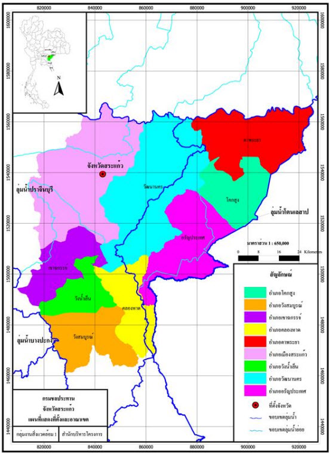

**ภาพที่ 2.1 แผนที่แสดงขอบเขตลุ่มน้ำหลักและลุ่มน้ำย่อยจังหวัดสระแก้ว**
ที่มา : สำนักบริหารโครงการกรมชลประทาน, (2561)

### 2.1.2  ลุ่มน้ำโตนเลสาบ
ลุ่มน้ำโตนเลสาบเป็นลุ่มน้ำขนาดเล็กที่ตั้งอยู่ทางทิศตะวันออกของประเทศไทยขนาดพื้นที่ลุ่มน้ำ 4,148.12  ตารางกิโลเมตร พื้นที่ส่วนใหญ่อยู่ในเขตจังหวัดสระแก้วและจันทบุรี  
ลุ่มน้ำทอดตัวยาวจากทิศเหนือลงสู่ทิศใต้ สภาพพื้นที่ตอนบนเป็นแนวเทือกเขาบรรทัดซึ่งกั้นเขตพื้นที่จังหวัดบุรีรัมย์และจังหวัดปราจีนบุรี  เป็นต้นกำเนิดของลุ่มน้ำต่าง ๆ หลายสาย พื้นที่ในเขต
อำเภอตาพระยาส่วนใหญ่เป็นภูเขาและมีที่ราบริมลุ่มน้ำ สำหรับพื้นที่ตอนกลางของลุ่มน้ำซึ่งอยู่ในเขตอำเภออรัญประเทศและอำเภอวัฒนานคร เป็นที่ราบ โดยลาดเทลงจากทิศตะวันตกไปทิศตะวันออก 
ส่วนในเขตอำเภอวัฒนานคร จะเป็นที่ราบสูงและมีภูเขาซึ่งเป็นต้นกำเนิดของคลองน้ำใส พื้นที่ทางตอนใต้ในเขตอำเภอโป่งน้ำร้อนมีสภาพเป็นภูเขาสูง มีเทือกเขาสอยดาวเป็นต้นกำเนิดของคลองพระพุทธและคลองโป่งน้ำร้อน เนื่องจากสภาพพื้นที่มีความลาดเทจากทิศตะวันตกไปสู่ทิศตะวันออก 
ลำน้ำสายต่าง ๆ จึงไหลออกไปทางประเทศกัมพูชาและลงทะเลสาบเขมร (สำนักงานทรัพยากรน้ำแห่งชาติ, 2563)

ทิศเหนือ	ติดกับลุ่มน้ำมูล

ทิศใต้		ติดกับลุ่มน้ำชายฝั่งทะเลตะวันออก

ทิศตะวันตก	ติดกับลุ่มน้ำบางปะกง

ทิศตะวันออก	ติดกับประเทศกัมพูชา

ลุ่มน้ำโตนเลสาบในพื้นที่จังหวัดสระแก้ว ได้แบ่งลุ่มน้ำสาขา ออกเป็น 3 ลุ่มน้ำสาขา ประกอบด้วยลุ่มน้ำโตนเลสาบตอนบน ลุ่มน้ำห้วยพรมโหด และลุ่มน้ำโตนเลสาบตอนล่าง ลักษณะของลุ่มน้ำเป็นแหล่งต้นน้ำ  โดยที่มีกลางน้ำ และท้ายน้ำอยู่ในเขตประเทศกัมพูชา ในช่วงฤดูแล้ง น้ำค่อนข้างน้อยถึงแห้งขอด และช่วงน้ำหลาก น้ำไหลค่อนข้างไว ไม่มีพื้นที่หรือแหล่งเก็บกักน้ำขนาดใหญ่ไว้ใช้ในฤดูแล้ง หากแบ่งพื้นที่ตามลักษณะเขต การปกครองเป็นตำบล และอำเภอ แบ่งได้ดังนี้

ทุกตำบล ในพื้นที่อำเภอตาพระยา

ทุกตำบล ในพื้นที่อำเภอโคกสูง

พื้นที่อำเภอวัฒนานคร ตำบลผักขะ และตำบลหนองแวง และบางส่วนของตำบลช่องกุ่ม ตำบลแซร์ออ ตำบลท่าเกวียน ตำบลโนนหมากเค็ง ตำบลวัฒนานคร ตำบลหนองน้ำใส ตำบลหนองหมากฝ้าย และตำบลห้วยโจด

ทุกตำบล ในพื้นที่อรัญประเทศ ยกเว้นบางส่วนของตำบลทับพริก

พื้นที่อำเภอคลองหาด บางส่วนของตำบลคลองไก่เถื่อน ตำบลคลองหาด
 ตำบลไทรเดี่ยว ตำบลไทรทอง และตำบลเบญจขร

ลุ่มน้ำโตนเลสาบไม่มีลำน้ำสายหลัก มีเพียงลำน้ำสายย่อยที่สำคัญ ได้แก่ ห้วยพรมโหด คลองน้ำใส คลองด่าน ห้วยยาง คลองพระพุทธลำสะโตน ห้วยตะเคียน ห้วยนางาม และคลองโปร่งน้ำร้อน (สำนักงานทรัพยากรน้ำแห่งชาติ, 2564)

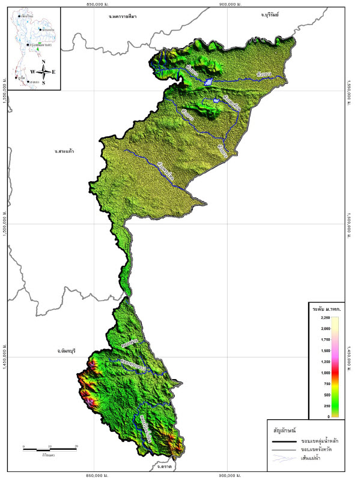

**ภาพที่ 2.2 สภาพภูมิประเทศและลำน้ำในลุ่มน้ำโตนเลสาบ**
ที่มา : สำนักงานทรัพยากรน้ำแห่งชาติ, (2563)

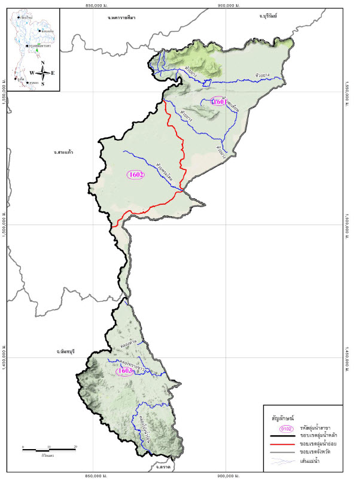

**ภาพที่ 2.3 ขอบเขตลุ่มน้ำโตนเลสาบ**
ที่มา : สำนักงานทรัพยากรน้ำแห่งชาติ, (2563)

#### 2.1.2.1  คลองพระพุทธลำสะโตน มีพื้นที่ลุ่มน้ำประมาณ 849.80 ตารางกิโลเมตร ปริมาณน้ำท่าตามธรรมชาติรายปีเฉลี่ยประมาณ 230.32 ล้านลูกบาศก์เมตร ครอบคลุมพื้นที่ในเขตอำเภอตาพระยาบางส่วน โดยมีลำน้ำสายสำคัญของลุ่มน้ำย่อย ได้แก่  ลำสะโตน ต้นน้ำกำเนิดจากเทือกเขาบรรทัด ในเขตอำเภอตาพระยา ไหลไปทางทิศตะวันออก และเข้าสู่ประเทศกัมพูชาประชาธิปไตยห้วยยาง ต้นน้ำกำเนิดจากเทือกเขาสะแกกรอง เขาคันนา เขาทะลาย เขาวง ไหลไปทางทิศตะวันออก และไปบรรจบกับลำสะโตน แล้วไหลเข้าสู่ประเทศกัมพูชาประชาธิปไตย

#### 2.1.2.2  ห้วยตะเคียน มีพื้นที่ลุ่มน้ำประมาณ 586.70 ตารางกิโลเมตร ปริมาณน้ำท่าตามธรรมชาติรายปีเฉลี่ยประมาณ 180.52 ล้านลูกบาศก์เมตร ครอบคลุมพื้นที่ส่วนใหญ่ของอำเภอ
ตาพระยา และกิ่ง อำเภอโคกสูง โดยมีลำน้ำสายสำคัญของลุ่มน้ำย่อย ได้แก่  ห้วยตะเคียน ต้นน้ำเกิดจากเทือกเขาคันนา เขาโล้น เขาอีด่าง ในเขตอำเภอตาพระยา และไหลไปบรรจบกับห้วยยางที่ 
บ้านโคกสูง กิ่งอำเภอโคกสูง

#### 2.1.2.3  ห้วยพรมโหด มีพื้นที่ลุ่มน้ำประมาณ 931.40 ตารางกิโลเมตร ปริมาณน้ำท่าตามธรรมชาติรายปีเฉลี่ยประมาณ 415.48 ล้านลูกบาศก์เมตร ครอบคลุมพื้นที่ส่วนใหญ่ของอำเภออรัญประเทศ และบางส่วนของอำเภอวัฒนานคร โดยมีลำน้ำสายสำคัญของลุ่มน้ำย่อย     ได้แก่
ห้วยพรมโหด   ต้นน้ำเกิดจากบริเวณบ้านโนนหมากเค็ง   ในเขต อำเภอ วัฒนานคร   มีสาขาย่อยไหลมารวมกัน คือห้วยพรหมโหดน้อย  ห้วยกุดตาโป้ ห้วยประพาน ห้วยพะใยไหลผ่านบ้านต่าง ๆ ตามลำดับดังนี้  บ้านบุกะสัง บ้านวังติ้ว บ้านหนองบัวเหนือ บ้านนาโพธิ์ บ้านใหม่หนองไทร บ้านสะพานดำ มีน้ำห้วยไผ่ไหลมารวมกันด้วยที่อรัญประเทศ แล้วไหลมาเรียบตามชายแดนระหว่างไทยกับกัมพูชา โดยไหลเข่าสู่ประเทศกัมพูชาประชาธิปไตย ที่บ้านหนองเอียน อำเภออรัญประเทศ

#### 2.1.2.4  คลองน้ำใส มีพื้นที่ลุ่มน้ำประมาณ 252.50 ตารางกิโลเมตร ปริมาณน้ำท่าตามธรรมชาติรายปีเฉลี่ยประมาณ 143.00 ล้านลูกบาศก์เมตร ครอบคลุมพื้นที่ส่วนใหญ่ของ อำเภอคลองหาด และบางส่วนของอำเภออรัญประเทศ โดยมีลำน้ำสายสำคัญของลุ่มน้ำย่อย ได้แก่คลองน้ำใสเป็นคลองแบ่งแนวเขตระหว่างไทยกับกัมพูชาไหลไปรวมกับคลองลึกและคลองพรหมโหด  รวมตัวกันไหลลงสู่ประเทศกัมพูชาประชาธิปไตย

#### 2.1.2.5  ห้วยนางาม มีพื้นที่ลุ่มน้ำประมาณ 225.20 ตารางกิโลเมตร ปริมาณน้ำท่าตามธรรมชาติรายปีเฉลี่ยประมาณ 71.99 ล้านลูกบาศก์เมตร   ครอบคลุมพื้นที่ส่วนใหญ่ของอำเภออรัญประเทศ และบางส่วนของ กิ่ง อ . โคกสูง โดยมีลำน้ำสายสำคัญของลุ่มน้ำย่อย ได้แก่ห้วยนางาม   ต้นน้ำเกิดจากหนองอ้อยที่บ้านเหล่าอ้อย อำเภออรัญประเทศ แล้วไหลไปตามเขตแดนระหว่าง อำเภออรัญประเทศ กับ กิ่งอำเภอโคกสูง เข้าสู่ประเทศกัมพูชาประชาธิปไตย

#### 2.1.2.6  ห้วยยาง  ต้นน้ำเกิดจากเขาแห่งในเขตอำเภอวัฒนานคร และเขาโล้น
 เขาอีด่าง ในเขตอำเภอตาพระยา ไหลผ่านหมู่บ้านแซร์ออ   บ้านผาสุก  บ้านหนองแคน  แล้วไหลไปบรรจบกับห้วยตะเคียนที่บ้านโคกสูง  กิ่งอำเภอโคกสูง เพื่อไหลเข้าสู่ประเทศกัมพูชาประชาธิปไตย

## 2.2  สถานการณ์น้ำแล้งในจังหวัดสระแก้ว
สถานการณ์ด้านการขาดแคลนน้ำและภัยแล้ง ในช่วงฤดูแล้งและฝนทิ้งช่วง สภาพปัญหา เนื่องจากปริมาณฝนที่ตกในลุ่มน้ำโตนเลสาบมีปริมาณน้อยกว่าเกณฑ์เฉลี่ย โดยเฉพาะบริเวณอำเภอตาพระยา อำเภอโคกสูง ปัจจุบันมีปริมาณฝนเฉลี่ยเพียง 900-1,100 มิลลิเมตรต่อปี ซึ่งเกณฑ์เฉลี่ย 1,400 -1,500 มิลลิเมตรต่อปี จึงทำให้ อ่างเก็บน้ำห้วยยาง ที่มีความจุอ่างเก็บน้ำ 60 ล้านลูกบาศก์เมตร แต่มีน้ำเพียง 20-35 ล้านลูกบาศก์เมตร ไม่เพียงพอที่จะส่งน้ำให้กับพื้นที่ชลประทาน 40,000 ไร่

### 2.2.1  สาเหตุการเกิดความแห้งแล้งในพื้นที่ลุ่มน้ำมี 3 ลักษณะ คือ

#### 2.2.1.1  สภาวะอากาศแห้งแล้ง (Meteorogical Drought) เป็นสภาวะที่มีการระเหยน้ำเกินจำนวนที่ได้รับ กล่าวคือ มีการระเหยจากไอน้ำของดินและพืชพรรณมากกว่าปริมาณฝนรายปี เป็นผลให้พื้นที่นั้น ๆ มีภูมิอากาศแห้งแล้ง

#### 2.2.1.2  สภาวะการขาดน้ำ (Hydrological Drought) เป็นปรากฏการณ์ที่มีสาเหตุมาจากการเปลี่ยนแปลงของสภาพภูมิอากาศที่เกิดจากการมีฝนน้อยเฉลี่ยต่ำกว่าปกติเป็นระยะเวลานานต่อเนื่องกัน จนมีผลกระทบต่อการลดลงของระดับน้าผิวดิน น้ำใต้ดิน และการขาดแคลนน้ำเพื่ออุปโภคบริโภคในช่วงฤดูแล้ง

#### 2.2.1.3  สภาวะความแห้งแล้งทางการเกษตร (Agricultural Drought) เป็นสภาวะที่เกิดจากการขาดน้ำสำหรับการเกษตรอันเนื่องมาจากการลดลงของปริมาณน้าฝน ระดับน้ำใต้ดิน ความชื้นในดินลดลง จนพืชไม่สามารถดึงน้ำมาใช้ มีผลทำให้พืชหยุดชะงักการเจริญเติบโต และตายไปในที่สุดสำหรับปัจจัยที่มีผลต่อสภาวะแห้งแล้งในพื้นที่ลุ่มน้ำ ได้แก่ ปัจจัยทางด้านอุตุนิยมวิทยา ประกอบด้วย ปริมาณน้ำฝนรายเดือน จำนวนวันที่ฝนตกรายเดือน อุณหภูมิเฉลี่ยรายเดือน และความชื้นสัมพัทธ์ ปัจจัยทางด้านกายภาพของพื้นที่ลุ่มน้ำ ประกอบด้วย แหล่งน้ำใต้ดิน การใช้ที่ดิน (ชนิดพืช) การอุ้มน้ำของดิน ความลาดของพื้นที่ ความหนาแน่นของลำน้ำในลุ่มน้ำสาขา ขนาดของลุ่มน้ำ ปัญหาด้านภัยแล้งหรือการขาดแคลนน้ำในภาพรวมของพื้นที่ลุ่มน้ำโตนเลสาบ สามารถสรุปสาเหตุของปัญหาได้ดังนี้
1. ความต้องการใช้น้ำที่เพิ่มมากขึ้น จากการขยายตัวของชุมชน อุตสาหกรรมและการท่องเที่ยวในพื้นที่ลุ่มน้ำ

2. ปริมาณฝนตกในบางพื้นที่ลุ่มน้ำสาขามีปริมาณน้อย ประกอบกับขาดแหล่งเก็บกักน้ำต้นทุนที่เพียงพอกับความต้องการใช้น้ำภายในลุ่มน้ำบางลุ่มน้ำสาขา

3. เกิดปัญหาในกระบวนการอนุมัติโครงการในการพัฒนาโครงการแหล่งน้ำขนาดใหญ่ เนื่องจากติดปัญหาผลกระทบสิ่งแวดล้อม เนื่องจากโครงการเข้าไปอยู่ในพื้นที่ป่าหรือเขตอนุรักษ์

4. ปัญหาด้านประสิทธิภาพการใช้น้ำทางด้านระบบประปาและโครงการชลประทานมีประสิทธิภาพต่ำ

ในการประเมินพื้นที่เสี่ยงต่อการเกิดภัยแล้ง ได้ใช้ปัจจัยในการประเมินทั้งหมด 9 ปัจจัย โดยให้คะแนนจากมาก (9 คะแนน) ไปถึงน้อย (1 คะแนน) เรียงตามลำดับดังต่อไปนี้ ปริมาณน้ำฝนรายปี จำนวนวันที่ฝนตก เขตชลประทานและแหล่งน้ำ แหล่งน้ำใต้ดิน พืชปกคลุมดิน สภาพการระบายน้ำ ความลาดชัน ความหนาแน่นของลำน้ำในลุ่มน้ำย่อย และขนาดของพื้นที่ลุ่มน้ำย่อยโดยทำการจำแนกระดับความเสี่ยง ออกเป็น 4 ระดับ ได้แก่ พื้นที่เสี่ยงระดับสูง พื้นที่เสี่ยงระดับปานกลาง พื้นที่เสี่ยงระดับต่ำ และพื้นที่เสี่ยงระดับต่ำมาก โดยใช้หลักการจำแนก โดยการแบ่งช่วงชั้นจากการกระจายตัวของข้อมูล Standard Deviation (SD) สำหรับพื้นที่เสี่ยงต่อการเกิดภัยแล้งในพื้นที่ลุ่มน้ำโตนเลสาบ

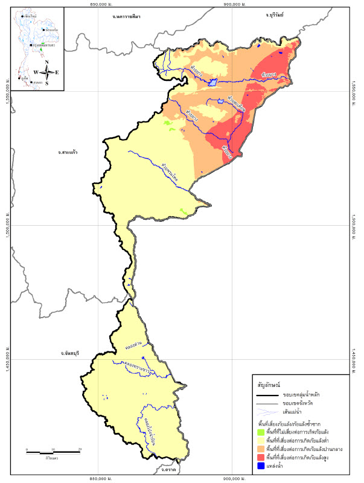

**ภาพที่ 2.4 พื้นที่เสี่ยงภัยแล้งในลุ่มน้ำโตนเลสาบ**
ที่มา : สำนักงานทรัพยากรน้ำแห่งชาติ, (2563)

### 2.2.2  แผนการบริหารจัดการน้ำเพื่อแก้ไขปัญหาภัยแล้ง
การบริหารจัดการน้ำเพื่อแก้ปัญหาภัยแล้ง โดยจัดสรรน้ำให้สอดคล้องกับปริมาณน้ำต้นทุนในอ่างเก็บน้ำ เพื่อสนับสนุนการใช้น้ำทุกกิจกรรมในพื้นที่ต่างๆอย่างทั่วถึงและพอเพียง รวมทั้งมีน้ำสำรองไว้ส่วนหนึ่ง สำหรับการอุปโภค-บริโภค การรักษาระบบนิเวศ การตสาหกรรม และการเพาะปลูกพืชฤดูฝนปีถัดไป โดยลำดับความสำคัญ ดังนี้

#### 2.2.2.1 เพื่อการอุปโภค-บริโภค และการประปา

#### 2.2.2.2 เพื่อรักษาระบบนิเวศทางน้ำ เช่น การผลักดันน้ำเค็ม การขับไล่น้ำเสีย

#### 2.2.2.3 เพื่อการเกษตร

#### 2.2.2.4 เพื่อการอุตสาหกรรม

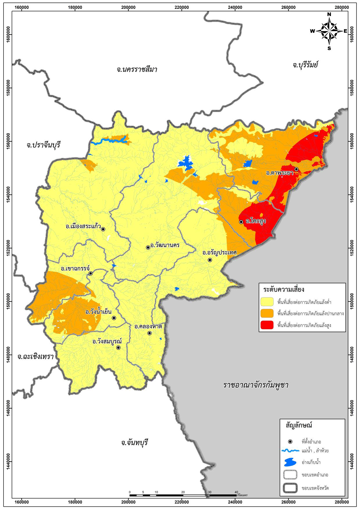

**ภาพที่ 2.5 พื้นที่เสี่ยงต่อการเกิดภัยแล้ง จังหวัดสระแก้ว**

## 2.3  สถานการณ์น้ำในจังหวัดสระแก้ว
จังหวัดสระแก้ว มีแหล่งน้ำธรรมชาติที่สำคัญ 12 แห่งคือ คลองพระสะทึง คลองตาหลัง คลองไก่เถื่อน คลองวังจิก คลองพระปรง คลองลำสะโตน ห้วยยาง ห้วยตะเคียนห้วยนางามห้วยพรมโหด ห้วยไผ่ คลองน้ำใส มีแม่น้ำ ห้วยลำธาร คลอง จำนวน 244 สาย ซึ่งในจำนวนนี้มีที่ใช้งานได้ในฤดูแล้ง จำนวน 96 สาย มีหนองบึง 106 แห่ง ที่มีสภาพใช้งานได้ในฤดูแล้ง 53 แห่ง และอื่น ๆ 297 แห่ง ที่มีสภาพการใช้งานได้ในฤดูแล้ง 202 แห่ง  และแหล่งน้ำของกรมชลประทาน แหล่งน้ำชลประทานที่มีอยู่ภายในจังหวัด ประกอบด้วยแหล่งน้ำตามโครงการขนาดใหญ่ และขนาดกลาง โครงการอื่นเนื่องมาจากพระราชดำริ โครงการหมู่บ้านป้องกันตนเองชายแดน และโครงการขนาดเล็ก ที่สร้างเสร็จแล้ว ถึงสิ้นปีงบประมาณ 2543 รวม 173โครงการ สามารถเก็บกักน้ำได้ 346.325 ล้าน ลบ.ม. และมีพื้นที่ที่ได้รับประโยชน์จากโครงการ 337,506 ไร่หรือร้อยละ 13.83 ของพื้นที่ถือครองทางการเกษตร ของจังหวัด 2,440,783 ไร่ (กองพัฒนาแหล่งน้ำ, 2565)

### 2.3.1  การใช้ประโยชน์จากแหล่งน้ำ
น้ำเพื่อการอุปโภคบริโภค ในจังหวัดสระแก้ว มีประชากรในเขตเมือง (เทศบาล) 65,612 คนและในเขตชนบท 473,945 คน มีความต้องการน้ำกินน้ำใช้ในเขตเมือง และชนบทประมาณ 16,403,000ลิตร และ 23,674,750 ลิตร ตามลำดับ

น้ำเพื่อการเกษตร แหล่งน้ำที่ประชาชนชาวจังหวัดสระแก้ว ใช้เพื่อการเกษตร ประกอบด้วย บ่อบาดาลส่วนตัว 12,805 บ่อ บ่อบาดาลสาธารณะ 1,920 บ่อ

ระบบน้ำประปา จังหวัดสระแก้วมีหน่วยงานที่ให้บริการน้ำประปา ได้แก่การประปาส่วนภูมิภาคและองค์กรปกครองส่วนท้องถิ่น มีจำนวนหมู่บ้านที่มีน้ำประปาทั้งหมด 633 หมู่บ้าน และไม่มีน้ำประปาใช้12 หมู่บ้าน คิดเป็นร้อยละ 98.14 และ 1.86 ของหมู่บ้านทั้งหมด ตามลำดับ  ประปาในเขตเมือง ณ เดือนกันยายน 2554 จังหวัดสระแก้ว มีจำนวนการประปาทั้งหมด 6 แห่ง มีจำนวนผู้ใช้น้ำ 20,778 ราย มีปริมาณน้ำผลิต 6,759,156 ลูกบาศก์เมตรต่อปี มีปริมาณน้ำจำหน่าย5,511,238 ลูกบาศก์เมตรต่อปี คิดเป็นปริมาณน้ำสูญเสียร้อยละ 18.46

### 2.3.2  ระบบประปาในภาพรวม
การประปาส่วนภูมิภาค ในจังหวัดสระแก้ว สังกัดการประปาส่วนภูมิภาค ภาค 3 เขต 1 อยู่ภาคตะวันออกของประเทศไทย ระบบผลิตประปาทั้งหมดของ การประปาส่วนภูมิภาคในพื้นที่จังหวัดสระแก้วเป็นระบบผลิตแบบทั่วไป (Conventional Water Treatment) กล่าวคือ ทำการสูบน้ำจากแหล่งน้ำผิวดินโดยแหล่งน้ำดิบหลักที่ใช้ในการผลิตน้ำประปา ได้แก่ คลองพระปรง คลองพระสะทึง คลองอีจ่อย และห้วยพรหมโหด สูบจากสถานีสูบน้ำแรงต่ำส่งมายังระบบสร้างและตกตะกอนก่อนที่จะเข้าสู่ระบบกรอง และน้ำประปาที่ผลิตได้จะถูกฆ่าเชื้อโรคด้วยคลอรีน และไหลไปพักที่ถังน้ำใส แล้วถูกสูบผ่านโรงสูบน้ำแรงสูงขึ้นเก็บไว้ในถังสูง เพื่อจ่ายให้ผู้ใช้น้ำต่อไป โดยมีจำนวน กปภ.สาขาในพื้นที่ จำนวน 3 สาขา ดังนี้

สาขาที่ 1 การประปาส่วนภูมิภาค สาขาสระแก้ว ประกอบด้วยหน่วยบริการ 2 แห่ง ได้แก่ หน่วยบริการเขาฉกรรจ์และ หน่วยบริการวังน้ำเย็น

สาขาที่ 2 การประปาส่วนภูมิภาค สาขาวัฒนานคร ประกอบด้วยหน่วยบริการ 1 แห่ง ได้แก่ หน่วยบริการคลองหาด

สาขาที่ 3 การประปาส่วนภูมิภาค สาขาอรัญประเทศ

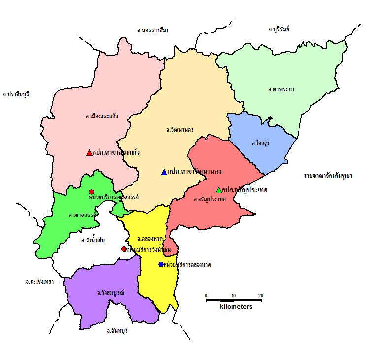

**ภาพที่ 2.6 แสดงตำแหน่งที่ตั้งของ กปภ.สาขา ในจังหวัดสระแก้ว**

### 2.3.3  ปริมาณน้ำฝน
ลักษณะภูมิประเทศของจังหวัดสระแก้ว พื้นที่จังหวัดสระแก้วโดยรวมเป็นพื้นที่ราบถึงราบสูงและมีภูเขาสูงสลับซับซ้อน มีระดับความสูงจากน้ำทะเล 74 เมตร ด้านเหนือ มีเทือกเขาบรรทัดซึ่งเป็นต้นกำเนิดของแม่น้ำบางประกง มีลักษณะเป็นป่าเขาทึบ ได้แก่ บริเวณอุทยานแห่งชาติปางสีดาเป็นแหล่งต้นน้ำลำธาร ด้านใต้ มีลักษณะเป็นที่ราบเชิงเขามีสภาพเป็นป่าโปร่ง ส่วนใหญ่ถูกบุกรุก แผ้วถางป่าเพื่อทำการเกษตร ทำให้เกิดสภาพป่าเสื่อมโทรม ตอนกลางมีลักษณะเป็นที่ราบ ได้แก่ อำเภอวังน้ำเย็น อำเภอวังสมบูรณ์เป็นเขตติดต่อจังหวัดจันทบุรี ด้านตะวันออก ลักษณะเป็นที่ราบถึงราบสูง และมีสภาพเป็นป่าโปร่ง ทำไร่ ทำนา ด้านตะวันตก นับตั้งแต่อำเภอวัฒนานครมีลักษณะเป็นสันปันน้ำ โดยทางตะวันตกเป็นที่ลาดอำเภอเมืองสระแก้ว ส่วนทางตะวันออกลาดลงสู่อำเภออรัญประเทศเข้าเขตประเทศกัมพูชา

พื้นที่ส่วนใหญ่ของจังหวัดสระแก้วมีปริมาณฝนรวมมากกว่า 1,200 มิลลิเมตร ได้แก่ อำเภอเมือง อำเภอวัฒนานคร อำเภอวังน้ำเย็น และอำเภออรัญประเทศ ส่วนอำเภอคลองหาดมีปริมาณฝนรวมต่ำกว่า 1,200 มิลลิเมตร เนื่องจากอิทธิพลของแนวเทือกเขาจันทบุรีซึ่งอยู่ทางตอนล่างของจังหวัด ทำให้พื้นที่ ทางตะวันออกของเทือกเขาเป็นพื้นที่ที่มีฝนน้อยกว่าทางตอนบนของจังหวัด รวมทั้งอำเภอตาพระยาซึ่งมี แนวเทือกเขาที่ต่อเนื่องมาจากเทือกเขาสันกกำแพงกั้นอยู่ซึ่งทอดเป็นแนวยาวจากทิศตะวันตกเฉียงเหนือไปยัง ทิศตะวันออกเฉียงใต้ท้าให้พื้นที่บริเวณอำเภอตาพระยาเป็นพื้นที่อับฝนจึงมีฝนน้อยกว่าบริเวณอื่น ๆ โดยมีปริมาณฝนรวมตลอดปีเพียง 800 มิลลิเมตร ปริมาณฝนรวมมากที่สุดใน 24 ชั่วโมงของจังหวัดสระแก้ว วัดได้ 181.5 มิลลิเมตร ที่อำเภอเมือง เมื่อวันที่ 11 มิถุนายน 2556  (กรมอุตุนิยมวิทยา, 2566)

การศึกษาปริมาณน้ำฝนได้รวบรวมข้อมูลจากหน่วยงานต่าง ๆ ได้แก่ กรมอุตุนิยมวิทยากรมชลประทาน สถานีวัดน้ำฝนที่เลือกตั้งอยู่ในขอบเขตพื้นที่ศึกษาซึ่งครอบคลุมในจังหวัดสระแก้วในการศึกษา ได้ทำการคัดเลือกสถานีวัดน้ำฝนที่เป็นตัวแทนของพื้นที่ จำนวน 9 สถานี โดยพิจารณาข้อมูลจากสถานีที่มีการตรวจวัดอย่างต่อเนื่องและกระจายทั่วทั้งพื้นที่ศึกษา ค่าปริมาณน้ำฝนรายปีเฉลี่ยเท่ากับ 1,359.77 มิลลิเมตร เป็นปริมาณน้ำฝนในช่วงฤดูฝน (พฤษภาคม – ตุลาคม) ประมาณ 1,182.21 มิลลิเมตรหรือคิดเป็นร้อยละ 87 ของปริมาณน้ำฝนทั้งปี และเป็นปริมาณน้ำฝนในช่วงฤดูแล้ง (พฤศจิกายน –เมษายน) ประมาณ 177.59 มิลลิเมตร หรือคิดเป็นร้อยละ 13 ของปริมาณฝนทั้งปี ทางด้านตะวันตกของพื้นที่ศึกษาบริเวณอำเภอเมืองสระแก้ว อำเภอวัฒนานคร มีปริมาณฝนรายปีสูงสุด โดยมีค่าปริมาณฝนรายปีเฉลี่ยมากกว่า 1,500 มม. ต่อปี และบริเวณด้านล่างของพื้นที่ศึกษาบริเวณอำเภออรัญประเทศ คลองหาดและวังน้ำเย็น มีปริมาณฝนระหว่าง 1,200 ถึง 1,400 มม. ต่อปี ส่วนในบริเวณด้านตะวันออกตอนบนของพื้นที่ศึกษาบริเวณอำเภอตาพระยา มีปริมาณฝนค่อนข้างต่ำกว่า โดยมีค่าเฉลี่ยระหว่าง 800 ถึง 1,100 มม. ต่อปี

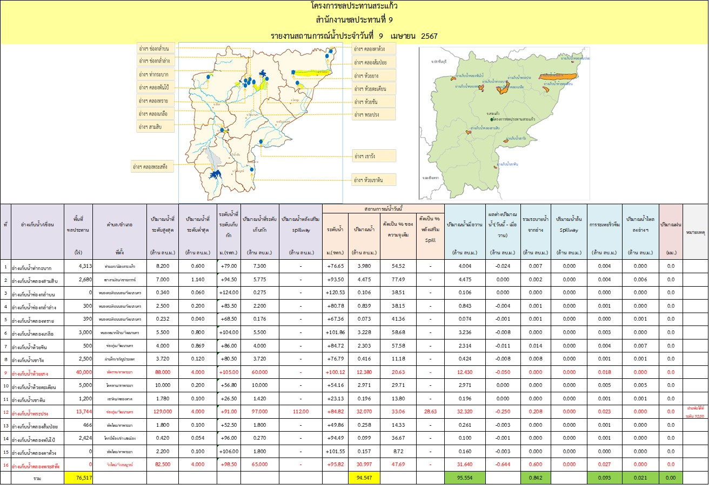

**ภาพที่ 2.7 รายงานสถานการณ์น้ำโครงการชลประทานจังหวัดสระแก้ว**
ที่มา : โครงการชลประทานจังหวัดสระแก้ว, (2567)

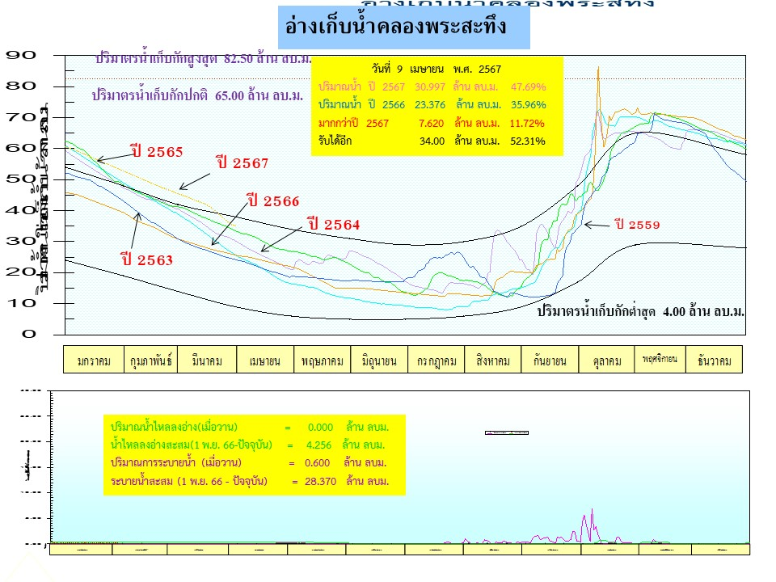

**ภาพที่ 2.8 รายงานสถานการณ์น้ำอ่างเก็บน้ำคลองพระสะทึง**
ที่มา : โครงการชลประทานจังหวัดสระแก้ว, (2567)

### 2.3.4  โครงการพัฒนาแหล่งน้ำที่มีในปัจจุบัน
จังหวัดสระแก้วยังไม่มีการพัฒนาโครงการขนาดใหญ่โดยมีโครงการชลประทานขนาดกลางและขนาด เล็กประเภทต่าง ๆ ที่ดำเนินการแล้วถึง พ.ศ.2560 จำนวนทั้งสิ้น 485 แห่ง สามารถเก็บกักน้ำได้ 343.39 ล้าน ลูกบาศก์เมตร พื้นที่ชลประทาน 132,239 ไร่ (สำนักบริหารโครงการ กรมชลประทาน, 2562)

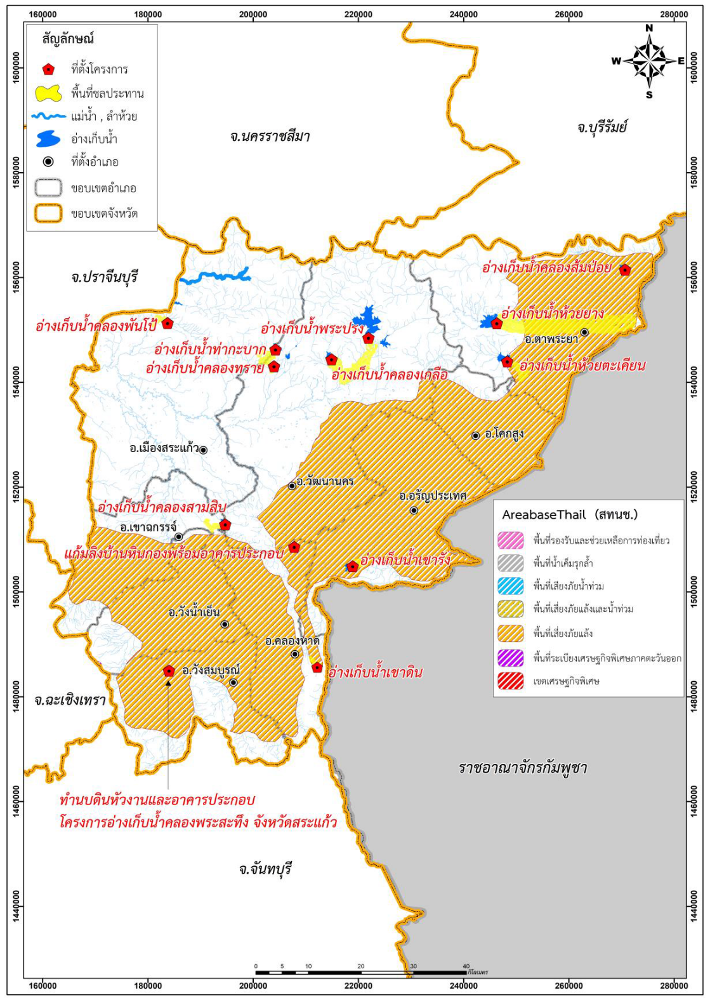

**ภาพที่ 2.9 โครงการชลประทานขนาดกลาง ในปัจจุบันจังหวัดสระแก้ว**

### 2.3.5  สถานการณ์ด้านน้ำท่วมและอุทกภัย
สภาพการเกิดอุทกภัยในจังหวัดสระแก้ว แยกตามพื้นที่ลุ่มน้ำ ดังนี้ พื้นที่ลุ่มน้ำปราจีนบุรี ในเขตลุ่มน้ำย่อย ลุ่มน้ำคลองพระสะทึง มีปัญหาอุทกภัยในช่วงฤดูน้ำหลาก เมื่อถึง ฤดูฝน ช่วงที่ฝนตกหนักแหล่งน้ำในพื้นที่ไม่สามารถรองรับปริมาณน้ำไว้ได้ ทำให้น้ำท่วมบริเวณที่ลุ่มต่ำข้างคลองธรรมชาติ แต่ก็ไม่รุนแรงมากนักท่วมขังประมาณ 3-5 วัน สามารถระบายไปทางพื้นที่ด้านท้ายน้ำได้เนื่องจากสภาพพื้นที่มีความลาดเอียงและเป็นพื้นที่ต้นน้ำ พื้นที่ลุ่มน้ำโตนเลสาบ มีปัญหาอุทกภัยในช่วงฤดูน้ำหลาก เมื่อถึงฤดูฝน ช่วงที่ฝนตกหนักแหล่งน้ำในพื้นที่ไม่สามารถรองรับปริมาณน้ำไว้ได้ โดยเฉพาะในเขตลุ่มน้ำพรมโหด อำเภออรัญประเทศ ซึ่งมีชุมชนย่านการค้าการลงทุน ตลาดการค้าชายแดน น้ำท่วมในเขตเทศบาลอรัญประเทศ ในช่วงระยะเวลา 15 ปี ที่ผ่านมา น้ำท่วมในเขตเทศบาลอรัญประเทศ 5 ครั้ง ครั้งแรกเมื่อปี 2538 ครั้งที่ 2 เมื่อปี 2540 ครั้งที่ 3 เมื่อปี 2553 ครั้งที่ 4 เมื่อปี 2555 และครั้งที่ 5 เมื่อปี 2556 น้ำท่วมแต่ละครั้งสร้างความเสียหายให้กับระบบเศรษฐกิจของอรัญประเทศซึ่งเป็นศูนย์กลางการส่งออกไปยังประเทศกัมพูชาเป็นอย่างมาก พื้นที่เสี่ยงภัยน้ำท่วมจังหวัดสระแก้ว  (สำนักบริหารโครงการ กรมชลประทาน, 2562)

#### 2.3.5.1  แผนการแก้ไขปัญหาอุทกภัย พัฒนาโครงการชลประทานขนาดเล็กที่ก่อสร้างไว้แล้ว ให้สามารถเก็บกักน้ำได้เพิ่มขึ้น 10 ล้านลูกบาศก์เมตร เพื่อเป็นแก้มลิงรองรับปริมาณน้ำไว้ส่วนหนึ่งและสามารถช่วยเหลือพื้นที่การเกษตรในลุ่มน้ำคลองพรมโหด โดยจัดซื้อพื้นที่หน้าฝายหรืออ่างเก็บน้ำแต่ละแห่งประมาณ 150-200 ไร่ และขุดเป็นสระใหญ่ความลึก 4 - 6 เมตร โดยรวมโครงการย่อย ๆ ทั้ง 13 แห่ง เข้าด้วยกันและเปิดเป็นโครงการชลประทานขนาดกลาง เพื่อให้กรมชลประทาน สามารถจ่ายค่าทดแทนที่ดินได้

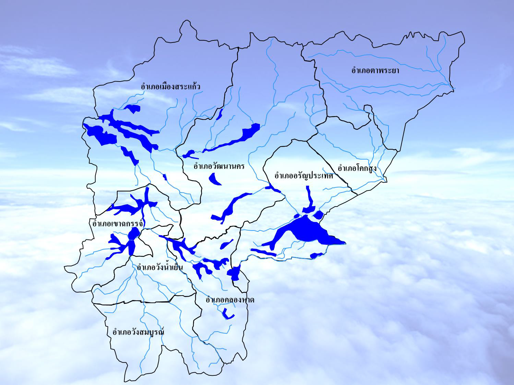

**ภาพที่ 2.10 พื้นที่เสี่ยงภัยน้ำท่วม จังหวัดสระแก้ว**

#### 2.3.5.2 แนวทางการแก้ไขปัญหาอย่างเป็นระบบ (AREA BASE)  สำนักงานทรัพยากรน้ำแห่งชาติ ได้กำหนดพื้นที่เป้าหมายในการแก้ไขปัญหาทรัพยากรน้ำอย่างเป็นระบบ (Area Base) ทั่วประเทศรวม 66 พื้นที่ โดยวิเคราะห์จากปัญหา ความถี่ ความรุนแรง ความเสียหาย โดยครอบคลุมปัญหาน้ำแล้ง น้ำท่วม น้ำเค็มรุกล้ำ รวมถึงการรองรับพื้นที่สำคัญ เช่น เขตเศรษฐกิจพิเศษ ในส่วนของจังหวัดสระแก้วมีพื้นที่เป้าหมายในการแก้ไขปัญหาทรัพยากรน้ำอย่างเป็นระบบ (Area Base) จำนวน 2 พื้นที่ ได้แก่ พื้นที่ประสบปัญหาเสี่ยงภัยแล้งลุ่มน้ำโตนเลสาบตอนบน มีพื้นที่ประมาณ 1,178,381 ไร่ อยู่ทางด้านตะวันออกของจังหวัด ครอบคลุมอำเภอตาพระยา อำเภอโคกสูง อำเภออรัญประเทศ อำเภอวัฒนานคร และอำเภอคลองหาด ดังแสดงภาพ
พื้นที่ประสบปัญหาเสี่ยงภัยแล้งลุ่มน้ำปราจีนบุรีตอนบน มีพื้นที่ประมาณ 
750,496 ไร่ อยู่ทางตอนใต้ของจังหวัดครอบคลุมอำเภอเขาฉกรรจ์ อำเภอวังน้ำเย็น อำเภอวังสมบูรณ์ และอำเภอคลองหาด แนวทางการแก้ไขปัญหาอย่างเป็นระบบทั้งภัยแล้งและน้ำท่วมของจังหวัดสระแก้วต้องมีการบูรณาการร่วมกันทุกภาคส่วน ทั้งมาตรการไม่ใช้สิ่งก่อสร้างและใช้สิ่งก่อสร้าง เช่น การอนุรักษ์ฟื้นฟูป่าไม้ต้นน้ำ การจัดทำแหล่งน้ำชุมชน ต่าง ๆ โดยในส่วนของกรมชลประทานมีแนวทางแก้ไขปัญหาอย่างเป็นระบบโดยการจัดทำแหล่งเก็บกักน้ำ การเพิ่มประสิทธิภาพการเก็บกักอ่างเก็บน้ำเดิมที่มีอยู่ในปัจจุบัน หรือการผันน้ำจากพื้นที่ใกล้เคียง ซึ่งสามารถแก้ไขปัญหาได้ทั้งภัยแล้งและน้ำท่วม ในพื้นที่เพาะปลูกมุ่งเน้นการพัฒนาระบบกระจายน้ำ รวมถึงการเก็บน้ำในลำน้ำ ซึ่งมีทั้งโครงการทั้งขนาดกลางและขนาดเล็ก ตามลำดับความสำคัญต่อไป

สำหรับปัญหาน้ำเค็มรุกพื้นที่เกษตรกรรม โครงการชลประทานสระแก้วมีแผนการระบายน้ำ จากอ่างเก็บน้ำคลองพระสะทึง จังหวัดสระแก้ว เพื่อช่วยผลักดันน้ำเค็มที่รุกล้ำเข้ามาในแม่น้ำบางปะกง และแม่น้ำปราจีนบุรี ควบคู่ ไปกับ อ่างเก็บน้ำคลองสียัด จังหวัดฉะเชิงเทรา อ่างเก็บน้ำคลองระบม จังหวัดฉะเชิงเทรา อ่างเก็บน้ำขุนด่าน ปราการชล จังหวัดนครนายก และอ่างเก็บน้ำ
นฤบดินทรจินดา จังหวัดปราจีนบุรี

### 2.3.6  ความต้องการใช้น้ำ
ความต้องการใช้น้ำของจังหวัดสระแก้วได้ประเมินความต้องการใช้น้ำจากกิจกรรมหลักที่สำคัญ 4 ประเภท คือ ความต้องการใช้น้ำเพื่อการอุปโภคบริโภค ความต้องการน้ำเพื่อรักษาระบบนิเวศท้ายน้ำ ความต้องการน้ำเพื่อการเกษตร และความต้องการน้ำเพื่ออุตสาหกรรม สามารถ โดยมีรายละเอียดดังนี้

#### 2.3.6.1 ความต้องการใช้น้ำเพื่อการอุปโภคบริโภค ความต้องการใช้น้ำเพื่อการอุปโภคบริโภคประเมินจากจำนวนประชากรกับอัตราการใช้น้ำของประชากรโดยทำการประเมินความต้องการในอนาคต 5 ปี, 10 ปี และ 20 ปี จากการวิเคราะห์แนวโน้มของปริมาณประชากร โดยมีรายละเอียดดังนี้ ความต้องการใช้น้ำเพื่ออุปโภคบริโภคในปัจจุบัน เท่ากับ 30.77 ล้านลูกบาศก์เมตร/ปี และจะเพิ่มเป็น 31.41, 32.06 และ 33.42 ล้านลูกบาศก์เมตร/ปี ในระยะ 5 ปี, 10 ปี และ 20 ปี ตามลำดับ

#### 2.3.6.2  ความต้องการใช้น้ำเพื่อรักษาระบบนิเวศท้ายน้ำ ความต้องการใช้น้ำเพื่อรักษาระบบนิเวศท้ายน้ำ ประเมินโดยการเปรียบเทียบความต้องการน้ำเพื่อรักษาระบบนินิเวศท้ายน้ำของลุ่มน้ำหลัก โดยเปรียบเทียบพื้นที่ของจังหวัดสระแก้วกับพื้นที่ลุ่มน้ำที่มีพื้นที่ครอบคลุมจังหวัดสระแก้ว จากผลการประเมินความต้องการใช้น้ำเพื่อรักษาระบบนิเวศท้ายน้ำจังหวัดสระแก้ว เท่ากับ 108.88 ล้านลูกบาศก์เมตร/ปี

#### 2.3.6.3  ความต้องการใช้น้ำเพื่อการเกษตรความต้องการใช้น้ำเพื่อการเกษตร ประเมินจากพื้นที่เกษตรกรรมฤดูฝนและฤดูแล้งทั้งในเขตชลประทานและนอกเขตชลประทาน กับอัตราการใช้น้ำเพื่อการเพาะปลูกต่อไร่ โดยความต้องการน้ำเพื่อการเกษตรในเขตชลประทานประเมินจากพื้นที่ชลประทานที่มีในปัจจุบันและแผนในอนาคตจากการพัฒนาพื้นที่ชลประทาน ซึ่งฤดูฝนเพาะปลูกเต็มพื้นที่ ส่วนฤดูแล้งพื้นที่เพาะปลูกร้อยละ 20 ของพื้นที่ชลประทาน ความต้องการน้ำเพื่อการเกษตรนอกเขตชลประทานประเมินจากพื้นที่เพาะปลูกนอกเขตชลประทานในปัจจุบัน และคาดการณ์ว่าพื้นที่เพาะปลูกโดยรวมไม่เปลี่ยนแปลงอย่างมีนัยสำคัญ ผลการประเมินความต้องการใช้น้ำเพื่อการเกษตรสรุปได้ดังนี้ ความต้องการใช้น้ำเพื่อการเกษตร เท่ากับ 894.60 ล้านลูกบาศก์เมตร/ปี และความต้องการน้ำเพื่อการเกษตร จะเพิ่มเป็น 896.69, 834.96 และ 934.56 ล้านลูกบาศก์เมตร/ปี ในระยะ 5 ปี, 10 ปี และ 20 ปี ตามลำดับ

#### 2.3.6.4  ความต้องการใช้น้ำเพื่อการอุตสาหกรรม กรมโรงงานอุตสาหกรรมและการนิคมอุตสาหกรรมได้ทำการประเมินความต้องการน้ำเพื่อการอุตสาหกรรมเป็นรายจังหวัด โดยประเมินจากจำนวนโรงงานอุตสาหกรรมที่ขึ้นทะเบียนกับกรมโรงงานอุตสาหกรรม กับอัตราการใช้น้ำของโรงงานอุตสาหกรรมขนาดต่างๆ แยกตามกำลังการผลิต (กำลังม้า) รวมถึงอัตราการใช้น้ำของนิคมอุตสาหกรรมโดยคิดเป็นต่อพื้นที่ โดยทำการประเมินความต้องการในอนาคต 5 ปี, 10 ปี และ 20 ปี จากการวิเคราะห์แนวโน้มของการเจริญเติบโตด้านอุตสาหกรรมและแผนการพัฒนานิคมอุสาหกรรม โดยมีรายละเอียดดังนี้ ความต้องการใช้น้ำเพื่ออุตสาหกรรม เท่ากับ 36.81 ล้านลูกบาศก์เมตร/ปี และจะเพิ่มเป็น 42.37, 48.77 และ56.14 ล้านลูกบาศก์เมตร/ปี ในระยะ 5 ปี, 10 ปี และ 20 ปี ตามลำดับ

## 2.4  แผนยุทธศาสตร์การบริหารจัดการทรัพยากรน้ำ
แผนยุทธศาสตร์การบริหารจัดการทรัพยากรน้ำดำเนินการโดยคณะกรรมการกำหนดนโยบายและการบริหารจัดการทรัพยากรน้ำ มีระยะเวลาของการดำเนินแผนงานตามยุทธศาสตร์ 12 ปี 
(พ.ศ. 2558 -พ.ศ. 2569) ปัจจุบันอยู่ระหว่างการปรับปรุงเป้าหมายตามแผนยุทธศาสตร์ให้สอดคล้องกับยุทธศาสตร์ชาติ 20 ปี (พ.ศ.2561 - พ.ศ. 2580) โดยสำนักงานทรัพยากรน้ำแห่งชาติ แต่ยังคงมียุทธศาสตร์ 6 ด้าน ได้แก่

1. การจัดการน้ำอุปโภคบริโภค

2. การสร้างความมั่นคงของน้ำภาคการผลิต

3. การจัดการน้ำท่วมและอุทกภัย

4. การจัดการคุณภาพน้ำ

5. การอนุรักษ์ฟื้นฟูป่าต้นน้ำ

6. การบริหารจัดการ

### 2.4.1  ยุทธศาสตร์กรมชลประทาน 20 ปี (พ.ศ. 2561 - พ.ศ. 2580)
กรมชลประทานมีวิสัยทัศน์คือ “องค์กรอัจฉริยะ ที่มุ่งสร้างความมั่นคงด้านน้ำ (Water Security) เพื่อเพิ่มคุณค่าการบริการ ภายในปี พ.ศ. 2579 โดยมีพันธกิจ ดังนี้

#### 2.4.1.1 พัฒนาแหล่งน้ำและเพิ่มพื้นที่ชลประทานตามศักยภาพของลุ่มน้ำให้เกิดความสมดุล

#### 2.4.1.2 บริหารจัดการน้ำอย่างบูรณาการให้เพียงพอ ทั่วถึง และเป็นธรรม

#### 2.4.1.3 ดำเนินการป้องกันและบรรเทาภัยอันเกิดจากน้ำตามภารกิจอย่างเหมาะสม

#### 2.4.1.4 เสริมสร้างการมีส่วนร่วมในกระบวนการพัฒนาแหล่งน้ำ และการบริหารจัดการน้ำ
โดยมีประเด็นยุทธศาสตร์ ดังนี้

1. การพัฒนาแหล่งน้ำและเพิ่มพื้นที่ชลประทานตามศักยภาพลักษณะลุ่มน้ำ (Basin–based Approach)

2. การเพิ่มประสิทธิภาพการบริหารจัดการน้ำอย่างบูรณาการ ตามวัตถุประสงค์การใช้น้ำ

3. การป้องกันความเสียหายและสนับสนุนการบรรเทาภัยอันเกิดจากน้ำ

4. การสร้างเครือข่าย และการมีส่วนร่วม (Networking and Participation) ของทุกภาคส่วนในการบริหารจัดการน้ำชลประทานในระดับพื้นที่ (Networking Collaboration Participation)

5. การปรับเปลี่ยนสู่องค์กรอัจฉริยะ (Turnaround to Intelligent Organization) 2.4.2  ยุทธศาสตร์กลุ่มจังหวัดภาคตะวันออก 2 (พ.ศ. 2561 – 2564)

กลุ่มจังหวัดภาคตะวันออก 2 ประกอบด้วย จังหวัดจันทบุรี จังหวัดตราด จังหวัดนครนายก จังหวัดปราจีนบุรี และจังหวัดสระแก้ว มีวิสัยทัศน์คือ “เมืองแห่งคุณภาพชีวิต ศูนย์กลางท่องเที่ยวประวัติศาสตร์ วัฒนธรรมและนิเวศ แหล่งผลไม้และครัวสุขภาพไทย” และมีประเด็นยุทธศาสตร์ ดังนี้

#### 2.4.2.1 ส่งเสริมและพัฒนาการท่องเที่ยวให้ได้มาตรฐานเพื่อสนับสนุนการท่องเที่ยวเชิงนิเวศ สุขภาพ และวัฒนธรรม

#### 2.4.2.2 เพิ่มขีดความสามารถด้านอุตสาหกรรม อัญมณี การค้า การลงทุน การค้าชายแดนเชื่อมโยง EEC และประเทศเพื่อนบ้าน

#### 2.4.2.3 พัฒนาประสิทธิภาพการผลิต การแปรรูป การตลาด สินค้าเกษตร และผลไม้คุณภาพปลอดภัย และสมุนไพรไทยอย่างครบวงจร

#### 2.4.2.4 อนุรักษ์ ฟื้นฟู พัฒนา และปกป้อง ทรัพยากรธรรมชาติและสิ่งแวดล้อมอย่างมีส่วนร่วม เพื่อประโยชน์ต่อการพัฒนาเศรษฐกิจและสังคมอย่างยั่งยืน

#### 2.4.2.5 พัฒนาทรัพยากรมนุษย์ สังคม การบริหารจัดการ ยกระดับคุณภาพชีวิตให้มีความมั่นคงปลอดภัย

#### 2.4.2.6 เพิ่มขีดความสามารถด้านอุตสาหกรรมและการลงทุน

### 2.4.3  ยุทธศาสตร์จังหวัดสระแก้ว (พ.ศ. 2561 – 2564)
วิสัยทัศน์จังหวัดสระแก้ว คือ “เมืองชายแดนแห่งความสุข ถิ่นเกษตรปลอดภัย แหล่งท่องเที่ยวเชิงนิเวศและอารยธรรมโบราณ เขตเศรษฐกิจพิเศษสระแก้วมั่นคง” โดยมีประเด็นยุทธศาสตร์ ดังนี้

#### 2.4.3.1 เสริมสร้างกระบวนการเรียนรู้และสภาพแวดล้อมของประชาชนให้สามารถปรับตัว ประกอบอาชีพและมีสภาพแวดล้อมและคุณภาพชีวิตที่ดี

#### 2.4.3.2 ปรับปรุงปัจจัยและกระบวนการผลิตสินค้าเกษตรปลอดภัยให้ได้คุณภาพมาตรฐานสากล

#### 2.4.3.3 ฟื้นฟูแหล่งท่องเที่ยว ให้มีความปลอดภัย และปรับปรุงสิ่งอำนวยความสะดวกเสริมสร้างสภาพแวดล้อมให้เอื้อต่อการเป็นแหล่งท่องเที่ยวเชิงนิเวศและเชื่อมโยงอารยธรรมโบราณ

#### 2.4.3.4 เพิ่มประสิทธิภาพระบบโครงสร้างพื้นฐาน การส่งเสริมการค้า การลงทุน พัฒนาเศรษฐกิจ การบริหารจัดการด้านสังคมและสิ่งแวดล้อม เพื่อรองรับการพัฒนาเขตเศรษฐกิจพิเศษสระแก้ว

#### 2.4.3.5 เสริมสร้างความมั่นคงเพื่อการพัฒนาพื้นที่จังหวัดชายแดน (ปรับปรุงปัจจัยและกระบวนการ ผลิตสินค้าเกษตรปลอดภัยให้ได้ คุณภาพมาตรฐานสากล)

### 2.4.4 แผนการพัฒนาการชลประทานระยะ 20 ปี (พ.ศ.2561 -พ.ศ.2580) ในการจัดทำแผนการดำเนินการระดับจังหวัด ได้นำโครงการที่มีผลการศึกษา สำรวจ ออกแบบ และโครงการที่มีศักยภาพในการดำเนินการ มาทำการจัดเป็นแผนงานและงบประมาณ โดยมีแนวทางดังนี้

#### 2.4.4.1  ระยะของแผนดำเนินการ
การจัดระยะของแผนงาน แบ่งออกเป็น 3 ระยะ ให้สอดคล้องกับยุทธศาสตร์ชาติ 20 ปี และยุทธศาสตร์การบริหารจัดการทรัพยากรน้ำ ซึ่งเป็นแผนดำเนินการก่อสร้าง ดังนี้

1. โครงการตามแผนระยะสั้น เป็นโครงการที่มีแผนดำเนินการแล้วเสร็จภายใน พ.ศ. 2561 – พ.ศ. 2565

2. โครงการตามแผนระยะกลาง เป็นโครงการที่มีแผนดำเนินการแล้วเสร็จภายใน พ.ศ. 2566 -พ.ศ. 2570

3. โครงการตามแผน๖ะยะยาว เป็นโครงการที่มีแผนดำเนินการแล้วเสร็จภายใน พ.ศ. 2571 -พ.ศ. 2580

#### 2.4.4.2  การจัดลำดับความสำคัญของโครงการ มีแนวทางดังนี้
1.เป็นโครงการที่มีความพร้อมด้านวิศวกรรมและสิ่งแวดล้อมและสามารถดำเนินกาก่อสร้างได้ทันที่

2. เป็นโครงการพระราชดำริ

3. มีความสอดคล้องกับนโยบายรัฐบาล แผนพัฒนาเศรษฐกิจและสังคมแห่งชาติ และยุทธศาสตร์ต่าง ๆ ตอบสนองการแก้ไขปัญหาเชิงพื้นที่ (Area base)

4. เป็นโครงการที่สามารถแก้ไขได้ทั้งปัญหาขาดแคลนน้ำ และน้ำท่วม

5. มีผลกระทบต่อสิ่งแวดล้อมต่ำ แต่มีผลตอบแทนทางเศรษฐกิจสูง

#### 2.4.4.3  ผลการจัดทำแผนงานโครงการ
กรมชลประทานได้จัดทำแผนการพัฒนาการชลประทานในระดับลุ่มน้ำ โดยการวางแผนพัฒนาโครงการชลประทานประเภทต่าง ๆ ทั้งขนาดเล็ก ขนาดกลาง และขนาดใหญ่ รวมถึงการปรับปรุงโครงการที่มีอยู่เดิม ทั้ง 25 ลุ่มน้ำหลักทั่วประเทศ โดยมีเป้าหมายเพื่อพัฒนาแหล่งเก็บกักน้ำ พื้นที่ชลประทาน และการป้องกันบรรเทาน้ำท่วมและอุทกภัย ให้สอดคล้องกับแผนยุทธศาสตร์ต่าง ๆ ตามที่กล่าวแล้วข้างต้น จังหวัดสระแก้ว มีโครงการพัฒนาแหล่งน้ำที่มีศักยภาพตามแผนการพัฒนาการชลประทานระยะ 20 ปี (พ.ศ.2561 – พ.ศ.2580) ที่อยู่ในแผนดำเนินการ จำนวน 153 โครงการ เป็นโครงการขนาดใหญ่ 4 โครงการ โครงการขนาดกลาง 12 โครงการ ขนาดเล็ก 123 โครงการ และงานปรับปรุงระบบชลประทาน 14 โครงการ

จากแผนการพัฒนาดังกล่าว สามารถจำแนกออกเป็นโครงการที่มีวัตถุประสงค์หลักในการตอบสนองแผนยุทธศาสตร์การบริหารจัดการทรัพยากรน้ำ ในยุทธศาสตร์ที่ 2 เป็นจำนวน 140 โครงการ และยุทธศาสตร์ที่ 3 จำนวน 13 โครงการ อย่างไรก็ตาม พบว่าโครงการหลายโครงการโดยเฉพาะโครงการประเภทอ่างเก็บน้ำ มีลักษณะเป็นโครงการที่สามารถตอบสนองได้ทั้ง ยุทธศาสตร์ที่ 2 และยุทธศาสตร์ที่ 3 สามารถแก้หรือบรรเทาได้ทั้งการขาดแคลนน้ำและน้ำท่วมจังหวัดสระแก้ว มีพื้นที่ 4,496,961 ไร่ เป็นพื้นที่เกษตรกรรม 3,047,886 ไร่ หรือประมาณร้อยละ 67.77 ของพื้นที่จังหวัด โดยในพื้นที่เกษตรกรรมดังกล่าวมีการพัฒนาเป็นพื้นที่ชลประทานแล้ว 132,239 ไร่ หรือประมาณ ร้อยละ 4.34 ของพื้นที่เกษตรกรรมทั้งหมด โครงการพัฒนาแหล่งน้ำที่มีศักยภาพตามแผนการพัฒนาการชลประทานระยะ 20 ปี (พ.ศ.2561-พ.ศ.2580) ที่อยู่ในแผนดำเนินการ จำนวน 152 โครงการ เป็นโครงการขนาดใหญ่ 4 โครงการ ขนาดกลาง 12 โครงการ ขนาดเล็ก 122 โครงการ และปรับปรุงระบบชลประทาน 14 โครงการ หากดำเนินการแล้วเสร็จ ตามแผนทั้งหมดจะสามารถเก็บกักน้ำได้เพิ่มอีก 141.32 ล้านลูกบาศก์เมตร และจะมีพื้นที่ชลประทานเพิ่มขึ้น 52,165 ไร่ ใช้วงเงินรวม 14,574.63 ล้านบาท โดยสามารถสรุปตามระยะดำเนินการได้ดังนี้

1. โครงการตามแผนระยะสั้น (พ.ศ.2561 -พ.ศ.2565)

มีโครงการที่ดำเนินการตามแผนระยะสั้น 135 โครงการ เป็นโครงการขนาดกลาง 4 โครงการ ขนาดเล็ก 117 โครงการ และปรับปรุงระบบชลประทาน 14 โครงการ หากก่อสร้างแล้วเสร็จจะสามารถเก็บกักน้ำได้เพิ่มอีก 72.14 ล้านลูกบาศก์เมตร และเพิ่มพื้นที่ชลประทาน 18,165 ไร่ ใช้เงินงบประมาณสำหรับโครงการในแผนระยะสั้น 5,528.63 ล้านบาท

2. โครงการตามแผนระยะกลาง (พ.ศ.2566 -พ.ศ.2570)

มีโครงการที่ดำเนินการตามแผนระยะกลาง 13 โครงการ เป็นโครงการขนาดใหญ่ 3 โครงการ ขนาดกลาง 5 โครงการ และขนาดเล็ก 5 โครงการ หากก่อสร้างแล้วเสร็จจะสามารถเก็บกักน้ำได้เพิ่มอีก 49.98 ล้านลูกบาศก์เมตร และเพิ่มพื้นที่ชลประทาน 34,000 ไร่ ใช้เงินงบประมาณสำหรับโครงการในแผนระยะกลาง 6,131.00 ล้านบาท 
                     3. โครงการตามแผนระยะยาว (พ.ศ.2571 -พ.ศ.2580)

มีโครงการที่ดำเนินการตามแผนระยะกลาง 4 โครงการ เป็นโครงการขนาดใหญ่ 1 โครงการ และ ขนาดกลาง 3 โครงการ หากก่อสร้างแล้วเสร็จจะสามารถเก็บกักน้ำได้เพิ่มอีก 19.20 ล้านลูกบาศก์เมตร ใช้เงิน งบประมาณสำหรับโครงการในแผนระยะยาว 2,915.00 ล้านบาท

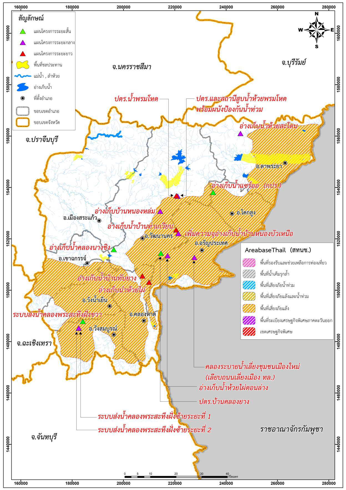

**ภาพที่ 2.11  แผนงานโครงการขนาดกลางและขนาดใหญ่ ระยะ 20 ปี จังหวัดสระแก้ว**

## 2.5  ระบบสารสนเทศรวบรวมองค์ความรู้บริการ Big Data
Big Data เป็นเทคโนโลยีที่มีประโยชน์สามารถนำไปประยุกต์ใช้ได้หลากหลายด้านไม่ว่าจะเป็นการวางแผนระดับประเทศ การวางแผนธุรกิจในองค์กร การวางแผนด้านการศึกษา การวางแผนด้านการแพทย์ และในด้านอื่น ๆ อีกหลากหลายด้าน Big Data เป็นขั้นตอนการจัดเก็บรวบรวมข้อมูลทั้งหมดจากแหล่งต่าง ๆ ไม่ว่าจะเป็นข้อมูลที่มีคุณภาพรวมถึงข้อมูลที่คาดว่าอาจจะเป็นประโยชน์ ไม่ว่าจะเป็นข้อมูลที่เป็นตัวอักษร ไฟล์เอกสาร ไฟล์รูปภาพ ไฟล์วีดีโอ การประมวลผลข้อมูล หลังจากที่นำข้อมูลมารวบรวมไว้ได้ในที่เดียวแล้ว ข้อมูลต่าง ๆ จะถูกนำไปจัดหมวดหมู่ให้อยู่ในกลุ่มที่มีความเกี่ยวข้องกันหรือความสัมพันธ์ใกล้เคียงกัน ให้ผลลัพธ์คล้ายคลึงกันมากที่สุด แล้วจึงนำมาเปลี่ยนเป็นรูปแบบข้อมูลเพื่อนำเอาข้อมูลที่มีอยู่เหล่านี้เข้าระบบข้อมูลที่ผ่านการประมวลผลแล้ว และวิเคราะห์ข้อมูลและนำเสนอข้อมูล หลังจากที่ข้อมูลทั้งหมดได้ถูกจัดกลุ่มและแยกประเภทเรียบร้อยแล้วนั้น ต่อจากนั้นจะนำมาวิเคราะห์หา Pattern ความเกี่ยวข้องกันทั้งหมด ที่อาจมองไม่เห็นได้เลยด้วยตา ไม่ว่าจะเป็นการหา แนวโน้มและกระแสที่อาจเกิดขึ้นได้ในอนาคต และข้อมูลด้านอื่นที่เป็นประโยชน์ โดยจัดมานำเสนอในรูปแบบต่าง ๆ ไม่ว่าจะเป็นรูปภาพหรือกราฟ เป็นต้น

### 2.5.1  กระบวนการจัดเก็บข้อมูล Big Data
ในกระบวนการจัดเก็บข้อมูลขนาดใหญ่ซึ่งมีข้อมูลมาจากหลายๆแหล่งและข้อมูลมีความหลากหลายทั้งแบบที่เป็นโครงสร้างและไม่เป็นโครงสร้างดังนั้นวิธีการจัดการข้อมูลจึงต้องมีการแบ่งการจัดเก็บเป็นโซนต่างๆ ดังรูป เช่น Landing Zone, Staging Zone, Warehouse Zone, Data Mart Zone โดยที่แต่ละโซนข้อมูลจากมีความเป็นระเบียบมากขึ้นเรื่อย ๆ และพร้อมใช้งานมากขึ้น ซึ่งกระบวนการที่อยู่ตรงกลางระหว่างโซนนั้นเป็นเรื่องของการทำความสะอาดข้อมูล การจัดระเบียบข้อมูล เพื่อตอบวัตถุประสงค์ในด้านความถูกต้อง การใช้งานง่าย และความเร็วในการเข้าถึงข้อมูลอย่างมีประสิทธิภาพ

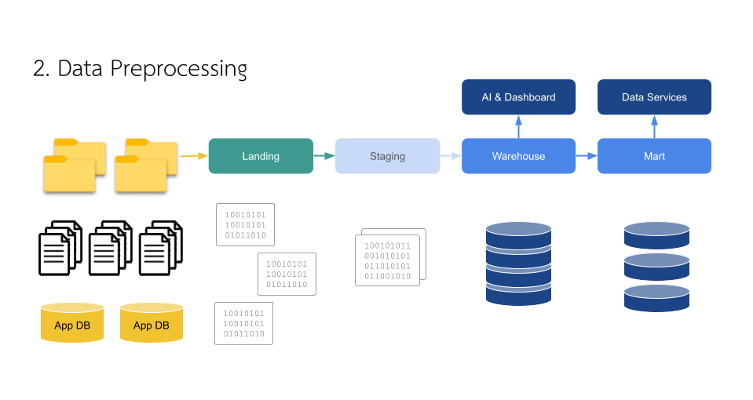

**ภาพที่ 2.12 แผนภาพกระบวนการจัดเก็บข้อมูล Big Data**
ข้อมูลขนาดใหญ่ หรือ Big Data เป็นข้อมูลขนาดใหญ่ที่มีปริมาณมหาศาล มีความหลากหลายของข้อมูลสูง เกิดขึ้นอย่างรวดเร็ว และมีคุณค่าต่อการนําไปใช้ประโยชน์ โดยข้อมูลขนาดใหญ่ (Big Data) นั้นจะถูกนํามาผ่านกระบวนการทางวิทยาศาสตร์ข้อมูล และสามารถใช้ประโยชน์ในการดำเนินการด้านการตลาดดิจิทัลขององค์กรได้ โดยความสำคัญของข้อมูลขนาดใหญ่ (Big Data) ในการพัฒนาประสิทธิภาพการตลาดดิจิทัลนั้น เมื่อข้อมูลขนาดใหญ่ (Big Data) รวมตัวกันมีขนาดที่ใหญ่ขึ้น ทําให้เกิดความสามารถในการนําไปใช้ประโยชน์ได้อย่างแม่นยํามากขึ้น ช่วยให้เกิดโอกาสใหม่ๆ ทางการตลาด ช่วยให้สามารถสื่อสารกับ กลุ่มเป้าหมายได้อย่างรวดเร็ว และจะช่วยให้องค์กรสามารถเข้าถึงกลุ่มเป้าหมายได้อย่างรวดเร็ว และเรียลไทม์ สามารถนำมาใช้เพื่อสร้างคอนเทนต์ที่ส่งมอบคุณค่าให้กับกลุ่มเป้าหมาย สร้างรูปแบบการส่งเสริมการตลาดที่เจาะจงสอดคล้องกับความต้องการ และดึงดูดลูกค้าเป้าหมายได้ โดยที่กระบวนการทำงานของข้อมูลขนาดใหญ่ (Big Data) สำหรับการพัฒนาประสิทธิภาพการตลาดดิจิทัล ประกอบด้วย 4 ส่วน คือ (1) การสร้างข้อมูล คือ ข้อมูลที่ถูกสร้างให้เกิดขึ้นจากสื่อดิจิทัลโดยโดยกลุ่มใดก็ได้ ทั้งเกิดจากด้านองค์กรที่สร้างขึ้น หรือกิจกรรมในชีวิตประจำวันวันของผู้บริโภค (2) การจัดหาข้อมูล คือ การเสาะหาและการจัดเก็บข้อมูลจากแหล่งข้อมูลมาจัดการเพื่อให้เกิดความเหมาะสมในการจัดเก็บ จำเป็นต้องรวบรวมข้อมูลที่ครบถ้วน ถูกต้อง แม่นยํา ตรงต่อความต้องการ และช่วยให้นําข้อมูลกลับมาใช้ใหม่ได้อย่างสะดวกรวดเร็ว (3) การจัดเก็บข้อมูล คือ บันทึกข้อมูลไว้ในเครื่องมือที่เหมาะสม ซึ่งการจัดการข้อมูลที่มีประสิทธิภาพช่วยให้องค์กรสามารถค้นหาข้อมูลได้อย่างง่ายดาย และ (4) การวิเคราะห์ข้อมูล คือการนําข้อมูลที่จัดเก็บมาผ่านกระบวนการต่างๆ เพื่อนําเสนอรายงานที่เป็นประโยชน์ เพื่อให้เกิดผลลัพธ์เป็นการดำเนินการด้านการตลาดดิจิทัลได้อย่างเหมาะสม ตรงกลุ่มเป้าหมาย รวดเร็ว และทันสมัย (ปรมิน โพธิพัฒไพบูลย์ ,2565

### 2.5.2  กระบวนการสกัดและประมวลผลข้อมูลจากข่าว
ข้อมูลข่าวสารต่าง ๆ ไม่จำเป็นต้องเกิดจากการที่ผู้พัฒนาระบบเป็นผู้จัดทำข้อมูลแต่สามารถใช้ความสามารถของซอฟต์แวร์เพื่อเข้าถึงข้อมูลได้อัตโนมัติโดยที่หลักการทำงานจะคล้ายคลึงกับ search engine ชื่อดัง ยกตัวอย่างเช่น Google ลักษณะสำคัญของการทำงานก็คือจะมีการใช้ซอฟต์แวร์ที่เรียกว่า Spider เข้าไปเก็บข้อมูลตามหน้าเว็บต่างๆ (crawling) จากนั้นก็จะมาทำการวิเคราะห์สรุปดัชนี (indexing) และจากนั้นก็จะมีการจัดลำดับความสำคัญ (Ranking) กระบวนการนี้เป็นตัวอย่างที่จะทำให้เราสามารถได้ข้อมูลมาทำการวิเคราะห์ต่อในขั้นตอนถัดไปส่วนภาษาที่ใช้ในการจัดการปัญหาลักษณะนี้ก็จะเป็น python เราจะเห็นว่า Google ใช้หลักการทำงานในลักษณะนี้ในการจัดเก็บเนื้อหาสาระข้อมูลบนเว็บไซต์ต่างๆที่ไม่ใช่ของตนเองแล้วจากนั้นนำมาเรียบเรียงใหม่ให้เป็นบริการของตนและจัดเก็บค่าใช้บริการในรูปแบบของโฆษณา โดยที่กระบวนการจัดเก็บข้อมูลนั้นเป็นไปโดยอัตโนมัติและทำงานตลอด 24 ชั่วโมง

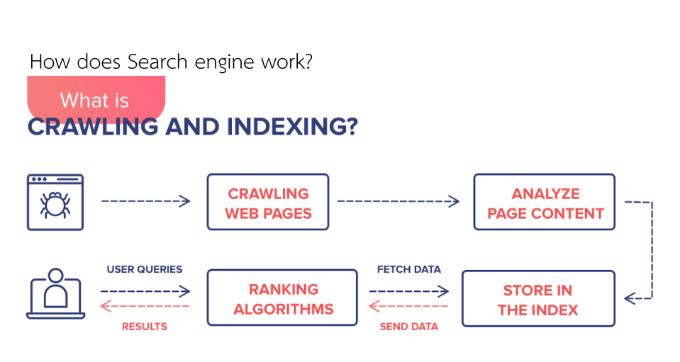

**ภาพที่ 2.13  ขั้นตอนการประมวลผลข้อมูลจากข่าว**

### 2.5.3  การจัดทำ Dashboard ด้วย Data Visualization
Data Visualization คือ การนำข้อมูลหรือ Data ที่ได้มาจากแหล่งข้อมูลต่างๆ มาวิเคราะห์ประมวลผลแล้วนำเสนอออกมาในรูปแบบที่มองเห็นและทำความเข้าใจได้ด้วยตา เช่น แผนภูมิ รูปภาพ แผนที่ กราฟแสดงเทรนด์ ตาราง วิดีโอ อินโฟกราฟิก (Infographic) แดชบอร์ด (dashboard) ฯลฯ จุดประสงค์สำคัญของการทำ Data Visualization คือ การนำเสนอข้อมูลให้เข้าใจง่าย ผู้อ่านข้อมูลสามารถเข้าใจได้ทันทีว่าตัวชิ้นงาน (media) ต้องการสื่อสารอะไร ชี้จุดสำคัญของเนื้อหา และชี้ Insight ข้อเปรียบเทียบให้เห็นอย่างชัดเจน ช่วยให้สังเกตเห็นจุดที่น่าสนใจของข้อมูลได้ง่ายขึ้น ฯลฯ

Data Visualization คือ การสรุปข้อมูลและแสดงออกมาเป็นภาพ มาจากการทำ Information Visualization และ Visual Analytics โดยแสดงผลลัพธ์ถูกจัดทำออกมาในรูปของแผนภูมิบ้าง กราฟรูปแบบต่าง ๆ บ้าง  แม้กระทั่งแผนที่ โดยมีจุดประสงค์เพื่อให้สามารถเข้าใจง่าย อธิบายได้ชัดเจน และเห็นภาพรวมของผลลัพธ์ที่ได้ ยกตัวอย่างง่าย ๆ เช่น แผนภูมิแท่งตามรูปข้างบนนี้ แสดงการใช้งานโซเชียลมีเดียแต่ละช่องทางของประชากรแต่ละประเทศ เราจะเข้าใจได้ทันทีว่า ประเทศใดที่มีการใช้งานโซเชียลมีเดียช่องทางใดมากกว่ากันโดยที่ไม่ต้องการตัวเลข รวมถึงเข้าใจได้ทันทีว่าโซเชียลมีเดียช่องทางใดได้รับความนิยมมาก-น้อย ต่างกันอย่างไร

สำหรับการทำ Data Visualization ในปัจจุบัน ก็มีหลากหลายรูปแบบที่ผสมผสานกับการเล่าข้อมูลออกมาเป็นเรื่องราวหรือ “Storytelling” เพื่อเล่าข้อมูลออกมาให้เข้าใจง่ายและน่าสนใจมากมาย ยกตัวอย่างเช่น ขนาดคลัสเตอร์จำนวนผู้ติดเชื้อ Covid-19 ในแต่ละจังหวัดของประเทศเกาหลีใต้ ที่เล่าออกมาให้เป็น “จำนวนคน” จริงๆ ที่ช่วยให้เรารู้สึกได้ทันทีว่า คลัสเตอร์ที่ใดระบาดหนักกว่ากัน ภาพและสีสันสามารถเล่าเรื่องได้ง่ายและให้ความรู้สึกได้ดีกว่าข้อความหรือตัวเลข เราทำ Data Visualization ก็เพื่อ “ย่อย” ข้อมูลที่ซับซ้อนและมีอยู่มากมายออกมา “เล่า” ให้เป็นเรื่องราวที่เราเข้าใจได้ง่ายๆ แถมยังช่วยให้ข้อมูลดิบๆ ที่อาจดูน่าเบื่อมีความน่าสนใจขึ้นมา

ประโยชน์ของการทำ Data Visualization ก็สามารถสรุปได้หลัก ๆ ดังนี้

#### 2.5.3.1 ช่วยให้เข้าใจข้อมูลได้ง่ายขึ้น เพราะเป็นข้อมูลที่ย่อยและจัดรูปแบบให้เข้าใจได้ทันทีด้วยภาพ

#### 2.5.3.2 ช่วยให้มองเห็น Insight ได้ชัดเจน เห็นข้อเปรียบเทียบ เห็นแนวโน้มหรือเทรนด์ของข้อมูล ช่วยให้อนุมานความสัมพันธ์ของข้อมูลได้ง่ายขึ้น

#### 2.5.3.3 ช่วยประหยัดเวลาในการตีความข้อมูลและตัดสินใจ เข้าใจข้อมูลได้โดยที่ไม่ต้องตีความ ลดภาระการค้นหาและเปรียบเทียบข้อมูล

#### 2.5.3.4 ช่วยให้สามารถมองเห็นจุดที่น่าสนใจของชุดข้อมูลได้ แม้ยังไม่ได้ตั้งข้อสันนิษฐานเกี่ยวกับข้อมูล ก็สามารถมองเห็นข้อมูลที่มีความโดดเด่นบางอย่างขึ้นมาได้จากการทำความเข้าใจภาพ

#### 2.5.3.5 ช่วยให้ข้อมูลมีความน่าสนใจมากขึ้น จากการนำเสนอที่มีเรื่องราวหรือใช้สีสันที่ดึงดูด สวยงาม

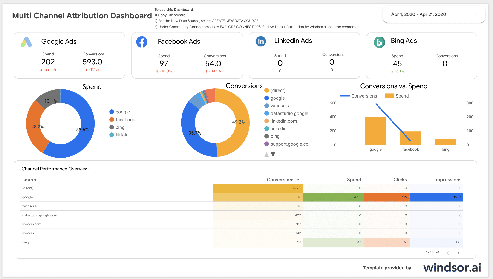

**ภาพที่ 2.14 การจัดทำ Dashboard ด้วย Data Visualization**

## 2.6  แอปพลิเคชันไลน์ (Line Application)
แอปพลิเคชัน Line ได้เปิดใช้งานมากว่าสิบปีแล้ว โดยมีจุดเริ่มต้นจากปัญหาที่เกิดขึ้นในเดือนมีนาคม ปี 2554 ซึ่งเกิดแผ่นดินไหวและสึนามิในเขต ภูมิภาคโทโฮกุ ประเทศญี่ปุ่น ทำให้ระบบโทรคมนาคมของประเทศญี่ปุ่นล่มเกือบทั้งประเทศและไม่สามารถ ใช้งานได้แม้ว่าสัญญาณอินเทอร์เน็ตจะยังคงใช้งานได้แต่ผู้ประสบภัยก็ไม่สามารถติดต่อขอช่วยเหลือ หรือติดต่อกับญาติได้เลย ต่อมาในเดือนมิถุนายน ปี 2554 บริษัท NHN Japan จึงได้ทำการเปิดตัว แอปพลิเคชันที่สามารถส่งข้อความ รูปภาพ วิดีโอ ไฟล์เสียง และมีเกมให้เล่น ติดตั้งได้ทั้งบนมือถือ แท็บเล็ต และเครื่องคอมพิวเตอร์ PC โดยมีชื่อว่า “Line” (เปรียบเสมือนผู้ประสบภัยมีการต่อแถวรอ ใช้โทรศัพท์เป็นแนวยาวคล้ายสายโทรศัพท์) ในเวลานั้นฟีเจอร์ที่ทำให้แอปพลิเคชัน Line มีความโดด เด่นไม่ซ้ำใครก็คือ ความสามารถในการส่งข้อความเป็นสติ๊กเกอร์ หรือ Line Sticker นั่นเอง โดยหลังจากนั้น
แอปพลิเคชัน Line ก็ได้มีการพัฒนามาอย่างต่อเนื่อง

ปี 2555 เปิดตัวฟีเจอร์ Home และ Timeline คล้ายกับการอัพเดตสถานะในแอปพลิเคชันFacebook หรือ Twitter และมีการพัฒนา Line Official Account หรือบัญชีทางการสำหรับดาราศิลปิน นักร้อง ซึ่งถือเป็นจุดเริ่มของแพลตฟอร์มทางการตลาดที่ทรงพลังสำหรับภาคธุรกิจในเวลาต่อมา และเนื่องจากแอปพลิเคชันไลน์ได้รับความนิยมจากประชากรหลากหลายประเทศ จึงทำให้มีการพัฒนาเวอร์ชันภาษาต่าง ๆ ได้แก่ ภาษาอินโดนีเซีย มลายู ไทย ตุรกี และจีน เพื่ออำนวยความสะดวกสำหรับผู้ใช้งานทั่วโลก

ปี 2556 เฉลิมฉลองเนื่องในโอกาสมีผู้ใช้งานแอปพลิเคชัน Line ครบ 1 ล้านคน มีการแจกสติ๊กเกอร์ 7 วัน 7 แบบ ให้สามารถนำไปใช้ได้ฟรี และมีการ์ตูนแอนิเมชันชื่อ Line Offline:Salaryman ซึ่งเป็นการ์ตูนเกี่ยวกับพนักงานเงินเดือนที่เป็นคาแรกเตอร์ใน Line Corporation

ปี 2557 เปิดตัว Line Webtoon แอปพลิเคชันอ่านการ์ตูนฟรี และ Line TV ที่เป็นทั้งเว็บไซต์และแอปพลิเคชันให้บริการวิดีโอสตรีมมิ่ง ซึ่งเป็นไอเดียของไลน์ประเทศไทย ที่เห็นพฤติกรรมในการชมคอนเทนต์วีดีโอของคนไทย ทำให้ Line TV มีรายได้จากการขายโฆษณาจากผลิตภัณฑ์
ต่าง ๆ มากมาย

ปี 2558 เปิดตัว Line Taxi ในประเทศญี่ปุ่น เพื่อให้ผู้ใช้งานสามารถกดเรียกรถแท็กซี่ได้

จากไลน์ และสามารถจ่ายเงินด้วย Line Pay

ปี 2559 จากแนวคิด Line Taxi และ Line Pay ที่ได้รับความสนใจในประเทศญี่ปุ่น ทำให้ ประเทศไทยพัฒนา Rabbit Line Pay สำหรับการชำระเงินผ่านสมาร์ตโฟน และ Line Man ซึ่งเป็น บริการเรียกแท็กซี่ บริการรับส่งอาหารและพัสดุ บริการเมสเซนเจอร์ หรือการซื้อของจากร้านสะดวกซื้อ

ปี 2560 เปิดตัว Line Today ซึ่งเป็นแหล่งรวมข้อมูลข่าวสารต่าง ๆ ที่มีการอัพเดตอยู่ ตลอดเวลา ทั้งทางด้านเศษฐกิจ การเมือง บันเทิง กีฬา อาชญากรรม และพยากรณ์อากาศ โดยผู้ใช้ สามารถกดชื่นชอบ (like) แสดงความคิดเห็น (comment) และแชร์ (share) ไปยังโซเชียลมีเดียอื่น ๆ ได้

ปี 2561 เปิดตัว Line Scaleup เพื่อสนับสนุนสตาร์ทอัพในประเทศไทยให้สามารถขยาย บริการและสามารถเข้าถึงผู้ใช้งานไลน์ได้หลายล้านคน ด้วยการพัฒนาเทคโนโลยี Line Messaging API สำหรับให้บริการบัญชี Line Official Account สามารถเชื่อมต่อและใช้งานได้ฟรี อีกทั้งยังมีการ พัฒนา Line Jobs ซึ่งแพลตฟอร์มจัดหางานรูปแบบใหม่ในประเทศไทย

ปี 2562 เปิดตัว Line Melody เพื่อให้ผู้ใช้งานสามารถใช้เพลงที่ชื่นชอบเป็นเสียงเรียกเข้า และเสียงรอสายในแอปพลิเคชัน Line ได้ และมีการเปิดตัว Line Shopping สำหรับธุรกิจการซื้อขาย สินค้าออนไลน์ มีการรวบรวมสินค้ากว่า 15 มาร์เก็ตเพลซที่มีชื่อเสียงมาไว้ในที่เดียว โดยมีความ ร่วมมือกับ Priceza ซึ่งเป็นผู้พัฒนาฟีเจอร์เปรียบเทียบราคา และแจ้งเตือนเมื่อมีโปรโมชัน พร้อมทั้ง มี Line Point Back ที่เป็นคะแนนสะสมสำหรับใช้เป็นส่วนลดในการซื้อของครั้งต่อ ๆ ไป

ปี 2563 เปิดตัว Line BK ซึ่งเป็นการพัฒนาร่วมกันระหว่าง Line กับ ธนาคารกสิกรไทย ถือเป็น Social Banking Platform ครั้งแรกของไทย เพื่อให้ผู้ใช้งานสามารถแชต โอน ยืม จ่าย ผ่านทาง Line ได้ในแอปพลิเคชันเดียว

Line เป็น App ที่คนไทยใช้เวลาด้วยเยอะที่สุดต่อวัน โดยเฉลี่ยประมาณ 63 นาที เทียบกับเวลาที่คนไทยใช้เวลาบน smartphone ทั้งหมดที่ 216 นาทีต่อวัน แอปพลิเคชัน Line มีการพัฒนาอย่างต่อเนื่อง และมีการขยายตัวสูงมากขึ้น เนื่องจากเป็นมากกว่าแอปพลิเคชันที่ใช้ในการสนทนา โดยในช่วงปี พ.ศ. 2563 - พ.ศ. 2564  มีผู้ใช้งาน Line Open Chat เพิ่มขึ้น 38% มีกลุ่ม สนทนาเพิ่มขึ้น 92% มีจำนวนบัญชี Line Official Account ใหม่ที่เป็นกลุ่มธุรกิจ SMEs มากกว่า 50% และมีการขายสินค้าบน Line Shopping มากกว่า 200,000 ร้านค้า และในปี 2565 Line ประเทศไทย ได้แจ้งสถิติสำคัญเนื่องในโอกาสการให้บริการครบรอบ 10 ปี คือมี จำนวนผู้ใช้งานมากกว่า 50 ล้านราย (มากกว่า 2 ใน 3 ของประชากรในประเทศ) ซึ่งแอปพลิเคชัน Line มีฟีเจอร์ต่าง ๆ มากมายเพื่อช่วยเชื่อมต่อผู้คนในประเทศและอำนวยความสะดวกในการสื่อสาร ช่วงการระบาดของโรค COVID-19

จากข้อมูลจากเว็บไซต์ datareportal.com ซึ่งเป็นเว็บไซต์ที่ออกแบบมาเพื่อช่วยให้ผู้คน และองค์กรทั่วโลกสามารถค้นหาข้อมูล ข้อมูลเชิงลึก และแนวโน้มที่ต้องการเพื่อเป็นประโยชน์ต่อการ ตัดสินใจที่ดีขึ้น มีการแสดงข้อมูลทางสถิติพบว่าในประเทศไทยมีการใช้งานแพลตฟอร์มโซเชียลมีเดีย มากที่สุด 5 อันดับแรก ได้แก่ Facebook รองลงมาคือ Line, Facebook Messenger, Tiktok, และ Instagram ตามลำดับ ดังแสดงในภาพ 2.15

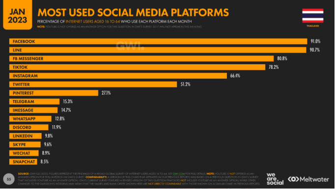

**ภาพที่ 2.15  สถิติการใช้งานแพลตฟอร์มโซเชียลมีเดียในประเทศไทย**

### 2.6.1 การจัดทำ Line Messaging Framework
ในการแจ้งเตือนในปัจจุบันหลายบริการนิยมใช้ระบบที่เรียกว่า Notification บนโทรศัพท์มือถือและคนไทยมากกว่า 40 ล้านคนใช้ Application Line ซึ่งเป็น Application ที่มีระบบ Notification ที่คนไทยคุ้นเคยดังนั้นการพัฒนาแอป possession บนบริการของ LINE ที่มีอยู่เดิมแล้วจะเป็นที่คุ้นเคยอย่างดีของคนไทยดังจะเห็นได้จากระบบจองวัคซีน modena ผ่านโรงพยาบาลในเครือธนบุรีเฮลท์แคร์กรุ๊ป ซึ่งทำการจองวัคซีนผ่าน Line แทนที่จะเป็นบริการจองผ่านเว็บซึ่งก็ได้รับผลตอบรับที่ดี อีกทั้งการทำ service เพิ่มเติมบน Application LINE ก็จะไม่เป็นภาระของผู้ใช้งานในการติดตั้งโปรแกรมเพิ่มเติมบนอุปกรณ์เคลื่อนที่ของตนถ้ามี Application LINE เป็นทุนเดิมอยู่แล้ว ในทางเทคนิครายได้มอบความสามารถในการส่งข้อความให้กับผู้พัฒนา Third Party ในการส่งข้อความถึงผู้ใช้งานเมื่อผู้พัฒนาเปิดใช้บริการ LINE official Account หลายบริษัทในประเทศไทยต่างก็เข้ามาใช้บริการในส่วนนี้เพื่อแจ้งข่าวโปรโมชั่นประชาสัมพันธ์ดังจะเห็นได้จากแอปบริษัทที่เกี่ยวกับทางด้านการเงินบริษัทที่เกี่ยวข้องกับสินค้าด้านอาหารด้านแฟชั่นด้านสุขภาพต่างก็มี LINE official account ในการให้บริการด้านข้อมูลข่าวสารในลักษณะส่งข้อความมาหาผู้บริโภคโดยตรงผ่าน ซึ่งทุกข้อความที่ส่งมาก็จะมี Notification ขึ้นใน Application Line โดยที่หลักการทำงานของตัวส่งข้อมูลจะใช้ไลบรารีที่ชื่อว่า LINE messaging API โดย API ตัวนี้สามารถทำงานร่วมกับภาษา Server ได้หลากหลายชนิดเพราะใช้ restful API เป็นตัวกลางในการรับส่งข้อมูล

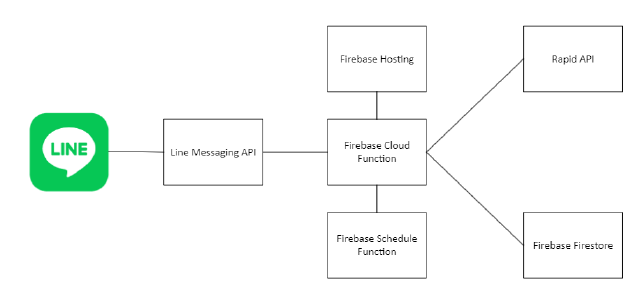

**ภาพที่ 2.16  การจัดทำ Line Messaging Framework**

### 2.6.2  Line Notify API  เป็นบริการผ่าน API ของ Line สำหรับใช้ส่งข้อความหรือแจ้งเตือน อัตโนมัติ ไม่ว่าจะส่งผ่านกลุ่ม (Group) หรือบัญชีส่วนตัว Line Notify เป็นบริการที่ Line ได้เตรียมไว้ให้ในรูปแบบของ API สามารถนําไปใช้ต่อยอด พัฒนาโปรเจค ที่มีความต้องการส่งข้อความในการแจ้งเตือนเข้าไปยัง โดยประกอบด้วย 2 ส่วน ได้แก่ ส่วนการ ตรวจสอบ OAuth2 และส่วนการแจ้งเตือน โดยมีลักษณะการทำงานดังแสดงตามภาพ 2.16

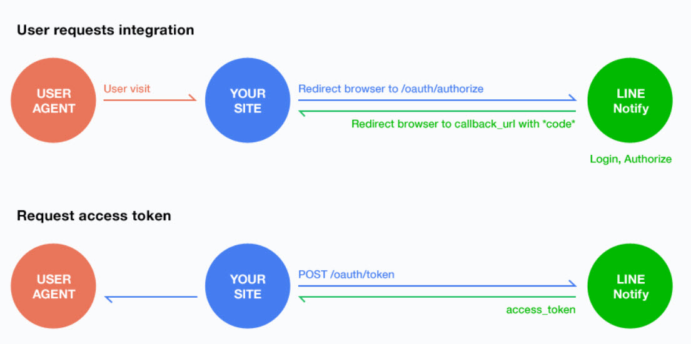

**ภาพที่ 2.17  การทำงานของ Line Notify API**
ที่มา : LINE Corporation, 2023

### 2.6.3  คุณสมบัติของแอปพลิเคชันไลน์
คุณสมบัติของแอปพลิเคชัน LINE มีหลากหลายและมีความแตกต่างจาก
แอปพลิเคชัน สนทนาอื่นซึ่งสามารถสรุปคุณสมบัติต่างได้ดังนี้

#### 2.6.3.1 LINE เป็นสื่อกลางในการสื่อสารได้ 2 ทาง (Two-way communication) โดยเป็นสื่อกลางในการสนทนาระหว่างผุ้รับสารและผู้ส่งสารโดยสามารถส่งได้ทั้งข้อความ รูปภาพ เสียงเอกสาร วีดีโอ เพื่อทำให้ผู้รับสารได้รับข้อมมูลที่ตรงต่อวัตถุประสงค์ของผู้ส่งสาร

#### 2.6.3.2 มีสติกเกอร์ที่เป็นลักษณะเฉพาะที่ทำให้ไลน์มีความแตกต่างจากแอปพลิเคชัน การสนทนาอื่นและลักษณะของสติ๊กเกอร์มีการออกแบบให้มีความสวยงาม มีสีสัน มีชีวิตชีวา นอกจากนี้ยังลักษณะพิเศษของข้อความที่มีการสื่อถึงความกระชับได้ใจความ และข้อความนั้นมีการสื่อถึงอารมณ์และความรู้สึกของผู้ที่ส่งข้อความได้ชัดเจน

#### 2.6.3.3 มีแบรนด์สินค้าและบริการหลายแบรนด์ได้มีการนำลักษณะพิเศษของ LINE ไปใช้ประโยชน์ในการประยุกต์เป็นกลยุทธ์ทางการตลาดทั้งในรูปแบบ LINE Official Account และSponsor Sticker จัดทำสติกเกอร์ให้ดาวน์โหลด โดยที่ไม่ต้องเสียค่าใช้จ่ายโดยที่มีเงื่อนไขว่าหากลูกค้าต้องการสติ๊กเกอร์ต้องมีการเป็นเพื่อนระหว่างแบรนด์สินค้าและบริการกับผู้ใช้งาน LINE ซึ่งจะทำให้เจ้าของแบรนด์สินค้าและบริการใช้ LINE เป็นสื่อกลางในการส่งข้อมูลข่าวสาร โฆษณาโปรโมชั่น เพื่อเป็นการดึงดูดให้ติดตามข่าวสารต่าง ๆ ของแบรนด์สินค้าและบริการ

#### 2.6.3.4 สามารถติดต่อสื่อสารกันได้ตลอดเวลาหากมีสัญญาณอินเตอร์เน็ตและยังมีสถานะเป็นเพื่อนกัน ทำให้สื่อสารกันได้ตลอดเวลา และไม่จำกัดระยะทางในการส่งข้อความถึงกัน

#### 2.6.3.5 สามารถส่งสารได้หลากหลายรูปแบบ (Multi Media) ผู้ส่งสารและผิรับสารสามารถโต้ตอบกันได้ด้วยรูปแบบที่หลากหลาย เช่น ข้อความ รูปภาพ ลิงค์เว็บไชต์ คลิปวิดีโอ สติกเกอร์สัญลักษณ์ของแบรนด์สินค้าและบริการ

### 2.6.4 LINE Official Account หรือ LINE OA
LINE Official Account คือ บัญชี LINE เพื่อทำธุรกิจที่มีรูปแบบการใช้งานติดต่อสื่อสารกันได้เหมือนกับบัญชี LINE ส่วนบุคคล แต่จะมีฟังก์ชันและการใช้งานอื่น ๆ เพิ่มเติมเข้ามาเพื่อรองรับการใช้งานในเชิงธุรกิจโดยเฉพาะ และมีคุณสมบัติเด่น ๆ เช่น LINE Official Account สามารถเพิ่มผู้ติดตามได้ไม่จำกัด ระบบข้อความตอบกลับอัตโนมัติ (Auto Response) ระบบข้อความ ต้อนรับ (Greeting Message) เป็นต้น และ โสภา พิมพ์สิริพานิชย์ (2562) สรุปไว้ว่า LINE Official Account คือบัญชี LINE รูปแบบใหม่โดยบริษัท LINE ที่ใช้แชทคุยกันอยู่ ในปัจจุบันเกือบทุกคน โดยเปลี่ยนแปลงจาก LINE@ ที่ถือว่าเป็นอีกหนึ่งอาวุธของพ่อค้าแม่ค้า ออนไลน์ใช้ในการปิดการขายกับลูกค้าผ่านการพูดคุยตอบโต้ โดยในปัจจุบันมีการปรับปรุงครั้งใหญ่มาเป็น LINE Official Account หรือ LINE OA เพื่อรองรับองค์กรให้มาใช้บริการภายใต้แพลตฟอร์มเดียวกัน ที่ผ่านมา LINE@ ได้รับ ความนิยมอย่างมากสำหรับกลุ่มผู้ประกอบการในไทย โดยมีบัญชีผู้ใช้งานมากกว่า 2.7 ล้านราย จากทั้งหมดประมาณ 3 ล้านราย แต่ปัญหาของ LINE@ คือความถี่ในการส่ง ข้อความจนเกิดเป็นการรบกวนลูกค้ามากเกินไป และการบริการที่ไม่ละเอียดครอบคลุม ด้วยเหตุนี้ บริษัท LINE จึงพัฒนาแอปพลิเคชันให้เหมาะสมกับการใช้งานในเชิงธุรกิจมากขึ้นในชื่อ LINE Official Account

#### 2.6.4.1 ประเภท LINE Official Account
1. บัญชีทั่วไป (Unverified Account) มีสัญลักษณ์เป็นโล่สีเทา เป็นบัญชีบุคคล ทั่วไปหรือร้านค้าออนไลน์อื่นๆ ที่สามารถใช้บริการได้เหมือนบัญชีพรีเมี่ยมและบัญชีรับรอง แต่จะไม่สามารถค้นหาเจอได้จากการสุ่มพิมพ์คำสำคัญ (keyword) และสามารถซื้อบัญชีพรีเมี่ยมหรือ ซื้อแพ็คเกจเพิ่มเติมได้ภายหลัง

2. บัญชีรับรอง (Verified Account) มีสัญลักษณ์เป็นโล่สีน้ำเงิน คือบัญชีที่ได้รับ การรับรองจาก LINE ตามเงื่อนไขต่าง ๆ ที่กำหนด เป็นธุรกิจที่มีการจดทะเบียนหรือมีหน้าร้าน มีสถานที่ประกอบการชัดเจน ประกอบธุรกิจโปร่งใสอยู่ในศีลธรรม สามารถค้นหาเจอได้จากการสุ่ม พิมพ์คำสำคัญ (keyword) ในแอปพลิเคชัน LINE

3. บัญชีพรีเมี่ยม (Premium Account) มีสัญลักษณ์เป็นโล่เขียว คือบัญชีรูปแบบ พิเศษซึ่งเงื่อนไขต้องติดต่อกับบริษัท LINE โดยตรง สามารถค้นหาเจอได้จากการสุ่มพิมพ์คำสำคัญ (keyword) ในแอพพลิเคชั่น LINE เช่น หากต้องการค้นหาโรงงานผลิตพลาสติก ก็จะแสดงผลขึ้นมาแม้ไม่ได้ติดตามผู้ใช้งานก็ตาม จะทำให้ลูกค้าสามารถเจอบัญชีของร้านค้าได้ง่ายขึ้น

#### 2.6.4.2 เครื่องมือ Rich Content
สามารถใช้งานได้ทุกบัญชีต่างจาก Line@ ที่มีการใช้ งานได้เฉพาะบัญชีระดับสูง โดยสามารถแบ่งเครื่องมือ Rich Content ดังนี้

1. Rich Message คือรูปภาพสี่เหลี่ยมจัตุรัส ที่สามารถฝังลิงก์ที่รูปภาพได้และ สามารถฝังได้สูงสุด 6 ลิงก์ใน 1 รูปภาพหากอยากกระตุ้นให้คนแตะลิงก์ เช่น ลิงก์ยูทูบ 
ลิงก์เฟซบุ๊ก ต้องออกแบบภาพให้เสมือนมีปุ่ม และข้อดีคือจะกระตุ้นให้คนสนใจเพราะขนาดรูปจะใหญ่เต็มจอ และประหยัดข้อความที่เราจะส่งถึงลูกค้า โดยข้อความทั้งหมดจะถูกยัดลงในลิงก์

2. Rich Video เป็นวิดีโอที่มีขนาดใหญ่ เต็มจอมือถือและจะเล่นอัตโนมัติ สามารถใส่ลิงก์เพิ่มเข้าไปได้ โดยเพิ่มปุ่มแอคชัน และระบุว่าจะให้แสดงชื่อว่าอะไร เช่น ดูเพิ่มเติม สมัคร เป็นต้น โดยไฟล์ขนาดไม่เกิน 200 MB

3. Rich Menu เป็นเมนูที่ปรากฏบริเวณแป้นพิมพ์ขณะลูกค้าใช้บริการ สามารถ ฝังลิงก์ไว้ในรูปภาพนั้น ๆ ได้ โดยสามารถเลือกรูปแบบได้ว่าเมื่อลูกค้ากดจะให้ตอบกลับเป็น รูปแบบใด และสามารถกำหนดเวลาได้ว่าจะให้แสดงผลตั้งแต่วันที่เท่าใดถึงเท่าใด

สรุป LINE Official Account เหมาะสมที่จะใช้เป็นช่องทางในการสื่อสารสำหรับกลุ่มชุมชนเนื่องด้วยโซเชียลมีเดียเป็นช่องทางที่มีผู้ใช้งานเป็นจำนวนมาก จึงเป็นช่องทางที่จะสามารถ สื่อสารต่าง ๆ ได้เป็นอย่างดีเพื่อรับรู้ข่าวสารในการแจ้งเตือนต่าง ๆ  สามารถอำนวยความสะดวกสำหรับใส่รายการที่เป็นคลิปวิดีโอ ภาพนิ่งข่าว ผ่านลิงก์ได้ รวมไปถึงการตั้งระบบตอบกลับข้อความอัตโนมัติ จะช่วยอำนวยความสะดวก ให้กับคนในชุมชนเนื่องด้วยสามารถเข้าถึงได้ง่าย และการใช้งานสะดวก  อีกทั้งการวิเคราะห์ข้อมูล LINE Official Account จะมีระบบการแสดงผลวิเคราะห์ข้อมูลที่ละเอียดมากขึ้น ไม่ว่าจะเป็นข้อมูล จำนวนผู้ติดตาม จำนวนข้อความที่ส่งพร้อมกัน จำนวนข้อความแชท จำนวนการมีส่วนร่วมในแต่ละโพสต์ โดยแสดงผลเป็นกราฟแบ่ง ตามสีต่าง ๆ เพื่อให้ดูได้ง่าย นอกจากนั้นยังสามารถส่งข้อความแบบระบุกลุ่มเป้าหมายได้แม่นยำมากขึ้น ด้วยการเลือกเพศ อายุ ตำแหน่งที่อยู่ รวมถึงความยาวนานในการเพิ่มเป็นเพื่อนกันมา ดังนั้นในการส่งข้อความแต่ละครั้งจะสามารถทำได้แม่นยำมากขึ้นเพราะใช้ข้อมูลเหล่านี้มาเจาะกลุ่มเป้าหมายได้อย่างตรงจุดอีกด้วย

## 2.7  แนวคิด และทฤษฎีเกี่ยวกับเว็บไซต์
เว็บไซต์ เป็นโปรแกรมประยุกต์ที่สามารถเข้าถึงด้วยอินเทอร์เน็ต เบราว์เซอร์ซึ่งทำให้เหมาะสำหรับงานที่ต้องการข้อมูลแบบตามเวลาจริง ข้อดีของเว็บไซต์คือข้อมูลต่าง ๆ ที่อยู่ในระบบที่มีการไหลเวียนในแบบออนไลน์ จึงสามารถโต้ตอบกลับผู้ใช้บริการแบบตามเวลาจริง ทำให้เกิดการตอบสนองกลับทันทีและสามารถใช้งานได้ง่าย และ นามมจันท์ ยอแสงรัตน์ (2563) สรุปว่า เว็บไซต์ประกอบไปด้วยเนื้อหาต่าง ๆ มีหน้าโฮมเพจ (Homepage) หรือหน้านำเข้าสู่เว็บไซต์เชื่อมโยงหน้ายังหน้าสารบัญอื่น ๆ ให้บริการสื่อสารข้อมูลหลากหลายรูปแบบทั้งข่าวสารเนื้อหา ข้อมูล ภาพกราฟิก และระบบมัลติมีเดียต่าง ๆ  รวมทั้งความสามารถในการโต้ตอบระหว่างผู้ใช้กับผู้ให้บริการสามารถใช้รูปภาพและไอคอน หรือสัญลักษณ์ต่าง ๆ ที่สื่อความหมายเป็นตัวเชื่อมการสื่อสารระหว่างผู้ใช้งานกับเว็บ

### 2.7.1 กระบวนการในการพัฒนาเว็บไซต์สามารถแบ่งได้เป็น 4 ขั้นตอนที่สำคัญ
ขั้นตอนที่ 1 วางแผนพัฒนาเว็บไซต์ กำหนดวัตถุประสงค์ กลุ่มเป้าหมายและปัจจัยต่าง ๆ เริ่มต้นจากการศึกษาลักษณะของหน่วยงานหรือชุมชนที่จะพัฒนา สำรวจความต้องการเพื่อกำหนดเป้าหมายของเว็บที่ชัดเจน ศึกษาลักษณะของผู้ใช้งาน กลุ่มเป้าหมาย เพื่อให้สามารถระบุกลุ่มผู้ใช้และความต้องการของผู้ใช้ เพื่อจะได้ออกแบบให้มีความเหมาะสมไม่ว่าจะเป็นเว็บไซต์ส่วนตัว เว็บไซต์บริษัท หรือเว็บไซต์ที่นำเสนอเรื่องใดเรื่องหนึ่งก็ตามในการออกแบบเว็บให้มีประสิทธิภาพ ควรเริ่มต้นด้วยการวางแผน โดยการวางแผนเว็บไซต์ จะเกี่ยวข้องกับการกำหนดจุดมุ่งหมายของเว็บไซต์ที่สร้าง การกำหนดกลุ่มเป้าหมาย และกำหนดกลยุทธ์ที่จะนำไปสู่ความสำเร็จตามวัตถุประสงค์ที่วางไว้ ซึ่งสามารถอธิบายได้ตามรายละเอียดต่อไปนี้

1. การกำหนดจุดมุ่งหมายและพันธกิจ พันธกิจ (Mission) คือจุดมุ่งหมายพื้นฐานที่แสดงถึงเหตุผลว่า ทำไมองค์กรจึงถือกำเนิดมาเป็นหลักการที่นำมาใช้เพื่อเป็นแนวทางในการกำหนดเป้าหมาย วัตถุประสงค์ และกลยุทธ์ อีกทั้งยังถือเป็นการกำหนดกรอบการทำงานของกลยุทธ์ในภาพรวมทั้งหมด เพื่อรู้ถึงภารกิจที่จะต้องทำโดยถ้อยแถลงพันธกิจ (Mission Statement) ก็คือลายลักษณ์อักษรที่มีความชัดเจน ที่อธิบายวัตถุประสงค์และเหตุผลของเว็บไซต์

ตัวอย่างพันธกิจของสำนักหอสมุดของมหาวิทยาลัยแห่งหนึ่ง

## 1.1 แสวงหา สร้างสม จัดระบบทรัพยากรสารนิเทศทุกประเภท

## 1.2 อนุรักษ์และบำรุงรักษาทรัพยากรสารนิเทศทุกประเภทตามหลักวิชาการ

## 1.3 บริการทรัพยากรสารนิเทศทุกประเภทอย่างมีคุณภาพ และเผยแพร่องค์ความรู้ให้คุ้มค่าต่อการลงทุนและเกิดประโยชน์อย่างสูงสุดต่อประชาคมในมหาวิทยาลัยและสังคม

## 1.4 พัฒนาศูนย์ข้อมูลท้องถิ่น และขยายไปสู่อนุภูมิภาค

## 1.5 ทำนุบำรุงศิลปวัฒนธรรม ศาสนา อนุรักษ์ทรัพยากรธรรมชาติและสิ่งแวดล้อม เพื่อความเป็นเอกลักษณ์ของท้องถิ่นทั้งในเชิงข้อมูลและการมีส่วนร่วมในกิจกรรม

## 1.6 บริการวิชาการแก่สังคม

## 1.7 การบริหารจัดการที่ดีในทุก ๆ ด้าน ด้วยหลักธรรมาภิบาลพึ่งพาตนเองโดยใช้หลักปรัชญาเศรษฐกิจพอเพียง และใช้เทคโนโลยีสารสนเทศในการบริหารจัดการ
2. การกำหนดกลุ่มเป้าหมาย

ภายหลังจากการประกาศพันธกิจของเว็บไซต์ที่จะจัดตั้งขึ้นมาแล้ว ลำดับถัดไปก็คือการกำหนดกลุ่มเป้าหมายของเว็บไซต์ ซึ่งก็คือกลุ่มผู้คนที่จะเข้าเยี่ยมชมเว็บไซต์แห่งนี้ ยกตัวอย่างเช่น กลุ่มเป้าหมายของเว็บไซต์ห้องสมุดก็คือ สมาชิก ซึ่งประกอบด้วยนักศึกษา คณาจารย์ และบุคคลภายนอก ในขณะที่เว็บไซต์ส่วนบุคคล กลุ่มเป้าหมายก็อาจจะเป็นสมาชิกภายในครอบครัว หรือบุคคลใด ๆ ที่มีความสนใจเกี่ยวกับงานอดิเรกในลักษณะเดียวกัน และภายหลังจากการกำหนดกลุ่มเป้าหมายแล้ว ขั้นตอนต่อไปก็คือ การกำหนดกลยุทธ์เพื่อสนับสนุนพันธกิจให้เกิดผลสำเร็จตามที่คาดหวัง

3. การกำหนดวัตถุประสงค์และกลยุทธ์

วัตถุประสงค์ของเว็บไซต์ จะระบุถึงเป้าหมาย ส่วนกลยุทธ์ของเว็บไซต์ก็คือ การนำเหล่าคุณสมบัติ ต่าง ๆ ที่ถูกเพิ่มเติมเข้าไปในเว็บไซต์ เพื่อนำไปสู่การบรรลุถึงเป้าหมายนั่นเอง ตัวอย่างเช่น เว็บไซต์ส่วนตัว อาจมีเพียงเป้าหมาย 2 ข้อหลัก ๆ ด้วยกันคือ การแบ่งปันข้อมูลเกี่ยวกับสมาชิกภายในครอบครัว และการเชื่อมโยงลำดับของวงศ์ตระกูล ซึ่งอาจมีประโยชน์ต่อนักวิจัยประวัติครอบครัวอื่น ๆ โดยเฉพาะตระกูลเก่าแก่ ดังนั้น กลยุทธ์ 3 ข้อ ที่จะสนับสนุนเป้าหมายทั้งสองก็คือ 1) ลิสต์รายชื่อสมาชิกภายในครอบครัวและความสัมพันธ์ที่เกี่ยวข้องในรูปแบบของโครงสร้างต้นไม้ 2) บันทึกข้อความต่าง ๆ ที่มาจากสมุดไดอารี่ของครอบครัว และ 3) การจัดทำลิงก์เพื่อเชื่อมโยงไปยังเว็บไซต์ลำดับตระกูลต่าง ๆ

ในทางตรงกันข้าม หากเป็นเว็บไซต์เพื่อการพาณิชย์ก็จะมีความชับซ้อนยิ่งขึ้น ซึ่งปกติเว็บไซต์ประเภทดังกล่าว ปกติจะมีเป้าหมายและกลยุทธ์หลายรายการด้วยกัน ในการพิจารณาถึงวัตถุประสงค์และกลยุทธ์ของเว็บไซต์เพื่อการพาณิชย์ที่ดำเนินในรูปแบบธุรกิจนั้น จะมีความยุ่งยากกว่า เนื่องจากวัตถุประสงค์และกลยุทธ์จะต้องสอดคล้องกับพันธกิจที่กำหนดไว้ อย่างไรก็ตาม แนวทางหนึ่งของการพัฒนาวัตถุประสงค์และกลยุทธ์ของเว็บไซต์เพื่อการพาณิชย์ก็คือ ทีมพัฒนาจะต้องการตอบคำถามเหล่านี้ให้ได้เสียก่อน อันประกอบด้วย

## 3.1 เว็บไซต์แห่งนี้ ถูกจัดตั้งขึ้นมาเพื่อสร้างภาพพจน์ที่ดีทางการตลาดให้กับบริษัท

## 3.2 ลูกค้าสามารถสั่งซื้อผลิตภัณฑ์และบริการจากเว็บไซต์ใช่หรือไม่

## 3.3 เว็บไซต์แห่งนี้ จัดตั้งขึ้นเพื่อสนับสนุนลูกค้าใช่หรือไม่

## 3.4 เว็บไซต์แห่งนี้ จะถูกนำมาใช้เพื่อการรวบรวมข้อมูลลูกค้า และลูกค้าเป้าหมาย

## 3.5 เว็บไซต์แห่งนี้ จะให้ข้อมูลเพิ่มเติมเกี่ยวกับอุตสาหกรรมหรือเทคโนโลยีเป็นการเฉพาะ ทีมพัฒนาเว็บไซต์ก็จะสามารถกำหนดวัตถุประสงค์ของเว็บไซต์เพื่อการพาณิชย์ขึ้นมาได้ และสามารถวางแผนกลยุทธ์เพื่อนำไปสู่การบรรลุตามวัตถุประสงค์ รวมถึงเว็บเพจแต่ละหน้า ที่จะต้องถูกรวมเข้าไปยังเว็บไซต์แห่งนี้ เมื่อถ้อยแถลงพันธกิจของเว็บไซต์ กลุ่มเป้าหมาย วัตถุประสงค์และกลยุทธ์ ถูกกำหนดขึ้นมาแล้ว เราก็สามารถดำเนินการวางแผนเว็บไซต์ จากนั้นก็ออกแบบส่วนประกอบย่อยต่าง ๆ ของเว็บเพจ ไม่ว่าจะเป็นการจัดโครงสร้างเนื้อหาบนเว็บ วิธีการนำเสนอ ภาพกราฟิกและข้อความ
ขั้นตอนที่ 2 พัฒนาเนื้อหาและกำหนดโครงสร้าง หลังจากได้ทำการศึกษาข้อมูลเบื้องต้น และกำหนดวัตถุประสงค์ของการพัฒนาเว็บแล้ว ได้กำหนดแนวทางในการออกแบบเว็บ รวมถึงขอบเขตเนื้อหาและการใช้งาน เพื่อรวบรวมข้อมูลและเนื้อหาของเว็บให้เหมาะสมและตรงกับความต้องการของผู้ใช้

ขั้นตอนที่ 3  ออกแบบและพัฒนาหน้าเว็บ ขั้นตอนนี้จะนำข้อมูลที่รวบรวมได้มาจัดระบบข้อมูล โดยจัดทำแผนผังโครงสร้างข้อมูล ออกแบบหน้าตาของเว็บให้มีความเหมาะสม มีการจัดแบ่งพื้นที่ในหน้าเว็บและวางสัดส่วนต่าง ๆ ให้เหมาะกับการใช้งาน รวมถึงมีรูปแบบโครงสร้างข้อมูลอยู่ในหน้าเว็บที่ออกแบบนี้ และพัฒนาเป็นเว็บต่อไป

ขั้นตอนที่ 4 เผยแพร่และบำรุงรักษาอัปโหลดเว็บไซต์สู่เครื่องแม่ข่ายเพื่อเผยแพร่สู่ระบบอินเทอร์เน็ต และกำหนดแนวทางการดูแลเนื้อหาและพัฒนาต่อไปภายหลังจากเว็บได้ถูกสร้างขึ้นเป็นที่เรียบร้อย ก็ถึงเวลาเผยแพร่ให้ผู้คนรู้จักบนอินเทอร์เน็ต        โดยประการแรก จะต้องทำการจัดหาเว็บเชิร์ฟเวอร์เพื่อจัดเก็บเว็บเพจเหล่านี้ ซึ่งก็มีอยู่หลายวิธีด้วยกัน คือ

การจัดหาพื้นที่ให้กับเว็บไซต์

ก่อนที่นักท่องเว็บจะสามารถดูหน้าเว็บของเรา จะต้องมีการถ่ายโอนเว็บเพจต่าง ๆ มาเก็บไว้ในเว็บเซิร์ฟเวอร์ก่อน โดยเว็บเซิร์ฟเวอร์ก็คือคอมพิวเตอร์ที่ถูกติดตั้งขึ้นมาเพื่อเชื่อมต่อเข้ากับอินเทอร์เน็ต และสั่งงานผ่านซอฟต์แวร์บนเว็บเซิร์ฟเวอร์ ซึ่งเราสามารถจัดหามาได้ด้วยวิธีต่าง ๆ ดังนี้

2. การติดต่อผู้ให้บริการอินเทอร์เน็ต

หากมีการติดต่อกับบริษัทผู้ให้บริการอินเทอร์เน็ต หรือ ISP เพื่อใช้อินเทอร์เน็ตในรูปแบบองค์กร ที่ต้องชำระค่าบริการรายเดือน ทาง ISP มักเตรียมพื้นที่บนเซิร์ฟเวอร์ของทางบริษัทเพื่อบริการแก่ลูกค้าให้สามารถจัดเก็บเว็บเพจได้ แต่ก็มีความจุขนาดเล็กที่เพียงพอต่อการใช้งานแบบจำกัด ซึ่งในกรณีที่ต้องการพื้นที่มากขึ้น ก็จำเป็นต้องเสียค่าใช้จ่ายเพิ่ม ในขณะเดียวกัน การพิจารณาเลือกใช้บริการ ISP รายใดนั้น เราสามารถนำข้อมูลจากบริษัท ISP ต่าง ๆ มาเปรียบเทียบกัน ไม่ว่าจะเป็นค่าใช้จ่ายต่อเดือน (ภายใต้ขนาดความจุของพื้นที่และความเร็ว) ความถี่เกี่ยวกับระบบหยุดทำงาน (Downtime) รวมถึงการบริการส่วนเสริมในด้านอื่น ๆ เป็นต้น

เมื่อมีพื้นที่ที่ใช้จัดเก็บโฮมเพจแล้ว ทาง ISP ก็จะเตรียมซอฟต์แวร์หรือโปรแกรมให้เรา เพื่อนำมาใช้เป็นเครื่องมือในการอัปโหลดเว็บของเราขึ้นไปเก็บยังเว็บเซิร์ฟเวอร์ โดยเราสามารถปฏิบัติตามขั้นตอนเพื่ออัปโหลดเว็บขึ้นไปเก็บไว้ในเว็บเซิร์ฟเวอร์ได้โดยไม่ยาก อย่างไรก็ตาม สำหรับบางบริษัท โดยเฉพาะองค์กรขนาดกลางขึ้นไป ที่มีส่วนงานอย่างแผนกไอที ที่ทำหน้าที่บริการระบบสารสนเทศและเครือข่ายภายในบริษัท โดยภายหลังจากบริษัทได้ติดต่อกับทาง ISP เพื่อบริการเชื่อมโยงอินเทอร์เน็ต ซึ่งปกติมักนิยมเลือกใช้บริการสายเช่าความเร็วสูง (Leased Line) ครั้นเมื่อได้หมายเลขไอพีแล้ว ก็จะติดตั้งเว็บเซิร์ฟเวอร์เอง (บริษัทสามารถขยายพื้นที่ความจุได้ตามความต้องการ เนื่องจากบริหารเอง) จากนั้นก็จะมีการจดทะเบียนโดเมนเนม (Domain Name) ภายใต้ URL ที่เป็นชื่อของบริษัท แต่ในกรณีดังกล่าว องค์กรจะต้องลงทุนอุปกรณ์เครือข่ายเอง พร้อมกับมีผู้เชี่ยวชาญคอยดูแลจัดการระบบเว็บและเครือข่ายอินเทอร์เน็ตภายในบริษัทด้วย อย่างไรก็ตาม หากองค์กรใดที่ไม่พร้อมลงทุนกับสิ่งเหล่านี้ ก็ยังมีอีกทางเลือกหนึ่งก็คือ การใช้บริการเว็บโฮสติ้ง ที่ทางผู้ให้บริการจะจัดสรรพื้นที่ให้เช่าโดยคิดค่าใช้จ่ายเป็นรายเดือน หรือรายปี

3. เว็บโฮสติ้งที่เปิดบริการฟรี

ปัจจุบัน มีฟรีเว็บโฮสต์หลายแห่งด้วยกัน ได้จัดเตรียมพื้นที่ให้เหล่าสมาชิกเก็บเว็บไซต์หรือเว็บเพจ ต่าง ๆ ที่ความจุสูงสุดถึง 15 เมกะไบต์ แต่ก็มีข้อจำกัดบางประการคือ เว็บเพจของเราอาจมีป้ายโฆษณา (Banner) แฝงมาด้วยจากบริษัทหรือหน่วยงานต่าง ๆ ที่สนับสนุนเงินก่อตั้ง ในขณะเดียวกัน ทางฟรีเว็บโฮสต์จะสงวนสิทธิ์ในการยกเลิกการใช้บริการฟรีเมื่อใดก็ได้ รวมถึงข้อจำกัดเกี่ยวกับเว็บเพจที่นำเสนอ ที่ทางเจ้าของเว็บเพจจะต้องปฏิบัติตามกฎกติกาที่ทางฟรีเว็บโฮสต์บัญญัติไว้อย่างเคร่งครัด มิฉะนั้นอาจถูกยกเลิกบัญชีการใช้งานโดยไม่มีการแจ้งล่วงหน้าได้

### 2.7.2	องค์ประกอบพื้นฐานของการออกแบบเว็บ
องค์ประกอบพื้นฐานที่ควรคำนึงถึงในการการออกแบบเว็บที่สำคัญมีดังนี้  (ธวัชชัย  ศรีสุเทพ, 2560)

#### 2.7.2.1 ความเป็นเอกลักษณ์ การออกแบบต้องคำนึงถึงลักษณะของหน่วยงานหรือชุมชน เนื่องจากรูปแบบของเว็บสามารถสะท้อนถึงเอกลักษณ์และลักษณะของชุมชนนั้นได้ เช่น การเลือกใช้ชุดสี รูปแบบตัวอักษร รูปภาพและกราฟิกต้องเลือกใช้องค์ประกอบต่าง ๆ อย่างเหมาะสม

#### 2.7.2.2 ความสม่ำเสมอ ความสม่ำเสมอ (Consistency)  ควรสร้างความสม่ำเสมอให้กับเว็บโดยใช้รูปแบบเดียวกันตลอดทั้งเว็บ เนื่องจากผู้ใช้งานจะรู้สึกกับเว็บว่าเป็นเสมือนสถานที่จริง  ถ้าลักษณะของแต่ละหน้าในเว็บเดียวกันนั้นแตกต่างกันมากผู้ใช้ก็อาจเกิดความสับสน และไม่แน่ใจว่ากำลังอยู่ในเว็บเดิมหรือไม่  ดังนั้นการออกแบบรูปแบบของหน้า การออกแบบของกราฟิก ระบบเนวิเกชัน และโทนสีที่เลือกใช้ควรจะมีความคล้ายคลึงตลอดทั้งเว็บ

#### 2.7.2.3 ความเรียบง่าย ความเรียบง่าย  (Simplicity) การออกแบบเว็บให้มีรูปแบบที่เรียบง่าย  ไม่สลับซับซ้อน และสามารถใช้งานง่ายได้อย่างสะดวก ไม่ควรใช้กราฟิกหรือตัวอักษรที่เคลื่อนไหวตลอดเวลาเพราะจะรบกวนสายตาและสร้างความรำคาญต่อผู้ใช้งาน  นอกจากนั้นการเลือกใช้รูปแบบและสีของตัวอักษรควรให้เหมาะสมไม่มากจนเกินไป ในส่วนเนื้อหาก็ใช้ตัวอักษรสีดำบนพื้นหลังสีขาวตามปกติ และไม่มีการเปลี่ยนแปลงสีไปมาตามลิงค์ให้สับสนแต่อย่างใด  สรุปว่าหลักที่สำคัญของความเรียบง่าย คือการสื่อสารเนื้อหาหรือข้อมูลถึงผู้ใช้โดยจำกัดองค์ประกอบเสริมที่เกี่ยวข้องกับการนำเสนอให้เหลือเฉพาะสิ่งที่จำเป็นเท่านั้น2.7.2.4 เนื้อหาที่มีประโยชน์ เนื้อหาและข้อมูลถือเป็นสิ่งที่สำคัญที่สุดในเว็บ ดังนั้นในเว็บควรจัดเตรียมเนื้อหาและข้อมูลที่ผู้ใช้ต้องการให้ถูกต้องและสมบูรณ์ครบถ้วน  โดยมีการปรับปรุงและเพิ่มเติมให้ทันต่อสมัยปัจจุบัน  เนื้อหาที่สำคัญที่สุดคือเนื้อหาที่สร้างขึ้นมาเองและไม่ซ้ำกับเว็บอื่น เพราะจะเป็นสิ่งที่สามารถดึงดูดผู้ใช้งานให้เข้ามาในเว็บอยู่เสมอ

#### 2.7.2.4 ระบบเนวิเกชันที่ใช้งานง่าย ระบเนวิเกชันเป็นองค์ประกอบที่สำคัญมากของเว็บ  ต้องออกแบบให้ผู้ใช้งานสามารถเข้าใจได้ง่ายและใช้งาน ได้สะดวกโดยใช้กราฟิกที่สื่อความหมายร่วมกับอธิบายที่ชัดเจนวางไว้ในตำแหน่งเดียวกันของทุก ๆ หน้า  การใช้แบบของตัวอักษรที่อ่านง่าย สบายตาและการใช้โทนสีที่เข้ากันอย่างสวยงาม  เป็นต้น

#### 2.7.2.5 การใช้งานอย่างไม่จำกัด การออกแบบเว็บให้ผู้ใช้งานส่วนใหญ่สามารถเข้าถึงได้มากที่สุด  โดยไม่มีข้อจำกัดให้ผู้ใช้งานต้องติดตั้งโปรแกรมต่าง ๆ เพิ่มเติม หรือในการเข้าเว็บต้องเลือกเบราว์เซอร์ชนิดใดชนิดหนึ่งจึงจะสามารถเข้าถึงเนื้อหาได้  การแสดงผลควรออกแบบให้มีความยืดหยุ่นได้ในทุกระบบปฏิบัติการที่ความละเอียดหน้าจอต่าง ๆ กันอย่างไม่มีปัญหา

#### 2.7.2.6 ระบบการใช้งานที่ถูกต้อง การทำงานต่าง ๆ ในเว็บจะต้องมีความแน่นอนและทำหน้าที่ได้อย่างถูกต้องสามารถใช้งานได้ตั้งแต่แรกและมีการตรวจสอบความถูกต้องอยู่เสมอ เช่น  เสียงบรรยาย วิดีโอ ก็ต้องแน่ใจว่าสามารถใช้การได้จริง หรือลิงค์ต่าง ๆ ที่มีในเว็บนั้นจะต้องเชื่อมโยงไปยังหน้าที่มีปรากฎอยู่จริงและถูกต้อง

### 2.7.3 เทคโนโลยีการพัฒนาเว็บไซต์

#### 2.7.3.1 CGI : (Common gateway interface) common gateway interface (CGI) เป็นมาตรฐานสำหรับ web server ในการส่งผ่านคำขอเว็บของผู้ใช้ ไปยังโปรแกรมประยุกต์์และนำข้อมูลส่งต่อไปยังผู้ใช้ เมื่อผู้ใช้ขอเว็บเพ็จ เครื่องแม่ข่ายจะส่งกลับเว็บที่ขอ อย่างไรก็ตาม เมื่อผู้ใช้ค้นหาฟอร์มบนเว็บเพจและส่งไป ซึ่งปกติต้องการประมวลผลโดยประแกรมประยุกต์ โดยปกติ web server จะส่งผ่านสารสนเทศของฟอร์มไปที่โปรแกรมประยุกต์ขนาดเล็ก ซึ่งประมวลผลข้อมูล และส่งกลับข่าวสารที่ยืนยัน หรือแบบแผนของการส่งข้อมูลกลับ และระหว่างเครื่องแม่ข่ายโปแกรมประยุกต์ เรียกว่า common gateway interface (CGI) ซึ่งเป็นส่วนหนึ่งของโปรโตคอล Hypertext Transfer Protocol ถ้าต้องการสร้าง web site และต้องการโปรแกรมประยุกต์ CGI ในการดึงตัวควบคุม ให้ระบุชื่อของโปรแกรมประยุกต์ ใน URL ซึ่งเขียนเป็นไฟล์ HTML โดย URL นี้สามารถระบุเป็นส่วนของ FORM tag เมื่อมีการสร้างฟอร์ม และให้เขียนคำสั่ง และเครื่องแม่ข่าย "Mybiz.com" จะส่งตัวควบคุมไปยังโปรแกรมประยุกต์ CGI ชื่อ"formprag.pl" ไปค้นหาข้อมูลและส่งกลับข่าวสารแสดงการยืนยัน (“.pl” เป็นการแสดงว่าโปรแกรมเขียนด้วยภาษา practical extraction and reporting language และภาษาอื่น ๆ สามารถใช้ได้) common gateway interface ให้วิธีที่เป็นไปได้ สำหรับการส่งผ่านข้อมูลจากคำขอของผู้ใช้ไปยังโปรแกรมประยุกต์ และส่งกลับของผู้ใช้ วิธีนี้เป็นวิธีที่บุคคลเขียนโปรแกรมประยุกต์เพื่อตรวจสอบว่าไม่ได้ใช้ระบบปฏิบัติที่เครื่องแม่ข่ายใช้ ซึ่งเป็นวิธีพื้นฐานที่สารสนเทศจะได้รับการส่งจาก webserver ที่ผู้ใช้ขอไปยังโปรแกรมประยุกต์และส่งกลับ 		2.7.3.2 ASP : (Active Server Page)ASP(Active Server Page) เป็นเทคโนโลยีที่ทำงานทางฝั่งด้านเซิร์ฟเวอร์ ที่ถูกออกแบบมาให้ง่ายต่อการพัฒนาแอปพลิเคชันผ่านเว็บเซิร์ฟเวอร์สำ หรับนักพัฒนาเว็บไซต์ การใช้งาน ASP สามารถกระทำได้โดยเขียนคำสั่งหรือสคริปต์ต่างๆ ในรูปของเท็กซ์ไฟล์ธรรมดาทั่วๆไป แล้วนำมาเก็บไว้ที่เซิร์ฟเวอร์เมื่อมีการเรียกใช้งานจากเบราว์เซอร์ ไฟล์เอกสาร ASP ก็จะถูกแปลโดย Server Interpreter แล้วส่งผลที่ได้ส่งกลับไปเป็นภาษา HTML ให้เบราว์เซอร์ที่เรียกดังกล่าว เนื่องจาก ASP สามารถรองรับได้หลายภาษา เช่น VBScript ,Jscript ,Perl และภาษาสคริปต์อื่นๆ ดังนั้นนักพัฒนาเว็บไซต์จึงไม่มีความจำเป็นต้องมีความรู้หรือต้องศึกษาในทุกภาษาเนื่องจาก ASP ได้ถูกออกแบบมาให้ขึ้นกับความรู้ของนักพัฒนาเว็บไซต์นั่นเอง การทำงานของโปรแกรม ASP นั้นจะทำงานอยู่ที่ฝั่งของ Server เท่านั้นเราจึงเรียกว่าเป็นการทำงานแบบ Server Side ซึ่งจากการทำงานทางฝั่ง Server ของ ASP นั้นทำให้ Web Browser ของฝั่ง Client จะทำหน้าที่เพียงรับผลลัพธ์ที่ได้จากการทำงานทางฝั่ง Serverเท่านั้น

#### 2.7.3.3 PHP : (Personal Home Page > Professional Home Page > PHP Hypertext Pro pressor) PHP เป็นภาษาจำพวก scripting language ค าสั่งต่างๆจะเก็บอยู่ในไฟล์ที่เรียกว่าสคริปต์ (script) และเวลาใช้งานต้องอาศัยตัวแปลชุดคำสั่ง ตัวอย่างของภาษาสคริปก็เช่น JavaScript, Perl เป็นต้น ลักษณะของ PHP ที่แตกต่างจากภาษาสคริปต์แบบอื่นๆ คือ PHP ได้รับการพัฒนาและออกแบบมา เพื่อใช้งานในการสร้างเอกสารแบบ HTML โดยสามารถ สอดแทรกหรือแก้ไขเนื้อหาได้โดยอัตโนมัติ ดังนั้นจึงกล่าวว่า PHP เป็นภาษาที่เรียกว่า server-side หรือ HTML-embedded scripting language เป็นเครื่องมือที่สำคัญชนิดหนึ่ง ที่ช่วยให้เราสามารถสร้างเอกสารแบบ Dynamic HTML ได้อย่างมีประสิทธิภาพและมีลูกเล่นมากขึ้น

#### 2.7.3.4 JSP : (Java Server Page) JSP หรือ Java Server Page เป็นเทคโนโลยี Java อีกเทคโนโลยีหนึ่ง ซึ่งมีการทำงานอยู่บนฝั่ง Server หรือ อาจเรียกได้ว่าเป็นการทำงานแบบ Server side ขั้นตอนการทำงานจะเริ่มตั้งแต่การร้องขอ หรือ เกิด Request จาก Browser หรือ Client มาที่ JSP บนฝั่ง Server จากนั้น Server จะทำการประมวลผล JSP เป็น servlet ก่อน แล้วส่ง Response กลับไปให้ Client ในรูปของ HTML

#### 2.7.3.5  PSP : (Python Server Page) ภาษา Python ถูกสร้างขึ้นโดยได้รวบรวมเอาส่วนดีของภาษาต่างๆ เข้ามาไว้ด้วยกัน อาทิเช่น ภาษา C,C++,Java, Perl ภาษา Python เป็นภาษาประเภท Server side Script คือการทำงานของภาษา Python จะทำงาน ด้านฝั่ง Server แล้วส่งผลลัพธ์กลับมายัง Client ใช้พัฒนา Web Service โดยที่ภาษา Python สามารถนำมาพัฒนาเว็บเซอร์วิส รวมทั้งใช้บริหารการ สร้างเว็บไซต์สำเร็จรูปที่เรียกว่า Content Management Framework (CMF) ตัวอย่าง CMF ที่มี ชื่อเสียงมากและเบื้องหลังทำงานด้วย python คือ Plone

#### 2.7.3.6 ASP.NET: (Active Server Page.NET) ASP.NET (Active Server Pages.NET) เป็นรูปแบบแอปพลิเคชันที่สร้างขึ้น เพื่อท างานบนเว็บ เซิร์ฟเวอร์ โดยจะโต้ตอบกับผู้ใช้งานเหมือนเว็บเพจทั่วไป การทำงานของ ASP.NET จะเป็นแบบ Server-Side Script ซึ่งเป็นการทำงานที่ฝั่งเซิร์ฟเวอร์ เมื่อแอปพลิเคชันถูกเรียกใช้งานจากบราวเซอร์ เว็บเซิร์ฟเวอร์ จะนำไฟล์ ASP.NET ไปประมวลผลและจะถูกแปลงให้อยู่ในรูปของไฟล์ Page Class และเป็นไฟล์ HTML อีกครั้งที่บราวเซอร์ของผู้ใช้งาน

## 2.8  งานวิจัยที่เกี่ยวข้อง

### 2.8.1  ทรงยศินทร์ ชนปทาธิป, วิศิษฎ์สร เอกกิตตินันท์ และ พลวัฒน์ สีทา (2566) ศึกษางานวิจัยเรื่อง การบริหารจัดการฐานข้อมูลขนาดใหญ่ (BIG DATA) เพื่อการพัฒนาพื้นที่เชิงสร้างสรรค์ : กรณีศึกษาโครงการยกระดับเศรษฐกิจและสังคมรายตําบลแบบบูรณาการของตําบลภูเขาทอง จังหวัดพระนครศรีอยุธยา ผลการวิจัยพบว่า 1) การพัฒนาพื้นที่เชิงสร้างสรรค์ ประกอบด้วย ผู้ประกอบการสร้างสรรค์ การเสริมสร้างสถานที่สร้างสรรค์ บรรยากาศสร้างสรรค์ วิสัยทัศน์ผู้นําของเมืองสร้างสรรค์ การส่งเสริมวัฒนธรรมท้องถิ่นสร้างสรรค์ 2) กระบวนการบริหารจัดการฐานข้อมูล (Big Data) พบว่า มีการวางแผนในการบริหารจัดการฐานข้อมูล มีระบบจัดการฐานข้อมูลผ่านระบบเว็บไซต์ มีระบบข้อมูลอิเล็กทรอนิกส์ในการค้นหาข้อมูลหรือการจัดการต่างๆ มีระบบการปรับปรุงฐานข้อมูลอยู่อย่างเสมอ 3) รูปแบบการบริหารจัดการฐานข้อมูล (Big Data) เพื่อการพัฒนาพื้นที่
เชิงสร้างสรรค์ กรณีศึกษาโครงการยกระดับเศรษฐกิจและสังคมราย พบว่า มีการวางแผนในการบริหารจัดการฐานข้อมูลของโครงการ มีการบริหารจัดการข้อมูลอย่างมีประสิทธิภาพ มีระบบการตรวจสอบความถูกต้องของข้อมูลก่อนทําการบันทึกและหลังการบันทึกข้อมูลของโครงการ มีระบบการปรับปรุงแก้ไขข้อบกพร่องของฐานข้อมูลของโครงการ

### 2.8.2  ปรมิน โพธิพัฒไพบูลย์ (2565) ศึกษางานวิจัยเรื่องการพัฒนาประสิทธิภาพการตลาดดิจิทัลด้วยข้อมูลขนาดใหญ่ การพัฒนาประสิทธิภาพการตลาดดิจิทัลด้วยข้อมูลขนาดใหญ่ (Big Data) โดยมีขอบเขตเนื้อหาเกี่ยวกับความสำคัญของการใช้ข้อมูลขนาดใหญ่ (Big Data) ในการตลาดดิจิทัล และกระบวนการของการใช้ประโยชน์จากข้อมูลขนาดใหญ่ (Big Data) เนื่องจากการใช้เทคโนโลยี Big Data มีความสำคัญต่อการตลาดดิจิทัล โดยมีส่วนสำคัญในการเพิ่มประสิทธิภาพของการตลาดดิจิทัล ซึ่งเป็นการใช้ประโยชน์ของข้อมูลจริงที่เกิดขึ้นในชีวิตประจำวันของผู้คน มาเป็นพื้นฐานในการตัดสินใจในด้านการการตลาดดิจิทัลขององค์กร ด้วยกระบวนการทำงานของ Big Data 4 ส่วน ซึ่งประกอบด้วย การสร้างข้อมูล การจัดหาข้อมูล การจัดเก็บข้อมูล และการวิเคราะห์ข้อมูล เพื่อให้เกิดผลลัพธ์เป็นการตัดสินใจในด้านการตลาดดิจิทัลได้อย่างเหมาะสม ตรงกลุ่มเป้าหมาย รวดเร็ว และทันสมัย อีกทั้งยังช่วยให้องค์กรสามารถป้องกันและแก้ไขปัญหาวิกฤตได้อย่างถูกต้องแม่นยํา

### 2.8.3  วสิศ ลิ้มประเสริฐ (2563) ศึกษางานวิจัยเรื่อง การพัฒนาระบบจัดเก็บข้อมูลขนาดใหญ่ (Big Data) ของกรมศิลปากร กรมศิลปากร มีภารกิจ คุ้มครอง ป้องกัน อนุรักษ์ บำรุงรักษา ฟื้นฟู ส่งเสริมสร้างสรรค์ผยแพร่ศึกษาค้นคว้าวิจัยพัฒนาสืบทอดศิลปะและทรัพย์สินมรดกทางลปวัฒนธรรมของชาติ เพื่อธำรงคุณค่าและเอกลักษณ์ของความเป็นชาติอันจะนำไปสู่การพัฒนาที่ยั่งยืนของสังคมไทยและความมั่นคงของชาติ และความก้าวหน้าทางด้านเทคโนโลยี การสื่อสารแบบไร้พรมแดน ทำให้เข้าถึงข้อมูลได้ง่าย จึงส่งผลให้เกิดข้อมูลขนาดใหญ่ในโลกออนไลน์ อีกทั้งข้อมูลที่จัดเก็บมาตั้งแต่อดีตถึงปัจจุบัน โดยมีแนวโน้นว่าจะเพิ่มขึ้นเรื่อย ๆ ทั้งนี้กรมศิลปากรมีการบริหารจัดการระบบสารสนเทศและระบบฐานข้อมูล ให้มีความเป็นระบบโดยอาศัยเทคโนโลยีสารสนเทศมาช่วยในการรองรับการปฏิบัติงานให้เป็นไปตามเป้าหมายของกรม เช่น ระบบภูมิสารสนเทศแหล่งมรดกทางศิลปวัฒนธรรม ระบบการนำเข้าส่งออก โบราณวัตถุ ศิลปวัตถุ ระบบบริการหอสมุดแห่งชาติ ระบบบริการหอจดหมายเหตุแห่งชาติ ฯลฯพัฒนาระบบข้อมูลแบบ Big Data เพื่อใช้ประโยชน์ได้  สามารถนำข้อมูลในระบบ Big Data ด้านมรดกศิลปวัฒนธรรม สามารถนำไปใช้งานเพื่อวางแผนกลยุทธ์ของกรมศิลปากรโดยใช้วิเคราะห์ข้อมูล เพื่อประโยชน์ทางด้านการพัฒนาประเทศ พัฒนางานด้านมรดกศิลปวัฒนธรรมได้อย่างเข้มแข็ง และยั่งยืน สามารถนำข้อมูลในระบบ Big Data มรดกศิลปวัฒนธรรม ไปจัดทำ Model จำลองสถานการณ์ หรือประกอบการวิเคราะห์ข้อมูลเพื่อการปฏิบัติงานได้ประชาชนไทยหน่วยงานภาครัฐ เอกชน สถานศึกษา สามารถนำข้อมูลในระบบ Big Data มรดกศิลปวัฒนธรรม ไปใช้เพื่อประโยชน์ในการพัฒนางาน พัฒนาสังคม เศรษฐกิจ ในระดับต่าง ๆ ได้

### 2.8.4 ยุพาพรรณ คนกระโทก และเยาวเรศ จันทะคัต (2566) ศึกษางานวิจัยเรื่อง การประยุกต์ใช้แคชบอร์ดบนเพาเวอร์บีไอสำหรับการรายงานทุนการศึกษา การศึกษานี้ใช้กลุ่มตัวอย่างเจาะจง 200 คนสำหรับการศึกษาความต้องการและการประเมินผลระหว่างการรายงานในรูปแบบปัจจุบัน(การรายงานจัดทำเป็นตารางด้วยโปรแกรมไมโครซอฟต์เอ็กเซลและไมโครซอฟต์เวิร์ดและต่อมาพิมพ์รายงานออกมาในรูปแบบกระดาษ) และรูปแบบแคชบอร์ดบนเพาเวอร์บีไอซึ่งผลการประเมินมีภาพรวมของการรายงานที่ใช้ในปัจจุบันอยู่ในระดับพึงพอใจน้อย ด้วยค่าเฉลี่ยเท่ากับ 1.87 และส่วนเบี่ยงเบนมาตรฐานเท่ากับ 0.12 ขณะที่ภาพรวมของรายงานที่ด้วยแคชบอร์ดบนเพาเวอร์บีไออยู่ในระดับพึงพอใจมากที่สุด ด้วยค่าเฉลี่ยเท่ากับ 4.75 และส่วนเบี่ยงเบนมาตรฐานเท่ากับ 0.23 นั่นแสดงว่า ผู้บริหารมทร.อีสาน ผู้ปฏิบัติงานที่รับผิดชอบด้านกองทุนการศึกษาของ มทร.อีสาน ผู้ให้ทุน และนักศึกษาที่ได้รับทุน มีความต้องการรายงานที่ได้รับการพัฒนาด้วยแคชบอร์ดบนเพาเวอร์บีไอ

### 2.8.5  ธวัชชัย ปาละคะมาน (2564) การวิเคราะห์เชิงสถาบันของระบบเตือนภัยล่วงหน้าสำหรับอุทกภัยในประเทศไทย กรณีศึกษา อุทกภัยจากอิทธิพลพายุโซนร้อนปาบึก พ.ศ. 2562 ในจังหวัดนครศรีธรรมราช การวิจัยในครั้งนี้มีวัตถุประสงค์เพื่อ 1) ทบทวนบริบทและแนวคิดระบบเตือนภัยล่วงหน้าสำหรับ อุทกภัยที่มีในประเทศไทยและต่างประเทศ 2) ศึกษาการบริหารจัดการของระบบเตือนภัยล่วงหน้าสำหรับอุทกภัย ของประเทศไทยในเหตุการณ์อุทกภัยจากอิทธิพลพายุโซนร้อนปาบึกในพื้นที่จังหวัดนครศรีธรรมราช 3) ข้อเสนอแนะเชิงนโยบายต่อการเสริมสมรรถนะกลไกเชิงสถาบันของระบบเตือนภัยล่วงหน้าสำหรับอุทกภัยของ ประเทศไทยในพื้นที่จังหวัดนครศรีธรรมราช โดยใช้วิธีการวิจัยแบบผสมผสาน ซึ่งมีการใช้เครื่องมือการวิเคราะห์ เครือข่ายทางสังคมและการสัมภาษณ์เชิงลึก วิธีเชิงปริมาณโดยใช้แบบสอบถาม ผลจากการวิเคราะห์ข้อมูล พบว่า 1) ประเทศไทยมีหน่วยงานที่มีอำนาจหน้าที่ตามกฎหมายเพื่อดำเนินการด้านการเตือนภัยจำนวนมาก แต่มีการ ดำเนินการเตือนภัยที่สอดคล้องกับมาตรฐานสากลโดยเฉพาะในหน่วยงานระดับส่วนกลาง 2) ภาพรวมของ เครือข่ายการเตือนภัยล่วงหน้าอยู่ในลักษณะการผสมผสานระหว่างเครือข่ายตารางแบบบางส่วนกับเครือข่ายที่ เข้าถึงได้หลายช่องทางที่ไม่สมบูรณ์ บ่งชี้ 2.1) เครือข่ายขาดการกำหนดบทบาทหน้าที่และทิศทางอย่างเป็น ทางการจึงให้สมาชิกในเครือข่ายมีปฏิสัมพันธ์กันต่ำ 2.2) สมาชิกในเครือข่ายไม่มีการดำเนินกิจกรรมด้านการ เตือนภัยล่วงหน้าเป็นการเฉพาะที่ก่อให้เกิดการปฏิสัมพันธ์ระหว่างกัน ส่งผลให้เครือข่ายขาดความเหนียวแน่น และ 2.3) เครือข่ายในระดับท้องถิ่นขาดการเชื่อมโยงกับกลไกการเตือนภัยล่วงหน้าอย่างเป็นระบบ 3) เสนอให้มีการกำหนดให้มียุทธศาสตร์การเตือนภัยล่วงหน้าเป็นการเฉพาะที่กำหนดความสัมพันธ์เชิงอำนาจอย่างเป็น ทางการของหน่วยงานต่าง ๆ ให้สอดคล้องกันตลอดจนกำหนดกลไกการติดตาม การประเมินผล และการ พิจารณางบประมาณด้านการเตือนภัยที่มีเอกภาพทั้งประเทศ ตลอดจนกำหนดกลไกแลการเตรียมพร้อมด้านการ เตือนภัยในระดับพื้นที่อย่างเป็นรูปธรรมในแผนการจัดการภัยพิบัติท้องถิ่น และจัดให้มือคู่มือมาตรฐานปฏิบัติการ ด้านการเตือนภัย

### 2.8.6  นิรุตติ์ ทาอ่อน (2561) การพัฒนาช่องทางการให้บริการข้อมูลข่าวสารด้วย Line@ ของคณะเทคโนโลยีการเกษตรและอาหาร มหาวิทยาลัยราชภัฏพิบูลสงคราม งานวิจัยนี้มีวัตถุประสงค์ 1. เพื่อศึกษาปัญหาการให้บริการด้านข้อมูลข่าวสาร 2. เพื่อพัฒนช่องทางการให้บริการข้อมูลข่าวสารด้วย Line@  3. เพื่อศึกษาความพึงพอใจต่อช่องทางการให้บริการข้อมูลข่าวสาร พบว่านักศึกษาใช้ติดต่อสื่อสารเป็นประจำ ผู้วิจัยจึงได้ศึกษาข้อมูลและได้พัฒนาช่องทางการให้บริการข้อมูลข่าวสารผ่านแอปพลิเคชัน Line@ และจากการทดสอบแอปพลิเคชันโดย ผู้บริหาร สามารถให้คะแนนได้ดังนี้ ด้านช่องทางการให้บริการข้อมูลข่าวสาร(Line@) อยู่ในระดับมากที่สุด มีค่าเฉลี่ย 4.83 คิดเป็นร้อยละ 96.57 ด้านกระบวนการ ขั้นตอนการให้บริการ อยู่ในระดับมากที่สุด มีค่าเฉลี่ย 4.55 คิดเป็นร้อยละ 91.00 ด้านคุณภาพในการให้บริการ อยู่ในระดับมากที่สุด มีค่าเฉลี่ย 4.80 คิดเป็นร้อยละ 96.00 ด้านเจ้าหน้าที่ผู้ให้บริการ อยู่ในระดับมากที่สุด ค่าเฉลี่ยเท่ากับ 4.73 คะแนน คิดเป็นร้อยละเท่ากับ 94.67
