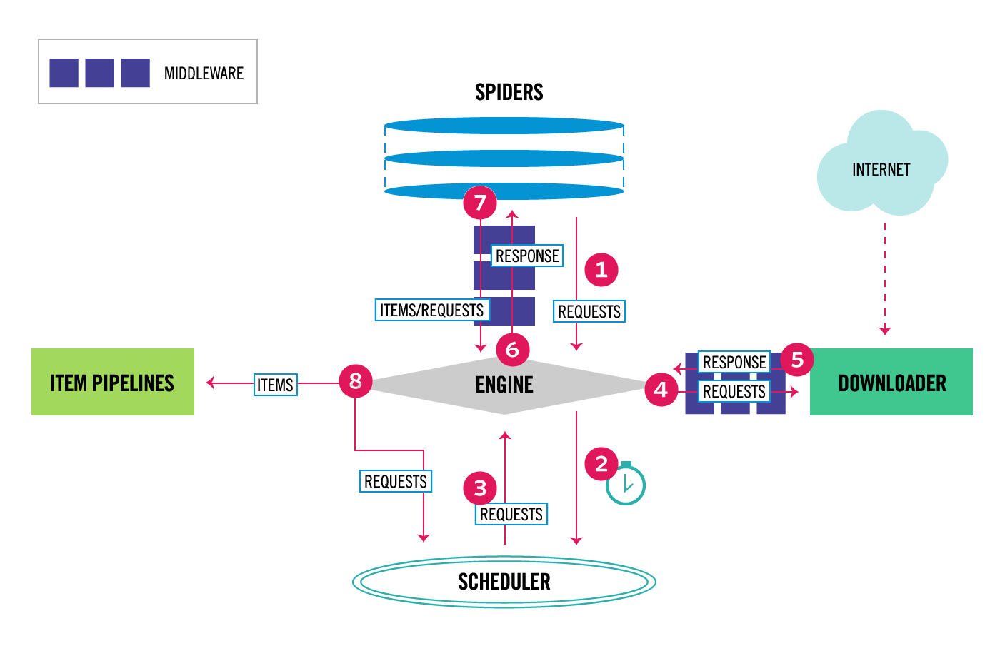

# บทที่ 3 วิธีดำเนินการวิจัย
การศึกษาวิจัยครั้งนี้ เป็นการวิจัยและพัฒนา (Research and Development) เพื่อพัฒนาระบบรวบรวมข้อมูลขนาดใหญ่ พยากรณ์และแจ้งเตือนภัยจากอุทกภัย-ภัยแล้งในพื้นที่ลุ่มน้ำพรมโหด และเขตเศรษฐกิจพิเศษสระแก้ว โดยมีวิธีกระบวนการวิจัยดังนี้

## 3.1 ประชากรและการสุ่มกลุ่มตัวอย่าง

### 3.1.1  ประชากร คือ  กลุ่มบุคคลที่ทำงานในการปกครองส่วนท้องถิ่น ประกอบด้วย เทศบาล และ องค์การบริหารส่วนตำบล (อบต.) อยู่ในเขตพื้นที่ลุ่มน้ำห้วยพรมโหดซึ่งประกอบด้วยพื้นที่ 3 อำเภอ คือ อำเภอคลองหาด ประมาณ 60.83 ตารางกิโลเมตร อำเภอวัฒนานคร 417.17 ตารางกิโลเมตร และอำเภออรัญประเทศ 570.04 ตารางกิโลเมตร และพื้นที่เศรษฐกิจพิเศษสระแก้ว ได้แก่ ตำบลท่าข้าม ตำบลบ้านด่าน และตำบลป่าไร่ อำเภออรัญประเทศ และตำบลผักขะ อำเภอวัฒนานคร  และกลุ่มบุคคลในหน่วยงานราชการที่มีส่วนเกี่ยวข้องในการบริหารจัดการน้ำ แก้ไขปัญหาการเกิดอุทกภัยของพื้นที่ และลงพื้นที่ดูแลประสานงานกับชุมชนในการบริหารจัดการน้ำในพื้นที่ประกอบด้วย 1.องค์การบริหารส่วนจังหวัดสระแก้ว  2.สำนักงานทรัพยากรธรรมชาติและสิ่งแวดล้อมจังหวัดสระแก้ว  3. โครงการชลประทานสระแก้ว กรมชลประทาน และ 4. สำนักงานป้องกันและบรรเทาสาธารณภัยจังหวัดสระแก้ว

### 3.1.2  กลุ่มตัวอย่าง ในครั้งนี้ผู้วิจัยใช้วิธีการเลือกกลุ่มตัวอย่างโดยวิธีการเจาะจง (Purposive Samplingโดยกำหนดคุณสมบัติดังนี้ คือ เป็นบุคคลที่มีความยินดีให้ข้อมูลและให้ความร่วมมือกับผู้วิจัยในการลงพื้นที่เก็บข้อมูล มีประสบการณ์และหน้าที่รับผิดชอบประสานงานในพื้นที่ดูแลเรื่องอุทกภัย-ภัยแล้ง และมีคุณสมบัติสามารถใช้เทคโนโลยีทางด้านคอมพิวเตอร์เบื้องต้นและใช้สมาร์ทโฟนรวมถึงสามารถติดตั้งและใช้งานแอปพลิเคชัน LINE ได้ รวมทั้งหมด 46 คน โดยกลุ่มตัวอย่างแบ่งเป็น 2 กลุ่ม ประกอบด้วย
กลุ่มที่ 1 ตัวแทนจากการปกครองส่วนท้องถิ่นประกอบด้วย เทศบาล และ องค์การบริหารส่วนตำบล(อบต.) อยู่ในเขตพื้นที่ลุ่มน้ำห้วยพรมโหด ประกอบ อำเภอคลองหาด  อำเภอวัฒนานคร และอำเภออรัญประเทศ จำนวน 13 หน่วยงาน และตัวแทนจากการปกครองส่วนท้องถิ่นพื้นที่เศรษฐกิจพิเศษสระแก้วจำนวน 4 หน่วยงาน  ส่งตัวแทนตำบลละ 2 คน รวมทั้งหมด 34 คน แสดงดังตารางที่ 3.1 และตารางที่ 3.2

**ตารางที่ 3.1  การปกครองส่วนท้องถิ่นประกอบด้วย เทศบาล และ องค์การบริหารส่วนตำบล อยู่ใน**
เขตพื้นที่ลุ่มน้ำห้วยพรมโหด

| ลำดับ | องค์การบริหารส่วนท้องถิ่น | อำเภอ | ที่ตั้ง |
| :--- | :--- | :--- | :--- |
| 1. | องค์การบริหารส่วนตำบลไทรทอง | คลองหาด | ต้นน้ำส่วนใต้ |
| 2. | องค์การบริหารส่วนตำบลผักขะ | วัฒนานคร | กลางน้ำส่วนกลาง |
| 3. | องค์การบริหารส่วนตำบลหนองน้ำใส | วัฒนานคร | ต้นน้ำส่วนเหนือ |
| 4. | องค์การบริหารส่วนตำบลช่องกุ่ม | วัฒนานคร | ต้นน้ำส่วนเหนือ |
| 5. | องค์การบริหารส่วนตำบลท่าเกวียน | วัฒนานคร | ต้นน้ำส่วนใต้ |
| 6. | เทศบาลตำบลวัฒนานคร | วัฒนานคร | ต้นน้ำส่วนกลาง |
| 7. | องค์การบริหารส่วนตำบลหนองแวง | วัฒนานคร | ต้นน้ำส่วนกลาง |
| 8. | องค์การบริหารส่วนตำบลหันทราย | อรัญประเทศ | กลางน้ำส่วนเหนือ |
| 9. | องค์การบริหารส่วนตำบลเมืองไผ่ | อรัญประเทศ | กลางน้ำส่วนใต้ |
| 10. | องค์การบริหารส่วนตำบลคลองทับจันทร์ | อรัญประเทศ | กลางน้ำส่วนใต้ |
| 11. | เทศบาลเมืองอรัญประเทศ | อรัญประเทศ | ปลายน้ำส่วนเหนือ |
| 12. | เทศบาลตำบลบ้านใหม่หนองไทร | อรัญประเทศ | ปลายน้ำส่วนเหนือ |
| 13. | เทศบาลตำบลฟากห้วย | อรัญประเทศ | ปลายน้ำส่วนใต้ |

**ตารางที่ 3.2  การปกครองส่วนท้องถิ่นประกอบด้วย เทศบาล และ องค์การบริหารส่วนตำบล อยู่ใน**
เขตพื้นที่พื้นที่เศรษฐกิจพิเศษสระแก้ว

| ลำดับ | องค์การบริหารส่วนท้องถิ่น | อำเภอ | ที่ตั้ง |
| :--- | :--- | :--- | :--- |
| 1. | องค์การบริหารส่วนตำบลท่าข้าม | อรัญประเทศ | ปลายน้ำส่วนใต้ |
| 2. | เทศบาลตำบลบ้านด่าน | อรัญประเทศ | ปลายน้ำส่วนใต้ |
| 3. | เทศบาลตำบลป่าไร่ | อรัญประเทศ | ปลายน้ำส่วนใต้ |
| 4. | องค์การบริหารส่วนตำบลผักขะ | วัฒนานคร | ต้นน้ำส่วนกลาง |
กลุ่มที่ 2 เป็นผู้ให้ข้อมูลสำคัญ (Key Informant Interview) เป็นบุคคลที่มีความรอบรู้ ความชำนาญมีประสบการณ์และหน้าที่รับผิดชอบประสานงานในพื้นที่ดูแลเรื่องอุทกภัย-ภัยแล้ง และเชี่ยวชาญในการบริหารจัดการน้ำในพื้นที่ลุ่มน้ำพรมโหด และเขตเศรษฐกิจพิเศษสระแก้ว ได้แก่ 
1.องค์การบริหารส่วนจังหวัดสระแก้ว  2. สำนักงานทรัพยากรธรรมชาติและสิ่งแวดล้อมจังหวัดสระแก้ว  3. โครงการชลประทานสระแก้ว กรมชลประทาน และ 4. สำนักงานป้องกันและบรรเทา
สาธารณภัยจังหวัดสระแก้ว ตัวแทนหน่วยงานละ 3 คน รวมทั้งหมด 12 คน

## 3.2 การเก็บรวบรวมข้อมูล

**งานวิจัยครั้งนี้เป็นการวิจัยและพัฒนา (Research and Development) เพื่อศึกษาข้อมูลผลกระทบในเขตพื้นที่ลุ่มน้ำพรมโหด และเขตเศรษฐกิจพิเศษสระแก้ว อำเภออรัญประเทศ จังหวัดสระแก้ว ในการดำเนินการวิจัยทําการเก็บรวบรวมข้อมูลทั้งปฐมภูมิและทุติยภูมิเพื่อให้ได้ทราบข้อมูล เกี่ยวกับสภาพปัญหาเกี่ยวกับการเกิดอุทกภัย ภัยแล้งรวมถึงการบริหารจัดการน้ำในพื้นที่ลุ่มน้ำพรมโหดและเขตเศรษฐกิจพิเศษสระแก้ว  การวิจัยนี้เป็นการบูรณาการทำงานร่วมกันระหว่างทีมวิจัย องค์การบริหารส่วนจังหวัดสระแก้วและหน่วยงานต่าง ๆ  รวมถึงคนในชุมชนที่มีส่วนเกี่ยวข้องในการบริหารจัดการน้ำในพื้นที่ลุ่มน้ำพรมโหด และเขตเศรษฐกิจพิเศษสระแก้ว ผลงานวิจัยจะมีการถ่ายทอดองค์ความรู้ให้กับองค์การบริหารส่วนจังหวัดสระแก้ว และหน่วยงานที่เกี่ยวข้อง สำหรับวางแผนนโยบายแนวทางการดำเนินการเกี่ยวกับการบริหารจัดการน้ำเพื่อแก้ไขปัญหาการเกิดอุทกภัยของพื้นที่ และถ่ายทอดให้กับคนในชุมชนที่อยู่ในพื้นที่ การเก็บรวบรวมข้อมูลและดำเนินงานวิจัยแบ่งออกเป็น 4 ระยะ ดังนี้**
ระยะที่ 1  สำรวจพื้นที่  ลงพื้นที่เพื่อสำรวจสภาพปัญหาการเกิดอุทกภัย ภัยแล้ง รวมถึงการบริหารจัดการน้ำในพื้นที่ลุ่มน้ำพรมโหด และเขตเศรษฐกิจพิเศษสระแก้ว  การเคลื่อนที่ของน้ำตาม
ลำน้ำ รวบรวมข้อมูลด้านภูมิศาสตร์ ลักษณะภูมิประเทศลักษณะทางธรณีวิทยา ลักษณะปฐพีวิทยา ลักษณะทางอุทกวิทยาในบริเวณพื้นที่ศึกษา รวมถึงข้อมูลภาพถ่ายดาวเทียม ใช้วิธีเชิงคุณภาพเป็นหลักในการวิจัยเพื่อสำรวจและทำความเข้าใจจากผู้มีส่วนได้ส่วนเสียที่เกี่ยวข้องเพื่อเป็นการรวบรวมข้อมูลโดยมีวิธีการดำเนินการศึกษา ดังต่อไปนี้

1. ผู้วิจัยได้ศึกษาแนวคิด ทฤษฎี จากเอกสาร ตำรา งานวิจัยที่เกี่ยวข้องกับลักษณะภูมิประเทศ ของจังหวัดสระแก้ว การเคลื่อนที่ของน้ำตามลำน้ำ และข้อมูลอื่น ๆ ที่เกี่ยวข้องกับขอบเขตงานวิจัย  รวมถึงข้อมูลการบริหารจัดการน้ำจากหน่วยงานที่เกี่ยวข้องเป็นข้อมูลทุติยภูมิ ประกอบด้วย องค์การบริหารส่วนจังหวัดสระแก้ว สำนักงานทรัพยากรธรรมชาติและสิ่งแวดล้อมจังหวัดสระแก้ว  โครงการชลประทานสระแก้ว กรมชลประทาน และ สำนักงานป้องกันและบรรเทาสาธารณภัยจังหวัดสระแก้ว  ซึ่งมีส่วนเกี่ยวข้องในพื้นที่ลุ่มน้ำห้วยพรมโหด ประกอบด้วย อำเภอคลองหาดประมาณ 60.83 ตารางกิโลเมตร อำเภอวัฒนานคร 417.17 ตารางกิโลเมตร และอำเภออรัญประเทศ 570.04 ตารางกิโลเมตร และพื้นที่เศรษฐกิจพิเศษสระแก้ว (ตำบลท่าข้าม ตำบลบ้านด่าน และตำบลป่าไร่ อำเภออรัญประเทศ และตำบลผักขะ อำเภอวัฒนานคร)

2. การสัมภาษณ์เชิงลึก (In-depth Interview)  ผู้วิจัยได้สัมภาษณ์เชิงลึก (In-depth Interview)  จากผู้บริหาร ตัวแทน หรือนักวิชาการระดับการปกครองส่วนท้องถิ่น ประกอบด้วย เทศบาล และ องค์การบริหารส่วนตำบล (อบต.)  เป็นบุคคลที่ทำงานในหน่วยงานปกครองส่วนท้องถิ่นในเขตพื้นที่ลุ่มน้ำห้วยพรมโหดและเขตเศรษฐกิจพิเศษสระแก้ว จำนวน 17 หน่วยงาน  รวมถึงหน่วยงานที่เกี่ยวข้องเป็นผู้ให้ข้อมูลสำคัญ ประกอบด้วย องค์การบริหารส่วนจังหวัดสระแก้ว สำนักงานทรัพยากรธรรมชาติและสิ่งแวดล้อมจังหวัดสระแก้ว  โครงการชลประทานสระแก้ว กรมชลประทาน และ สำนักงานป้องกันและบรรเทาสาธารณภัยจังหวัดสระแก้ว ซึ่งเป็นผู้เชี่ยวชาญ และลงพื้นที่ดูแลประสานงานกับชุมชนในการบริหารจัดการน้ำในพื้นที่ลุ่มน้ำพรมโหด และเขตเศรษฐกิจพิเศษสระแก้ว

3.  ผู้วิจัยได้รวบรวมข้อมูลจากการสัมภาษณ์ นํามาวิเคราะห์ข้อมูลโดยการวิเคราะห์เนื้อหาเชิงพรรณนา (Descriptive Content Analysis) โดยมีการโยงเข้ากับกรอบแนวคิดการวิจัยเพื่อให้เป็นไปตามวัตถุประสงค์ของการวิจัยในครั้งนี้ ผู้วิจัยได้ใช้วิธีการถอดถ้อยคําการสัมภาษณ์จากเครื่องบันทึกเสียง พร้อมทั้งรายละเอียดเพิ่มเติมจากการจดบันทึก เพื่อตีความและกำหนดประเด็น
ที่สำคัญได้อย่างถูกต้องและเชื่อถือได้ แล้วทําการวิเคราะห์ข้อมูลเชิงคุณภาพ ซึ่งในการวิเคราะห์นั้นผู้วิจัยใช้การถอดข้อความทั้งหมดในภาพรวม แล้วนําข้อความมาทําการวิเคราะห์ในแต่ละประเด็นเพื่อให้การวิจัยครั้งนี้สามารถตอบวัตถุประสงค์ของการวิจัยได้อย่างถูกต้อง  มีการออกแบบวิธีการเก็บรวบรวมข้อมูลที่ครอบคลุมทั้งแหล่งข้อมูลปฐมภูมิและข้อมูลทุติยภูมิ รวมถึงผู้วิจัยได้ศึกษาข้อมูลเพิ่มเติมจากเอกสาร ทฤษฎี งานวิจัยต่าง ๆ ที่เกี่ยวข้องเพื่อให้ได้ข้อมูลที่ครบถ้วน ถูกต้องสมบูรณ์และทันสมัย

ระยะที่  2 รวบรวม บริหารจัดการข้อมูลขนาดใหญ่และจัดทำโมเดลการพยากรณ์

ส่วนที่ 1 รวบรวมข้อมูลขนาดใหญ่ และสกัดข้อมูลจากแหล่งข่าว  เป็นงานที่มีการรวบรวมข้อมูลจากข้อมูลทุติยภูมิ 2 แบบด้วยกัน แบบที่ 1 เป็นข้อมูลที่ได้จากระบบ API ของคลังข้อมูลน้ำแห่งชาติ และ Social Media API ในพื้นที่จังหวัดสระแก้ว โดย ข้อมูลจะถูกส่งมาเป็น Restful API แบบที่ 2 ข้อมูลที่ได้จากสำนักข่าวทั้งภาครัฐและภาคเอกชน โดยจะใช้เทคนิคทางคอมพิวเตอร์และจักรกลเรียนรู้ในการการสกัดข้อมูล จากเนื้อข่าวโดยอัตโนมัติ เพื่อหาระดับความรุนแรงของเหตุการณ์ และสถานที่ และบุคคลที่เกี่ยวข้อง หน่วยงานที่เกี่ยวข้อง เพื่อให้ทราบถึงบริบทของเหตุการณ์ และความถี่ของเหตุการณ์ที่เกิดขึ้นในแต่ละช่วงเวลา ออกแบบและพัฒนาโมดูลสำหรับการรวบรวมและประสานข้อมูลจากแหล่งต่าง ๆ เข้าด้วยกัน โดยใช้เทคนิคการประมวลผลข้อมูลแบบเรียลไทม์ (Real-time Data Processing) เพื่อให้ได้ข้อมูลที่เป็นปัจจุบันและแม่นยำ ภายใต้กระบวนการบริหารจัดการฐานข้อมูลขนาดใหญ่ (Big Data) สำหรับการการออกแบบสถาปัตยกรรมระบบ (System Architecture Design) มีการเลือกโครงสร้างระบบที่รองรับการประมวลผลข้อมูลขนาดใหญ่ เช่น การใช้คลาวด์คอมพิวติ้ง (Cloud Computing) เพื่อให้ระบบสามารถรองรับการขยายตัวของข้อมูลในอนาคต และการเลือกเทคโนโลยีการจัดเก็บ เช่น ฐานข้อมูลแบบ NoSQL หรือ S3 compatible object storage สำหรับการจัดการข้อมูลที่ไม่มีโครงสร้าง เพื่อประมวลผลข้อมูลอย่างมีประสิทธิภาพ

ส่วนที่ 2 บริหารจัดการข้อมูลขนาดใหญ่  การบริหารจัดการข้อมูลขนาดใหญ่ จำเป็นจะต้องมีวิธีการบูรณาการข้อมูล (Data Integration) ตามที่ได้รวบรวมวรรณกรรม  ชั้นแรกสุด จะเป็นข้อมูลที่ได้มาโดยไม่ผ่านการปรับแต่ง ข้อมูลชุดนี้จะยังไม่พร้อมให้บริการ เมื่อข้อมูลผ่านกระบวนการปรับแต่งและจัดโครงสร้างทางวิธีการจัดการข้อมูลขนาดใหญ่ สุดท้ายแล้วเราจะได้ข้อมูลที่พร้อมให้บริการในโครงสร้างที่อำนวยความสะดวกในการเข้าถึงข้อมูลมากที่สุด

วิธีการปรับแต่งและจัดโครงสร้างคือการนำข้อมูลระดับน้ำและปริมาณน้ำฝนที่รวบรวมได้จะถูกบูรณาการเข้าด้วยกันในฐานข้อมูลกลาง ระบบจะทำการเชื่อมโยงข้อมูลเหล่านี้กับข้อมูลเชิงพื้นที่และข้อมูลสภาพอากาศ เพื่อให้พร้อมสำหรับสร้างแบบจำลองที่สามารถพยากรณ์สถานการณ์น้ำและภัยพิบัติที่อาจเกิดขึ้นได้ โดยใช้โครงสร้างที่ได้รับการออกแบบไว้

ส่วนที่ 3 จัดทำโมเดลการพยากรณ์ จะใช้อย่างน้อยสองโมเดลในการพยากรณ์ โมเดลแรกจะเป็นเรื่องของการพยากรณ์โดยใช้ข้อมูลจากทางภาครัฐ คลังข้อมูลน้ำ ร่วมกับการสำรวจพื้นที่ มาจัดทำ เป็นการคาดการณ์ระดับน้ำในอนาคต ซึ่งจะทำให้ ระบบสามารถมองเห็น สิ่งที่กำลังจะเกิดขึ้นล่วงหน้า ของการเตือนภัย ได้อย่างทันท่วงที โมเดลที่สอง จะเป็นการวิเคราะห์ ข้อมูลจากแหล่งข่าว ซึ่งจะใช้ข้อมูลจากสำนักข่าวไทย ทั้งภาครัฐและเอกชน เพื่อให้ได้ข้อมูลในด้านความถี่ การเกิดเหตุการณ์ และมีการสรุปเหตุการณ์ให้โดยอัตโนมัติ ส่วนในรายละเอียดด้านโมเดลจะมีการคัดเลือกอัลกอริธึมที่เหมาะสมสำหรับการพยากรณ์ระดับน้ำ ด้วยอัลกอริธึมทางสถิติ (Statistical Algorithms) เช่น ARIMA (Auto-Regressive Integrated Moving Average) หรืออัลกอริธึมการเรียนรู้ของเครื่อง (Machine Learning Algorithms) เช่น Random Forest, Support Vector Machine (SVM), หรือ Long Short-Term Memory (LSTM)

ในงานวิจัยนี้ ทีมวิจัยได้ใช้เทคนิค Web Scraping ในการอ่านข่าวและรายงานเหตุการณ์น้ำท่วม รวมถึงการสรุปสถานการณ์เป็นแนวทางที่มีประสิทธิภาพในการรวบรวมข้อมูลจากหลายแหล่งข่าวและสื่อออนไลน์ เพื่อให้ได้ข้อมูลที่อัปเดตและเชื่อถือได้ ในการทำงานนี้ เราสามารถใช้ Scrapy ซึ่งเป็นเครื่องมือที่นิยมในการทำเว็บสแครปปิ้ง เพื่อนำข้อมูลมาเก็บรวมรวม วิเคราะห์ และสรุปสถานการณ์น้ำท่วมในพื้นที่ต่าง ๆ  แสดงดังภาพที่ 3.1

**ภาพที่ 3.1  หลักการทำงานของเครื่องมือสกัดข้อมูลจากเว็บไซต์ที่ชื่อว่า Scrapy**
Web Scraping คือกระบวนการดึงข้อมูลจากเว็บไซต์โดยอัตโนมัติด้วยการใช้โปรแกรมหรือสคริปต์ โปรแกรมจะเข้าไปดึงเนื้อหาจากหน้าเว็บเพจ เช่น ข้อความ รูปภาพ หรือข้อมูลในตาราง โดยสามารถระบุองค์ประกอบเฉพาะในโครงสร้าง HTML ของหน้าเว็บ เช่น แท็กหรือคลาสที่ต้องการดึงข้อมูล หลังจากได้ข้อมูลมาแล้ว ระบบจะทำการจัดเก็บและประมวลผลเพื่อแปลงเป็นรูปแบบ
ที่เข้าใจง่ายหรือเหมาะสำหรับการใช้งาน เช่น CSV หรือฐานข้อมูล ข้อมูลที่เก็บได้จากการ Web Scraping มักถูกนำไปใช้สำหรับการวิเคราะห์แนวโน้ม การวิจัย หรือการรายงานข่าว สำหรับในงานวิจัยนี้ใช้เครื่องมือที่ชื่อว่า Scrapy

Scrapyเริ่มต้นด้วยการระบุเว็บไซต์ที่ต้องการสกัดข้อมูล เช่น เว็บไซต์ข่าวที่รายงานสถานการณ์น้ำท่วม (เช่น ไทยรัฐ, เดลินิวส์, BBC Thai) หรือเว็บไซต์ของหน่วยงานรัฐที่รายงานข้อมูลแบบเรียลไทม์เกี่ยวกับน้ำท่วม (เช่น กรมอุตุนิยมวิทยา สำนักงานป้องกันและบรรเทาสาธารณภัย) คัดเลือกแหล่งที่มีความน่าเชื่อถือ และสามารถเข้าถึงข้อมูลได้อย่างต่อเนื่อง

การตั้งค่า Scrapy Spider ใน Scrapy เป็นตัวจัดการการเรียกดูและดึงข้อมูลจากเว็บไซต์ที่เราต้องการรวบรวม ระบุถึงองค์ประกอบของหน้าเว็บ เช่น URL ของบทความ หัวข้อข่าว วันที่เผยแพร่ และเนื้อหาที่เกี่ยวข้องกับเหตุการณ์น้ำท่วม เพื่อดึงข้อมูลที่เราสนใจ เช่น ข้อมูลพาดหัวข่าว เนื้อหาข่าว และข้อมูลที่อัปเดตล่าสุดเกี่ยวกับน้ำท่วมในแต่ละพื้นที่ สามารถตั้งค่าให้ Scrapy ทำการดึงข้อมูลอย่างต่อเนื่อง เช่น ทุก 30 นาที หรือทุกชั่วโมง เพื่อให้ได้ข้อมูลที่อัปเดตตามสถานการณ์

ข้อมูลที่ดึงมาจากหลายแหล่งควรจัดเก็บในรูปแบบที่ง่ายต่อการประมวลผล เช่น JSON หรือ CSV เนื่องจากข้อมูลที่มาจากหลายแหล่งอาจมีความซ้ำซ้อนหรือข้อมูลไม่สมบูรณ์ จำเป็นต้องทำการลบข้อมูลที่ซ้ำกันและจัดเรียงข้อมูลให้เหมาะสม ค้นหาคำหลัก (Keywords) ที่เกี่ยวกับสถานการณ์น้ำท่วม เช่น น้ำท่วม ระดับน้ำ การอพยพ เพื่อสรุปภาพรวมของสถานการณ์

จากนั้นใช้การวิเคราะห์ข้อมูลจากหลายแหล่งเพื่อสรุปสถานการณ์น้ำท่วมในแต่ละพื้นที่ เช่น พื้นที่ที่มีผลกระทบหนักที่สุด ระดับน้ำที่เพิ่มขึ้น พื้นที่ที่มีการอพยพ หรือเส้นทางที่ถูกปิด ใช้ข้อมูลที่ดึงมาเพื่อตรวจสอบแนวโน้มของเหตุการณ์น้ำท่วม ว่าพื้นที่ใดมีแนวโน้มที่จะถูกน้ำท่วมมากขึ้น และประเมินผลกระทบที่อาจเกิดขึ้น ใช้กราฟ แผนที่ หรือตาราง เพื่อช่วยในการแสดงผลข้อมูลสรุปสถานการณ์น้ำท่วมให้เข้าใจได้ง่ายขึ้น

ระยะที่ 3 พัฒนาช่องทางการสื่อสารผ่านเว็บไซต์และแอปพลิเคชันไลน์ OA เมื่อข้อมูลพร้อมให้บริการแล้ว จะถูกจัดเก็บอยู่ในฐานข้อมูล ช่องทางการให้บริการจะมีอยู่สองช่องทางได้แก่ ทางเว็บไซต์และ แอปพลิเคชันไลน์ ช่องทางเว็บไซต์จะเน้นการให้บริการด้านข้อมูลที่ครบถ้วน ทั้งในส่วนของภาพรวมและรายละเอียดต่าง ๆ ที่ครบถ้วน ส่วนช่องทางแอปพลิเคชันไลน์ จะเน้นในด้านการแจ้งเตือน โดยข้อมูลนั้นจะมีการเข้าถึงจากแหล่งข้อมูลเดียวกันแต่การนำเสนอข้อมูลแตกต่างกัน ช่องทางที่ 1 ผ่านเว็บไซต์ มีลักษณะการพัฒนาเป็นเรซสปอนต์ซีฟ เว็บดีไซน์ ออกแบบเว็บไซต์ให้มีความสามารถปรับเปลี่ยนขนาดของเว็บไซต์ให้เหมาะสมกับการแสดงผลบนหน้าจอขนาดต่าง ๆ ช่องทางที่ 2 ผ่านแอปพลิเคชันไลน์ OA

ช่องทางที่ 1 ผ่านเว็บไซต์ มีลักษณะการพัฒนาเป็นเรซสปอนต์ซีฟ เว็บดีไซน์ ออกแบบเว็บไซต์ให้มีความสามารถปรับเปลี่ยนขนาดของเว็บไซต์ให้เหมาะสมกับการแสดงผลบนหน้าจอขนาดต่าง ๆ และช่องทางที่ 2 ผ่านแอปพลิเคชันไลน์ OA

ระยะที่ 4 ถ่ายองค์ความรู้และการใช้งานให้กับกลุ่มตัวอย่าง โดยกลุ่มตัวอย่างแบ่งเป็น 2 กลุ่ม

กลุ่มที่ 1 ตัวแทนจากการปกครองส่วนท้องถิ่นอยู่ในเขตพื้นที่ลุ่มน้ำห้วยพรมโหด ประกอบ อำเภอคลองหาด   อำเภอวัฒนานคร และอำเภออรัญประเทศ จำนวน 13 ตำบล และตัวแทนจากการปกครองส่วนท้องถิ่นพื้นที่เศรษฐกิจพิเศษสระแก้ว  จำนวน 4 ตำบล  ส่งตัวแทนตำบลละ 2 คน รวมทั้งหมด 34 คน  ดำเนินการดังนี้

ผู้วิจัยติดต่อประสานงาน นัดหมาย วัน-เวลา และเตรียมความพร้อมสถานที่ และสัญญาณอินเตอร์เน็ต

การถ่ายทอด ก่อนดำเนินการถ่ายทอดผู้วิจัยอธิบายวัตถุประสงค์ การเตรียมสมาร์ทโฟนชี้แจงทำความเข้าใจกับกลุ่มตัวอย่าง  รวมถึงการทำแบบประเมิน จากนั้นแจกเอกสารประกอบการอบรม

3. ดำเนินการอบรมถ่ายทอดความรู้ ผู้วิจัยอธิบายการแสดงผลข้อมูลผ่านเว็บไซต์ ช่องทางเว็บไซต์จะเน้นการให้บริการด้านข้อมูลที่ครบถ้วน ทั้งในส่วนของภาพรวมและรายละเอียดต่าง ๆ ที่ครบถ้วน  เพื่อให้กลุ่มตัวอย่างเห็นภาพรวม  จากนั้นอธิบายการติดตั้งและการใช้งานแอปพลิเคชันไลน์ OA ทีละขั้นตอน ให้กลุ่มตัวอย่างลงมือปฏิบัติตามทีละขั้นตอนผ่านสมาร์ทโฟน ซึ่งสำหรับกลุ่มตัวอย่างกลุ่มที่ 1 จะเน้นให้เข้าใจการใช้งานแอปพลิเคชันไลน์ OA ซึ่งจะเน้นในด้านการแจ้งเตือน โดยข้อมูลนั้นจะมีการเข้าถึงจากแหล่งข้อมูลเดียวกันกับเว็บไซต์แต่การนำเสนอข้อมูลแตกต่างกัน จะเหมาะกับการใช้งานของคนในชุมชนที่ง่ายและสะดวกรวดเร็ว เมื่อสิ้นสุดการอบรมแล้วตัวแทนจากหน่วยงานต้องไปเผยแพร่และถ่ายทอดต่อให้กับคนในชุมชนต่อไป

4. เมื่อกระบวนการดำเนินการถ่ายทอดความรู้สิ้นสุดลง ผู้วิจัยให้กลุ่มตัวอย่างทำแบบประเมินความพึงพอใจในการดำเนินโครงการถ่ายทอด  และให้กลุ่มตัวอย่างทดลองใช้งานเว็บไซต์และแอปพลิเคชันไลน์ OA ด้วยตนเองเพื่อทำความเข้าใจ และถ้ามีปัญหาจะได้แก้ไขปัญหาได้ด้วยตนเอง จากนั้นให้กลุ่มตัวอย่างทำแบบประเมินความพึงพอใจการใช้งานของระบบเว็บไซต์และ
แอปพลิเคชันไลน์ OA เมื่อสิ้นสุดกระบวนการผู้วิจัยนำผลมาวิเคราะห์หาค่าทางสถิติ และสรุปผลต่อไป

กลุ่มที่ 2 กลุ่มตัวอย่างซึ่งเป็นผู้ให้ข้อมูลสำคัญ (Key Informant Interview) เป็นบุคคลที่มีความรอบรู้ ความชำนาญ และเชี่ยวชาญในการบริหารจัดการน้ำในพื้นที่ลุ่มน้ำพรมโหด และเขตเศรษฐกิจพิเศษสระแก้ว ได้แก่ 1.องค์การบริหารส่วนจังหวัดสระแก้ว  2.สำนักงานทรัพยากรธรรมชาติและสิ่งแวดล้อมจังหวัดสระแก้ว  3. โครงการชลประทานสระแก้ว กรมชลประทาน และ 4. สำนักงานป้องกันและบรรเทาสาธารณภัยจังหวัดสระแก้ว ตัวแทนหน่วยงานละ 3 คน รวมจำนวน 12 คน  มีขั้นตอนการดำเนินการดังนี้

ผู้วิจัยประสานงาน นัดหมาย วัน-เวลา และสถานที่ จัดเตรียมเอกสารประกอบการอบรมที่ใช้ในการจัดอบรมเชิงปฏิบัติการ ก่อนดำเนินการถ่ายทอดผู้วิจัยอธิบายวัตถุประสงค์ ชี้แจงทำความเข้าใจกับกลุ่มตัวอย่าง

2. ดำเนินการอบรมถ่ายทอดความรู้โดยผู้วิจัยได้แจกเอกสารประกอบการอบรมเพื่อเสริมความรู้ความเข้าใจให้กับผู้เข้าร่วมอบรม ผู้วิจัยสาธิตขั้นตอนการใช้งานเว็บไซต์ อธิบายส่วนประกอบของเว็บไซต์ และองค์ประกอบของเนื้อหา การแสดงผลข้อมูลผ่านเว็บไซต์ ช่องทางเว็บไซต์จะเน้นการให้บริการด้านข้อมูลที่ครบถ้วน ทั้งในส่วนของภาพรวมและรายละเอียดต่าง ๆ ที่ครบถ้วน ในกลุ่มที่ 2 จะเน้นการอบรมในส่วนของ ผู้ดูแลระบบ ที่สามารถเพิ่ม ลบ แก้ไขข้อมูลได้ รวมถึงอธิบายการติดตั้งและการใช้งานแอปพลิเคชันไลน์ OA ทีละขั้นตอน ให้กลุ่มตัวอย่างลงมือปฏิบัติตามทีละขั้นตอนผ่านสมาร์ทโฟน/เครื่องคอมพิวเตอร์

3. เมื่อกระบวนการดำเนินการถ่ายทอดความรู้สิ้นสุดลง ผู้วิจัยให้กลุ่มตัวอย่างทำแบบประเมินความพึงพอใจในการดำเนินโครงการถ่ายทอด  และให้กลุ่มตัวอย่างทดลองใช้งานเว็บไซต์และแอปพลิเคชันไลน์ OA ด้วยตนเองเพื่อทำความเข้าใจ จากนั้นให้กลุ่มตัวอย่างทำแบบประเมินความ
พึงพอใจการใช้งานของระบบเว็บไซต์และแอปพลิเคชันไลน์ OA เมื่อสิ้นสุดกระบวนการผู้วิจัยนำผลมาวิเคราะห์หาค่าทางสถิติ และสรุปผลต่อไป

## 3.3 เครื่องมือในการวิจัยและการตรวจสอบคุณภาพเครื่องมือ
การศึกษาครั้งนี้ใช้เครื่องมือในการเก็บรวมรวมข้อมูลโดยมีกระบวนการสร้างและตรวจคุณภาพเครื่องมือที่ใช้ในการวิจัย โดยมีรายละเอียดดังนี้

### 3.3.1 แบบสัมภาษณ์

#### 3.3.1.1 ศึกษาทฤษฎีหลักการสัมภาษณ์และกำหนดประเด็นปัญหา สภาพปัญหาการเกิดอุทกภัย ภัยแล้ง รวมถึงการบริหารจัดการน้ำ และแนวทางความต้องการการพัฒนาระบบ เพื่อเป็นแนวทางกรอบการพัฒนาระบบเพื่อแก้ไขปัญหาให้กับกลุ่มเป้าหมายและะพัฒนาระบบให้ตรงกับความต้องการที่แท้จริงของกลุ่มผู้ใช้งาน นำข้อมูลที่ได้จากการศึกษาค้นคว้ามาเป็นกรอบแนวความคิด กำหนดขอบเขต เพื่อนำมาเป็นแนวทางและกำหนดโครงสร้างในการสร้างข้อคำถามของแบบสัมภาษณ์ให้สัมพันธ์กับประเด็นที่ต้องการทราบข้อมูล จากนั้นสร้างข้อคำถามแบบสัมภาษณ์ ลักษณะเป็นแบบสัมภาษณ์ โดยกำหนดรูปแบบของแบบสัมภาษณ์เป็นคำถามลักษณะแบบปลายเปิด (ณรงค์ โพธิ์พฤกษานันท์, 2557) แบบสัมภาษณ์แบ่งทั้งหมด 7 ตอน ดังนี้ ตอนที่ 1 ข้อมูลทั่วไปของผู้ตอบแบบสัมภาษณ์ตอนที่ 2 คำถามเกี่ยวกับสภาพปัญหาการเกิดอุทกภัยและภัยแล้ง  ตอนที่ 3 คำถามเกี่ยวกับการมีส่วนร่วมของชุมชนในการบริหารจัดการน้ำในพื้นที่ลุ่มน้ำพรมโหดและเขตเศรษฐกิจพิเศษสระแก้วตอนที่ 4 คำถามเกี่ยวกับแนวทางการบริหารจัดการน้ำของหน่วยงานที่เกี่ยวข้อง ตอนที่ 5 คำถามเกี่ยวกับช่องทางการเข้าถึงและรับรู้ข่าวสารของชุมชนเกี่ยวกับสถานการณ์น้ำตอนที่ 6 คำถามเกี่ยวกับการใช้งานสื่อสังคมออนไลน์ และการเข้าใช้งานเว็บไซต์
ตอนที่ 7 ข้อเสนอแนะอื่น ๆ

#### 3.3.1.2 นำแบบสัมภาษณ์ที่สร้างขึ้น เสนอต่อผู้เชี่ยวชาญจำนวน 3 ท่าน  เพื่อ ตรวจสอบพิจารณาความเหมาะสม ครบถ้วนประเด็นของข้อคำถามให้ มีความสอดคล้องและตรงกับวัตถุประสงค์ของการวิจัยโดยวัดความตรงตามเนื้อหา (Content Valid) จากการหาค่าดัชนีความสอดคล้อง (Index-Objective Congruence : IOC)

#### 3.3.1.3 นำผลการตรวจสอบพิจารณาไปวิเคราะห์หาค่าดัชนีความสอดคล้อง (Index of Item-Objective Congruence : IOC) ค่า IOC ที่เหมาะสมในการพิจารณาหาค่าความตรงต้องมีค่า= 0.50 ขึ้นไป ถือว่ามีความเหมาะสม  จากนั้นปรับปรุงแบบสัมภาษณ์ในส่วนที่ยังไม่สมบูรณ์ตามข้อเสนอแนะของผู้เชี่ยวชาญ และนำ กลับไปให้ผู้เชี่ยวชาญตรวจสอบความเหมาะสมและความถูกต้องและครบถ้วนของประเด็นคำถามอีกครั้ง เพื่อให้สอดคล้องกับวัตถุประสงค์ของการวิจัยจากนั้นจัดพิมพ์แบบสัมภาษณ์ที่ผ่านการตรวจจสอบเพื่อนำไปใช้ในการเก็บรวบรวมต่อไป

### 3.3.2 แบบประเมินประสิทธิภาพของระบบ  สำหรับผู้เชี่ยวชาญผู้วิจัยได้สร้างแบบประเมินเพื่อประเมินประสิทธิภาพของระบบ  มีขั้นตอนดังนี้

#### 3.3.2.1 ศึกษาหลักการทฤษฎีการสร้างแบบประเมินประสิทธิภาพตามแนวทางการประเมินเว็บไซต์ของ (ศศิพันธ์ นิตยะประภา, 2558) เพื่อกำหนดเป็นกรอบในการประเมินประสิทธิภาพและความเหมาะสมของการออกแบบและพัฒนาเว็บไซต์ทั้งหมดรวมถึงทดสอบการทำงานและความถูกต้องตรงตามเงื่อนไขต่าง ๆ แบ่งการประเมินเว็บไซต์ออกเป็น 3 ด้าน ดังนี้ ประเมินด้านด้านข้อมูล ประเมินด้านระบบและการเชื่อมโยงและด้านการออกแบบและจัดรูปแบบ รวมทั้งหมด 20 ข้อ และ เกี่ยวกับด้านการออกแบบ แอปพลิเคชันไลน์ OA (line official Account)จำนวน 5 ข้อ รวมทั้งหมดจำนวน  25 ข้อ  ลักษณะแบบประเมินประสิทธิภาพเป็นลักษณะมาตราส่วนประเมินค่า 5 ระดับตามแนวคิดของลิเคิร์ท (Likert’s Scale)
5	หมายถึง 	ประสิทธิภาพมากที่สุด
4 	หมายถึง 	ประสิทธิภาพมาก
3	หมายถึง 	ประสิทธิภาพปานกลาง
2	หมายถึง 	ประสิทธิภาพน้อย
1 	หมายถึง 	ประสิทธิภาพน้อยที่สุด

#### 3.3.2.2 3. ตรวจสอบความตรงเชิงเนื้อหาของแบบประเมินประสิทธิภาพผู้วิจัยนำแบบประเมินประสิทธิภาพที่สร้างเรียบร้อยเสนอต่อผู้เชี่ยวชาญ จำนวน 3 ท่าน เพื่อพิจารณาตรวจสอบวิเคราะห์หาค่าความเที่ยงตรงของข้อคำถาม (Index of item-objective congruence : IOC) ตลอดจนความครบถ้วนสมบูรณ์ของข้อคำถาม นำผลที่ได้มาทำการวิเคราะห์ดัชนีความสอดคล้อง ผู้วิจัยเลือกข้อคำถามที่มีค่า IOC ตั้งแต่ 0.5 มาใช้เป็นข้อคำถามแบบประเมินประสิทธิภาพ

### 3.3.3 แบบประเมินความพึงพอใจ
แบบประเมินความพึงพอใจ	ที่สร้างขึ้น จะแบ่งออกเป็น 2 ชุด ดังนี้ ชุดที่ 1 แบบประเมินความพึงพอใจของผู้ใช้งานระบบผ่านช่องทางการสื่อสารผ่านเว็บไซต์และแอปพลิเคชันไลน์       และ ชุดที่ 2 แบบประเมินความพึงพอใจที่มีต่อการดำเนินโครงการถ่ายทอดเทคโนโลยีและการใช้งาน ผู้วิจัยดำเนินการสร้างและตรวจสอบคุณภาพของแบบสอบถามความพึงพอใจ วัดทัศนคติตามแนวทางของลิเคิร์ท (Likert)  ดำเนินการสร้างและตรวจสอบคุณภาพ ดังนี้

#### 3.3.3.1 ศึกษา เอกสาร แนวคิด ทฤษฎี และงานวิจัยที่เกี่ยวกับการสร้างข้อคำถามประเมินการใช้งานเว็บไซต์และแอปพลิเคชันไลน์สำหรับผู้ใช้งานระบบ และการสร้างข้อคำถามเกี่ยวกับการดำเนินโครงการถ่ายทอดเทคโนโลยีและการใช้งานระบบ  รวมถึงศึกษาการสร้างแบบสอบถามความพึงพอใจให้มีความเหมาะสมกับกลุ่มตัวอย่างในการตั้งข้อคำถาม เพื่อนำไปเป็นแนวทางในการสร้างแบบสอบถามความพึงพอใจ เพื่อกำหนดเป็นกรอบให้ครอบคลุมเนื้อหาและวัตถุประสงค์และใช้เป็นแนวในการสร้างแบบสอบถาม

#### 3.3.3.2 ดำเนินการสร้างแบบสอบถาม โดยกำหนดขอบเขตคำถามให้ครอบคลุม  สร้างแบบสอบถามความพึงพอใจให้มีคำถามที่ครอบคลุมตามหลักการและทฤษฎี ที่ได้จากการศึกษาเอกสาร แนวคิด ทฤษฎี  แบ่งการสร้างแบบสอบถามความพึงพอใจออกเป็นดังนี้ เรื่องที่1 สร้างข้อคำถามระบบรวบรวมข้อมูลขนาดใหญ่ พยากรณ์และแจ้งเตือนภัยจากอุทกภัย-ภัยแล้งในพื้นที่ลุ่มน้ำพรมโหด และเขตเศรษฐกิจพิเศษสระแก้วผ่านช่องทางการสื่อสารผ่านเว็บไซต์และแอปพลิเคชันไลน์ สำหรับผู้ใช้งานระบบจำนวนทั้งหมด 20 ข้อ เรื่องที่ 2 สร้างแบบสอบถามความพึงพอใจที่มีต่อการดำเนินโครงการ จำนวนทั้งหมด 15 ข้อ ลักษณะแบบสอบถามเป็นลักษณะมาตราส่วนประเมินค่า (Rating Scale) 5 ระดับตามแนวคิดของลิเคิร์ท (Likert’s Scale)
5	หมายถึง 	ความพึงพอใจมากที่สุด
4 	หมายถึง 	ความพึงพอใจมาก
3	หมายถึง 	ความพึงพอใจปานกลาง
2	หมายถึง 	ความพึงพอใจน้อย
1 	หมายถึง 	ความพึงพอใจน้อยที่สุด
เกณฑ์การพิจารณาระดับความพึงพอใจของผู้ใช้งานระบบแปลความหมายจากค่าเฉลี่ยตาม น้ำหนักคะแนนเฉลี่ยที่คำนวณได้ จำแนกเป็น 5 ระดับดังนี้ (มนสิช สิทธิสมบูรณ์ , 2563)

## 4.50 – 5.00 	หมายถึง 	มีความพึงพอใจมากที่สุด

## 3.50 – 4.49 	หมายถึง 	มีความพึงพอใจมาก

## 2.50 – 3.39 	หมายถึง 	มีความพึงพอใจปานกลาง

## 1.50 – 2.49 	หมายถึง 	มีความพึงพอใจน้อย

## 1.00 – 1.49 	หมายถึง 	มีความพึงพอใจน้อยที่สุด

#### 3.3.3.3 หาความเที่ยงตรง (Validity) นำเสนอผู้เชี่ยวชาญตรวจสอบความเที่ยงตรงตามเนื้อหา (Content Validity) จำนวน 3 ท่าน  เพื่อพิจารณาตรวจสอบความสอดคล้องของคำถามแต่ละข้อว่ามีความสอดคล้องกับเนื้อหาที่จะวัดหรือไม่ ตลอดจนความเหมาะสมของภาษาที่ใช้ในข้อคำถาม นำผลการตรวจสอบไปวิเคราะห์หาค่าดัชนีความสอดคล้อง (Index of Item -Objective Congruence : IOC)  ค่า IOC มากกว่า 0.5 ขึ้นไปถือว่ามีความเหมาะสม

#### 3.3.3.4 หาความเชื่อมั่น (Reliability) ผู้วิจัยได้นำแบบสอบถามที่ปรับปรุงแก้ไข จากผู้เชี่ยวชาญแล้ว ไปทดลองใช้กับกลุ่มทดลองที่มีคุณสมบัติลักษณะเดียวกันกับกลุ่มตัวอย่าง จำนวน 25 คน จากนั้นนำมาวิเคราะห์ หาค่าความเชื่อมั่นโดยวิธีหาสัมประสิทธิ์แอลฟา (α – Coefficient) ตามวิธีการของครอนบาค นำแบบสอบถามที่ผ่านการทดลองการใช้แล้ว จัดพิมพ์แบบสอบถามเป็นฉบับสมบูรณ์เพื่อใช้ในการเก็บข้อมูลต่อไป

## 3.4 การวิเคราะห์ข้อมูล

### 3.4.1 สถิติพื้นฐาน ค่าเฉลี่ย (Mean) และค่าส่วนเบี่ยงเบนมาตรฐาน (Standard Deviation)
วิเคราะห์หาค่าเฉลี่ยคะแนนประสิทธิภาพของระบบ และวิเคราะห์หาค่าเฉลี่ยแบบประเมินความพึงพอใจ (มนสิช สิทธิสมบูรณ์ , 2563) มีสูตรการคำนวณหาค่าเฉลี่ยคะแนนจากสูตร

$$\bar{X} = \frac{\sum X}{N}$$

$$X$$

$$X$$

$$N$$
การพิจารณาค่าของความคิดเห็นจะเปรียบเทียบกับเกณฑ์การแปลความหมายของค่าเฉลี่ย การแปลความหมาย มีรายละเอียดดังนี้

คาเฉลี่ยคะแนนตั้งแต 	4.51-5.00 	หมายถึง 	มากที่สุด

คาเฉลี่ยคะแนนตั้งแต	3.51-4.50 	หมายถึง		มาก

คาเฉลี่ยคะแนนตั้งแต 	2.51-3.50 	หมายถึง 	ปานกลาง

คาเฉลี่ยคะแนนตั้งแต 	1.51-2.50	หมายถึง 	นอย

คาเฉลี่ยคะแนนตั้งแต 	1.00-1.50 	หมายถึง 	น้อยที่สุด

สูตรหาค่าส่วนเบี่ยงเบนมาตรฐาน (Standard division)

$$SD = \sqrt{\frac{N \sum X^2 - (\sum X)^2}{N(N - 1)}}$$
เมื่อ  SD			 คือ	ส่วนเบี่ยงเบนมาตรฐาน

N			 คือ	จำนวนกลุ่มผู้ประเมิน

$$X$$

$$X 2$$

### 3.4.2 สถิติที่ใช้ในการหาคุณภาพเครื่องมือ ได้แก่

#### 3.4.2.1 วิเคราะห์หาค่าดัชนีความสอดคล้องความเที่ยงตรงตามเนื้อหา (Index of Item-Objective Congruence: IOC) โดยมีสูตรการคำนวณ  (อนุวัติ คูณแก้ว, 2560)

$$IOC = \frac{\sum R}{N}$$
โดย IOC	คือ	ค่าดัชนีความสอดคล้อง

$$R$$
N	คือ	จำนวนผู้เชี่ยวชาญ

ซึ่งเกณฑการแปลความหมายดัชนีความสอดคลอง มีดังนี้

## 0.50	ถึง 1.00 	หมายถึง 	สอดคลอง
-0.50	ถึง 0.49		 หมายถึง 	ไมแนใจ

-1.00 	ถึง -0.49	หมายถึง		ไมสอดคลอง

การหาค่าสัมประสิทธิ์ความสอดคล้องหากผลรวมค่า IOC มากกว่า 0.5 ขึ้นไปถือว่ามีความเหมาะสมโดยมีเกณฑ์การพิจารณาให้คะแนนตรวจพิจารณาข้อคำถามหาค่า IOC ดังนี้

+1 	หมายถึง 	แน่ใจว่าแบบวัดตรงจุดประสงค์หรือตรงตามเนื้อหา

0 		หมายถึง 	ไม่แน่ใจว่าแบบวัดตรงจุดประสงค์หรือตรงตามเนื้อหา
-1 		หมายถึง 	แน่ใจว่าแบบวัดไม่ได้ตรงจุดประสงค์หรือตรงตามเนื้อหา

#### 3.4.2.2 สถิติที่ใช้หาค่าความเชื่อมั่นของแบบประเมิน โดยวิธีหาสัมประสิทธิ์แอลฟา (α – Coefficient) ตามวิธีการของครอนบาค (Cronbach)วิเคราะห์ค่าความเชื่อมั่นของแบบสอบถามความพึงพอใจ และแบบประเมินประสิทธิภาพ โดยหาสัมประสิทธิ์แอลฟา (α – Coefficient) ตามวิธีการของครอนบาค (Cronbach) (ธานินทร์ ศิลป์จารุ, 2563) สูตรการคำนวณดังนี้

$$\alpha = \frac{n}{n - 1} \left(1 - \frac{\sum S_i^2}{S_t^2}\right)$$
คือ	 สัมประสิทธิ์แอลฟา

n 	คือ 	 จำนวนข้อคำถาม

$$\alpha = \frac{n}{n - 1} \left(1 - \frac{\sum S_i^2}{S_t^2}\right)$$

$$S t 2$$
ค่าสัมประสิทธิ์แอลฟา (α) 	การแปลความหมายระดับความเที่ยง

มากกว่า 0.9 				ดีมาก

มากกว่า 0.8 				ดี

มากกว่า 0.7 				พอใช้

มากกว่า 0.6 				ค่อนข้างพอใช้

มากกว่า 0.5				 ต่ำ

น้อยกว่า หรือ เท่ากับ .5			 ไม่สามารถรับได้
