# บทที่ 4 ผลการวิจัย
การวิจัยเรื่อง การพัฒนาระบบรวบรวมข้อมูลขนาดใหญ่ พยากรณ์และแจ้งเตือนภัยจากอุทกภัย-ภัยแล้งในพื้นที่ลุ่มน้ำพรมโหด และเขตเศรษฐกิจพิเศษสระแก้ว เป็นการวิจัยและพัฒนา (Research and Development) เพื่อศึกษาข้อมูลผลกระทบในเขตพื้นที่ลุ่มน้ำพรมโหด และเขตเศรษฐกิจพิเศษสระแก้ว อำเภออรัญประเทศ จังหวัดสระแก้ว โดยมีผลการวิจัยในประเด็นที่สำคัญดังต่อไปนี้

## 4.1 ผลการพัฒนาระบบการพยากรณ์ฝนล่วงหน้าจากข้อมูลตรวจวัดของเรดาห์ตรวจวัดฝน แบบหลากหลายช่วงเวลา รายชั่วโมง รายวัน รายสัปดาห์ รายเดือน
แพลตฟอร์มรายงานสถานการณ์น้ำที่ทำงานร่วมกับระบบ Machine Learning ของพื้นที่ลุ่มน้ำพรมโหด และเขตเศรษฐกิจพิเศษสระแก้ว แพลตฟอร์มรวบรวมข้อมูลตรวจวัดจากสถานีอุตุนิยมวิทยาและอุทกวิทยา ข้อมูลสภาพพื้นที่ และข้อมูลปัญหาน้ำท่วมในพื้นที่ศึกษา เพื่อที่จะจำลองสภาพน้ำท่วมและพัฒนา Machine Learning Model ให้มีประสิทธิภาพสูงสุด การทำงานของระบบ และพัฒนาแบบจำลองชลศาสตร์เพื่อตอบสนองจุดประสงค์ และเพื่อให้ได้ผลผลิตตรงตามการทำงานใน Flow Chart ที่ได้ออกแบบไว้ นอกจากการรวบรวมข้อมูลข้างต้น จำเป็นจะต้องมีการลงพื้นที่เพื่อสอบถามปัญหาและความต้องการของประชาชนที่อยู่อาศัยในพื้นที่เสี่ยงภัย เพื่อให้การออกแบบระบบสามารถส่งข้อมูลไปยังแพลตฟอร์มที่ประชาชนสามารถเข้าถึงได้ ในขั้นตอนนี้จึงได้ทำการลงพื้นที่เพื่อสำรวจพื้นที่ ทำการพูดคุยและแลกเปลี่ยนข้อคิดเห็นกับประชาชน เจ้าหน้าที่ของเทศบาล และหน่วยงานที่เกี่ยวข้อง นอกจากนี้ แพลตฟอร์มยังมีระบบติดตามข้อมูลและส่งภาพถ่ายผ่านไลน์แอพพลิเคชัน เพื่อให้ผู้ใช้งานสามารถส่งข้อมูลกลับมายังแพลตฟอร์มบอกแจ้งภาพเหตุการณ์ในสถานการณ์ปัจจุบันได้อย่างทันท่วงที

### 4.1.1 การจัดทำ Data Pipeline
Data Pipeline สำหรับการทำแผนที่น้ำท่วม สำหรับรายชั่วโมง กล่าวคือในทุก ๆ ชั่วโมงจะมีการ processing ภาพแผนที่น้ำท่วมจากระบบ Machine Learning จากนั้นนำผลลัพธ์ที่ได้จากภาพดังกล่าวมา overlay บนแผนที่ GIS  แสดงดังภาพ 4.1

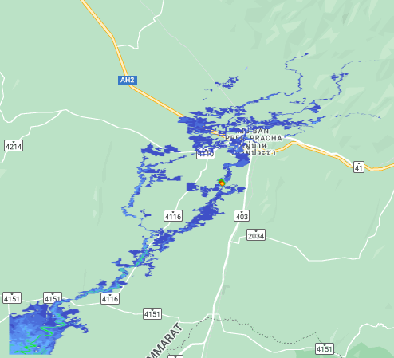

**ภาพที่ 4.1 แผนที่แสดงสภาพและข้อมูลการท่วม**
แผนที่แสดงสภาพและข้อมูลการท่วม ได้แก่พื้นที่ที่คาดการณ์ว่าน้ำจะท่วม ความลึกของน้ำที่ท่วม รวมทั้งข้อมูลสำหรับการอพยพ เช่น จุดอพยพ เส้นทางการอพยพ จุดอันตรายในเส้นทางอพยพ เป็นต้น ข้อมูลเหล่านี้จะแสดงในรูปแบบของรูปภาพที่เข้าใจง่าย โดยมีเป้าหมายหลักเพื่อให้สามารถอพยพประชาชนไปอยู่ ในที่ปลอดภัยได้อย่างเหมาะสม ทันเวลา ในกรณีที่เกิด เหตุการณ์น้ำท่วมขึ้น

จากต้นน้ำถึงปลายน้ำข้อมูลเริ่มต้นที่การนำข้อมูลทุติยภูมิจากคลังข้อมูลน้ำ thaiwater.net มาใช้งานโดยดึงผ่าน API จากนั้นโหลดข้อมูลเข้าสู่โมเดลและเริ่มต้นสร้างรูปแผนที่น้ำท่วมโดยการใช้ Machine Learning จากนั้นนำข้อมูลไปเก็บไว้ที่ object Storage และทำการแสดงข้อมูลผ่านเว็บไซต์

แสดงดังภาพที่ 4.2

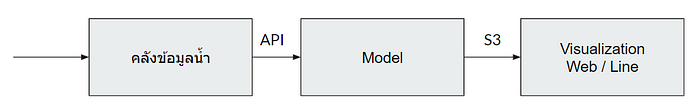

**ภาพที่ 4.2  แผนที่แสดงสภาพคลังข้อมูลน้ำ**

### 4.1.2 Flow การทำงานของระบบ Data Pipeline
ส่วนของการประมวลผล Machine Learning ทำบนระบบปฏิบัติการ Windows ที่มีการเชื่อมต่อกับอินเทอร์เน็ต source code ที่ใช้ก็เขียนอยู่บนภาษา python โค้ดที่เกี่ยวกับ Machine Learning ถูกเขียนอยู่บน Jupyter Notebook เราต้องการที่จะรันตัว Jupyter Notebook ไฟล์เป็นรายชั่วโมงจึงตั้ง Windows Task scheduler ไว้ และใช้ Pepper mill สำหรับ execute ผ่าน command line เมื่อได้ผลลัพธ์ออกมาเป็นรูปภาพและ metadata ต่างๆก็จะส่งไปเก็บไว้ที่ S3 compatible object Storage ดังภาพที่ 4.3 และสุดท้ายก็แสดงผลผ่าน google map โดยใช้วิธี overlay ไฟล์รูปภาพลงบนตำแหน่งที่ระบุไว้ ดังภาพที่ 4.4

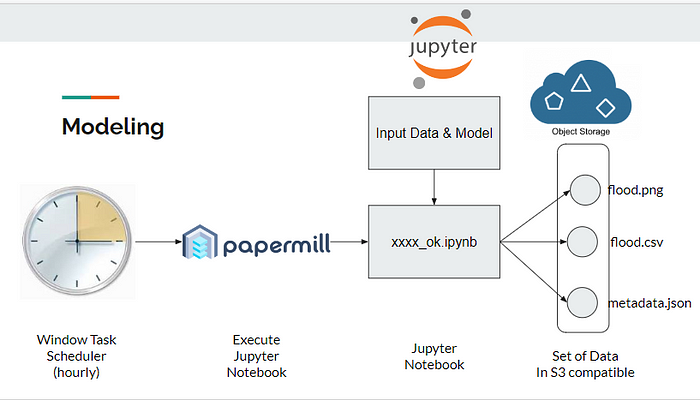

**ภาพที่ 4.3  โปรแกรม Task Schedule เพื่อจัดการคำสั่งที่ทำงานตามปฏิทินเวลา**

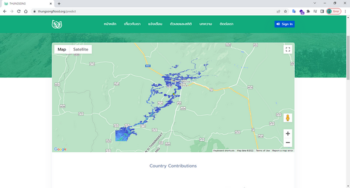

**ภาพที่ 4.4  Overlay ผลการวิเคราะห์และวางบน GIS Map**

### 4.1.3  ผลการพัฒนาระบบคาดการณ์สถานการณ์อุทกภัยโดยใช้ Machine Learning
ในการวิจัยครั้งนี้เป็นการพัฒนาระบบคาดการณ์สถานการณ์อุทกภัยโดยใช้ Machine Learning โดยเป็นการทำงานร่วมกันระหว่างแพลตฟอร์มรายงานสถานการณ์น้ำโดยใช้ข้อมูลภาพถ่ายระดับน้ำจากตำแหน่งต่างๆ ในพื้นที่ศึกษาร่วมกับการประมวลผลของระบบคาดการณ์สถานการณ์อุทกภัย พบว่าในส่วนของระบบระบบคาดการณ์โดยใช้ข้อมูลภาพถ่ายระดับน้ำมีส่วนสำคัญและเป็นส่วนกำหนดความแม่นยำของระบบและในส่วนของการพยากรณ์น้ำท่วม

การคาดการณ์สถานการณ์อุทกภัยนั้นสามารถคาดการณ์ได้ล่วงหน้าตั้งแต่ 5 ถึง 60 นาที โดยผลการคาดการณ์ยังมีความแตกต่างจากข้อมูลแผนที่น้ำท่วมในอดีตอยู่ในบางตำแหน่ง เนื่องมาจากข้อมูลที่ทำการศึกษามีน้อยและยังไม่มีความละเอียดมาก ทำให้อาจจะไม่สามารถวิจัยการเปลี่ยนจากข้อมูลในอนาคตได้อย่างแม่นยำ ซึ่งผู้วิจัยจะพัฒนาปรับปรุงระบบให้ดีขึ้นและมีประสิทธิภาพมากขึ้นต่อไป ซึ่งปริมาณข้อมูลแผนที่น้ำท่วมที่ใช้ในการสร้างระบบคาดการณ์สถานการณ์อุทกภัยโดยใช้ Machine Learning ส่งผลโดยตรงกับความแม่นยำของการคาดการณ์ และการพัฒนาคุณภาพของข้อมูลที่ดีมากขึ้นเพื่อให้แบบจำลองอุทกภัยสามารถแสดงผลได้แม่นยำมากขึ้น

การประมวลผลของระบบคาดการณ์สถานการณ์อุทกภัย พบว่าผลการเปรียบเทียบเมื่อนำเหตุการณ์ต่อเนื่องจากข้อมูลแผนที่น้ำท่วมในอดีตประมวลผลโดยระบบพบว่าสามารถแจ้งเตือนล่วงหน้าได้ประมาณ 5 นาที ถึง 60 นาที โดยความแม่นยำจะลดลงจากช่วงเวลาคาดการณ์สั้นไปถึงยาว เมื่อเทียบจากการประมวลผลของข้อมูลแผนที่น้ำท่วมในอดีตจะพบว่ายังคงมีบางส่วนในพื้นศึกษาที่ไม่ครอบคลุม แต่ในภาพรวมและจุดสำคัญต่างๆพบว่าระบบนี้สามารถแจ้งเตือนและให้ข้อมูลตำแหน่งและความลึกของระดับน้ำท่วมได้ล่วงหน้าและมีประสิทธิภาพและสามารถนำไปใช้เป็นข้อมูลประกอบการตัดสินใจของเจ้าหน้าที่ที่ควบคุมดูแลการบริหารงานระบายน้ำในพื้นที่ได้ระบบคาดการณ์สถานการณ์อุทกภัยโดยใช้ Machine Learning เพื่อการพยากรณ์แผนที่อุทกภัยและการประยุกต์ใช้แพลตฟอร์มรายงานสถานการณ์น้ำ เพื่อนำไปใช้ในการบริหารจัดการและการตัดสินใจในการระบายน้ำในพื้นที่คลองบางบาลบางไทร สามารถสรุปผลได้ดังต่อไปนี้ ดังภาพที่ 4.5

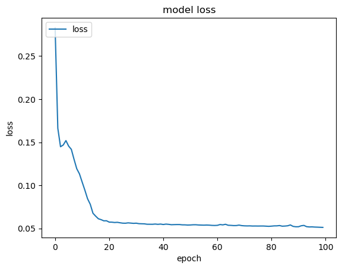

**ภาพที่ 4.5 กราฟแสดงผลการพัฒนาระบบคาดการณ์สถานการณ์อุทกภัยโดยใช้ Machine Learning**
ผลการเปรียบเทียบความแม่นยำระบบคาดการณ์สถานการณ์อุทกภัยเมื่อนำเหตุการณ์ต่อเนื่องจากข้อมูลแผนที่น้ำท่วมในอดีตนั้นจากผล root mean square error (RMSE) และ coefficient of determination (R²) ของ Machine Learning โดยการคาดการณ์น้ำท่วมที่ในช่วงเวลาที่น้อยนั้นจะมีความแม่นยำสูงถึง R² 0.949329124 และ RMSE 17.89657051 และเมื่อต้อองการคาดการณ์น้ำท่วมในในช่วงเวลาที่มากขึ้น Machine Learning นั้นจะให้ผลคาดการณ์ที่มีความแม่นยำน้อยลงโดยมีค่า R² 0. 035306683 และ RMSE 52.17236273 จากผลของค่า Machine Learning ค่า root mean square error (RMSE) และ coefficient of determination (R²) เมื่อช่วงเวลาในการคาดการณ์อุทกภัยในพื้นที่นั้นหากทำการร่วงหน้าในช่วงเวลาอันใกล้นั้นสามารถได้ผลการทำนายที่มีความแม่นยำสูงและหากต้องการทำนายอุทกภัยในช่วงเวลาที่ยาวนานนั้นจะมีความแม่นยำที่ต่ำ แสดงดังตารางที่ 4.1  และ แสดงเป็นกราฟดังภาพที่ 4.6 และ ภาพที่ 4.7

**ตารางที่ 4.1 ผลการเปรียบเทียบความแม่นยำระบบคาดการณ์สถานการณ์อุทกภัยเมื่อนำเหตุการณ์
                 ต่อเนื่องจากข้อมูลแผนที่น้ำท่วมในอดีต**

| Prediction_minute | RMSE | R^2 |
| :--- | :--- | :--- |
| 5 | 17.89657051 | 0.949329124 |
| 10 | 27.40407641 | 0.87896555 |
| 15 | 28.06272702 | 0.866818538 |
| 20 | 31.96563587 | 0.827197217 |
| 25 | 34.88956267 | 0.752372041 |
| 30 | 38.47236547 | 0.663080414 |
| 35 | 41.38806565 | 0.610077104 |
| 40 | 44.12210136 | 0.264309857 |
| 45 | 42.45656783 | 0.030653504 |
| 50 | 42.42258667 | 0.032204564 |
| 55 | 49.51631092 | 0.033755623 |
| 60 | 52.17236273 | 0.035306683 |

**ภาพที่ 4.6 กราฟแสดงความแม่นยำระบบคาดการณ์สถานการณ์อุทกภัยระหว่างค่า root mean**
square error (RMSE) และ coefficient of determination (R²)

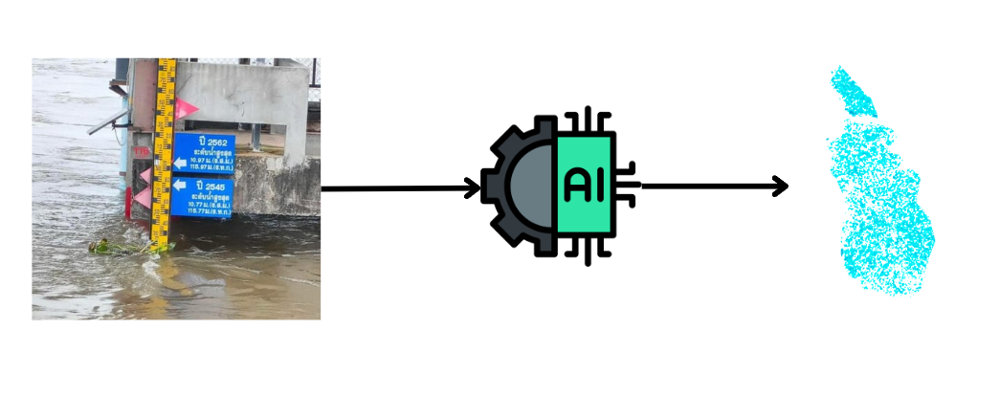

**ภาพที่ 4.7  รูปภาพในการนำเข้าแบบจำลองและผลลัพธ์ที่แบบจำลองให้กลับคืนมา**

## 4.2 ผลการพัฒนาโครงข่ายระบบระบายน้ำในพื้นที่ศึกษาโดยการประยุกต์ใช้แบบจำลองคณิตศาสตร์ และ ใช้จักรกลเรียนรู้เพื่อปรับปรุงความเร็วในการประมวลผล และใช้ Server สมรรถนะที่ต่ำลงเพื่อประหยัดการลงทุน

### 4.2.1  การรวบรวมข้อมูลฐานที่ใช้ในการคำนวณโครงข่ายระบบระบายน้ำ ประกอบด้วย

#### 4.2.1.1  ข้อมูลลักษณะภูมิประเทศทั่วไป
พื้นที่ลุ่มน้ำพรมโหดและเขตเศรษฐกิจพิเศษสระแก้วมีภูมิประเทศที่ซับซ้อน ประกอบด้วยที่ราบสูงสลับที่ราบลุ่ม มีป่าไม้และแหล่งน้ำธรรมชาติกระจายตัวตามแนวสันเขาและลำน้ำสายหลัก ข้อมูลจาก DEM ของดาวเทียม SRTM และ ASTER ชี้ให้เห็นว่าทางตอนเหนือและตะวันตกเป็นพื้นที่สูงและภูเขา ส่วนตอนกลางและตอนใต้เป็นที่ราบเหมาะสมต่อการเพาะปลูกและตั้งถิ่นฐาน อย่างไรก็ตาม พื้นที่ลาดเขามีความเสี่ยงต่อดินถล่มและน้ำหลากฉับพลัน ขณะที่พื้นที่ราบลุ่มตามแม่น้ำพรมโหดและแม่น้ำสระแก้วมักเกิดน้ำท่วมซ้ำซากในฤดูฝน แสดงดังภาพที่ 4.8

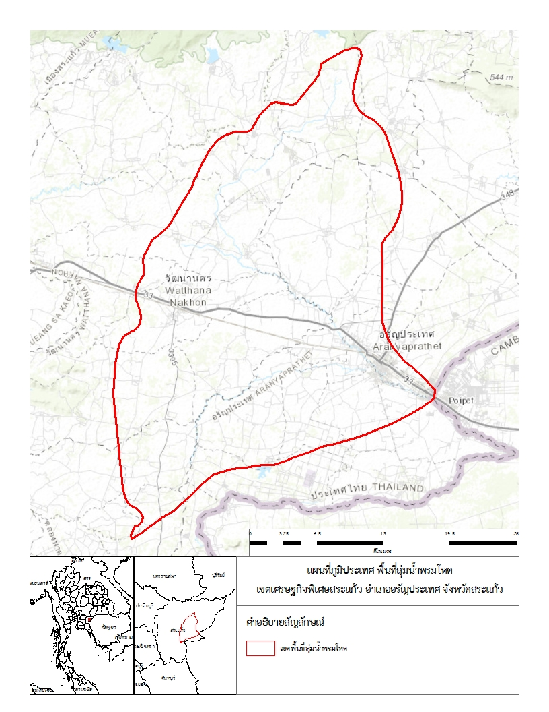

**ภาพที่ 4.8 แผนที่ภูมิประเทศที่ใช้ในการศึกษา**

#### 4.2.2.2  ข้อมูลลักษณะภูมิประเทศจากภาพถ่ายดาวเทียม
ภาพถ่ายดาวเทียม Landsat และ Sentinel-2 แสดงถึงการใช้ประโยชน์ที่ดินที่หลากหลาย โดยมีพื้นที่เกษตรกรรมเป็นสัดส่วนสูงสุด รองลงมาคือป่าไม้และเขตเมืองที่ขยายตัวตามแนวถนนและพื้นที่ชายแดน ข้อมูลจากกรมทรัพยากรน้ำและกรมแผนที่ทหารยืนยันทิศทางการไหลของน้ำจากเหนือสู่ใต้และจากตะวันตกไปตะวันออก ผ่านพื้นที่เกษตรกรรมและชุมชน ซึ่งเป็นปัจจัยเพิ่มความเปราะบางต่อทั้งน้ำท่วมและภัยแล้งนอกจากนี้ ฐานข้อมูลจากกรมป้องกันและบรรเทาสาธารณภัย (ปภ.) และ GISTDA ยังระบุพื้นที่เสี่ยงน้ำท่วมในเขตอำเภอวัฒนานครและอรัญประเทศซึ่งมีการเพาะปลูกหนาแน่น ขณะที่พื้นที่เชิงเขาทางตะวันตกเฉียงเหนือมักได้รับผลกระทบจากน้ำหลาก การบูรณาการข้อมูลภูมิประเทศ อุทกวิทยา และภูมิอากาศ ทำให้สามารถจำแนกพื้นที่เสี่ยงภัยได้อย่างชัดเจน และเป็นประโยชน์ต่อการวางแผนเชิงพื้นที่เพื่อการจัดการทรัพยากรน้ำอย่างยั่งยืนในอนาคต แสดงลักษณะภูมิประเทศ  แสดงดังภาพที่ 4.9

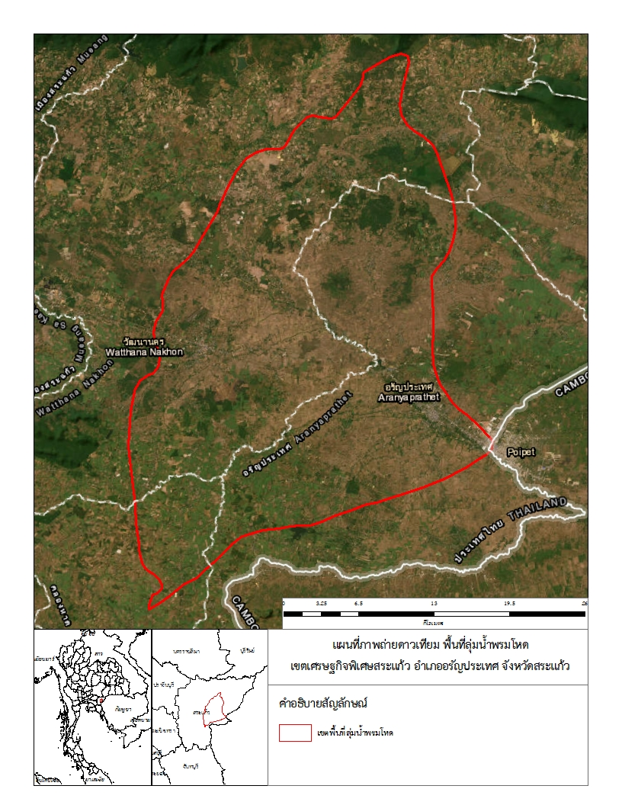

**ภาพที่ 4.9  แผนที่ภาพถ่ายดาวเทียมที่ใช้ในการศึกษา**

#### 4.2.2.3  ข้อมูลโครงข่ายการไหลของน้ำ แสดงดังภาพที่ 4.10

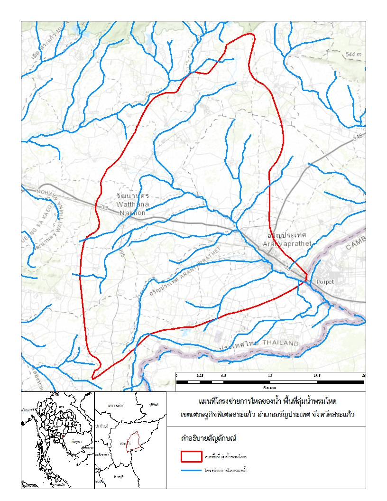

**ภาพที่ 4.10 แผนที่โครงข่ายการไหลของน้ำที่ใช้ในการศึกษา**
1)  พื้นที่ลุ่มน้ำพรมโหดและเขตเศรษฐกิจพิเศษสระแก้วมีระบบแหล่งน้ำสำคัญ ได้แก่ แม่น้ำพรมโหดซึ่งไหลจากเหนือสู่ใต้ มีความจุสูงสุดถึง 200 ล้าน ลบ.ม. และแม่น้ำสระแก้วที่ไหลจากตะวันตกไปตะวันออก มีความจุ 180 ล้าน ลบ.ม. ทั้งสองเป็นแม่น้ำหลักที่มีบทบาทต่อการเกษตรและการควบคุมการไหลของน้ำในพื้นที่ ส่วนลำน้ำสาขา เช่น ลำน้ำท่าเรือ (120 ล้าน 
ลบ.ม.) ลำน้ำบางพระ (80 ล้าน ลบ.ม.) ลำน้ำคลองท่าเรือ (50 ล้าน ลบ.ม.) และแม่น้ำคลองปูน 
(60 ล้าน ลบ.ม.) มีบทบาทสนับสนุนระบบชลประทานและการกระจายน้ำในพื้นที่เกษตรกรรมและชุมชน โดยรวมแล้ว แหล่งน้ำเหล่านี้ทำหน้าที่เป็นโครงสร้างพื้นฐานสำคัญในการจัดการทรัพยากรน้ำและรองรับความต้องการใช้น้ำของพื้นที่ทั้งสองแห่ง ดังตารางที่ 4.2

**ตารางที่ 4.2 ข้อมูลทิศทางการไหลในลุ่มน้ำพรมโหด**

| ชื่อแม่น้ำ/ลำน้ำ | ทิศทางการไหล | ความจุของแม่น้ำ (ล้านลูกบาศก์เมตร) | พื้นที่ที่ไหลผ่าน |
| :--- | :--- | :--- | :--- |
| แม่น้ำพรมโหด | จากทิศเหนือไปทิศใต้ | 200 | ลุ่มน้ำพรมโหด |
| แม่น้ำสระแก้ว | จากทิศตะวันตกไปทิศตะวันออก | 180 | เขตเศรษฐกิจพิเศษสระแก้ว |
| ลำน้ำท่าเรือ | จากทิศตะวันออกไปทิศตะวันตก | 120 | เขตเศรษฐกิจพิเศษสระแก้ว |
| ลำน้ำบางพระ | จากทิศตะวันออกไปทิศตะวันตก | 80 | ลุ่มน้ำพรมโหด |
| ลำน้ำคลองท่าเรือ | จากทิศเหนือไปทิศใต้ | 50 | เขตเศรษฐกิจพิเศษสระแก้ว |
| แม่น้ำคลองปูน | จากทิศใต้ไปทิศเหนือ | 60 | เขตเศรษฐกิจพิเศษสระแก้ว |

#### 4.2.2.4   ข้อมูลลักษณะทางอุทกธรณีวิทยา
1)  อ่างเก็บน้ำและเขื่อน จังหวัดสระแก้วมีอ่างเก็บน้ำและเขื่อนขนาดกลางถึงเล็กหลายแห่งที่มีบทบาทสำคัญต่อการเก็บกักน้ำเพื่อเกษตรกรรม การอุปโภคบริโภค และการบรรเทาภัยแล้ง แหล่งน้ำหลัก ได้แก่ อ่างเก็บน้ำพระปรง คลองน้ำเขียว บ้านซ่อง รวมถึงโครงการตามแนวพระราชดำริ เช่น บ้านทับลานและบ้านคลองหาด ทั้งหมดช่วยเสริมระบบชลประทานและควบคุมน้ำท่วมในฤดูฝน โดยเขื่อนคลองน้ำใสมีความจุสูงสุด 95 ล้าน ลบ.ม. ทำหน้าที่หลักด้านอุตสาหกรรมและชลประทาน ขณะที่อ่างเก็บน้ำคลองตะเคียนและหนองตาโล่สนับสนุนการประปาและเกษตรกรรมท้องถิ่น ส่วนอ่างเก็บน้ำเขาฉกรรจ์มีบทบาทด้านการป้องกันน้ำท่วมและการอุปโภคโดยตรง โดยรวม พื้นที่สามารถเก็บกักน้ำได้กว่า 242 ล้าน ลบ.ม. และมีการปล่อยน้ำเฉลี่ยราว 70 ล้าน ลบ.ม./ปี ครอบคลุมทั้งด้านเกษตรกรรม ระบบประปา และการพัฒนาเศรษฐกิจในพื้นที่ ดังตารางที่ 4.3

**ตารางที่ 4.3 ข้อมูลทิศทางการไหลในลุ่มน้ำพรมโหด**

| ลำดับ | ชื่ออ่างเก็บน้ำ / เขื่อน | ประเภทโครงสร้าง | ขนาด (ไร่) | ปริมาตรเก็บกักน้ำ (ล้าน ลบ.ม.) | ปริมาณการปล่อยน้ำเฉลี่ย (ล้าน ลบ.ม./ปี) | พื้นที่รับประโยชน์ |
| :--- | :--- | :--- | :--- | :--- | :--- | :--- |
| 1 | อ่างเก็บน้ำพรมโหด | ดินถม | 3,200 | 45 | 12 | เกษตรกรรม ชุมชนลุ่มน้ำ |
| 2 | เขื่อนคลองน้ำใส | คอนกรีต | 6,500 | 95 | 30 | เขตเศรษฐกิจพิเศษชลประทาน |
| 3 | อ่างเก็บน้ำหนองตาโล่ | ดินถม | 1,850 | 22 | 6 | การเกษตร อ.อรัญประเทศ |
| 4 | อ่างเก็บน้ำคลองตะเคียน | ดินถม | 2,100 | 28 | 8 | ประปาท้องถิ่น, เกษตร |
| 5 | อ่างเก็บน้ำเขาฉกรรจ์ | หินถม | 3,800 | 52 | 14 | ป้องกันน้ำท่วม การอุปโภค |
2)  คลองชลประทานและระบบส่งน้ำ จังหวัดสระแก้วมีระบบชลประทานที่เชื่อมโยงอ่างเก็บน้ำ แหล่งน้ำธรรมชาติ และพื้นที่เกษตรกรรมอย่างเป็นระบบ โดยเฉพาะจากอ่างเก็บน้ำพระปรง คลองน้ำเขียว และบ้านซ่อง ซึ่งส่งน้ำผ่านคลองหลักและคลองย่อยไปยังอำเภอเมืองสระแก้ว วัฒนานคร และคลองหาด ระบบดังกล่าวอยู่ภายใต้การบริหารของกรมชลประทาน เพื่อให้การจ่ายน้ำเพาะปลูกเป็นไปอย่างต่อเนื่อง พร้อมทั้งสนับสนุนการอุปโภคบริโภคในบางพื้นที่ ทั้งนี้ เส้นทางการส่งน้ำที่สอดคล้องกับภูมิประเทศมีบทบาทสำคัญต่อการเกษตรและการบรรเทาผลกระทบจากภัยแล้งดังตารางที่ 4.4

**ตารางที่ 4.4 คลองชลประทานและระบบส่งน้ำ เส้นทางการไหลของน้ำเพื่อการเกษตรและการ**
อุปโภคบริโภค

| ลำดับ | ชื่อคลอง / ระบบส่งน้ำ | จุดเริ่มต้นของน้ำ | เส้นทางการไหล | ความยาว (กม.) | การใช้งานหลัก |
| :--- | :--- | :--- | :--- | :--- | :--- |
| 1 | คลองส่งน้ำพรมโหดสายใหญ่ | อ่างเก็บน้ำพรมโหด | ไหลลงทิศใต้ผ่าน ต.ทับพริก ต.อรัญประเทศ | 18.5 | เกษตรกรรม, ชุมชน |
| 2 | คลองชลประทานคลองน้ำใส | เขื่อนคลองน้ำใส | ไหลตะวันออกเฉียงเหนือสู่เขตเมืองสระแก้ว | 22.0 | การประปา,เกษตรกรรม |
| 3 | ระบบส่งน้ำบ้านคลองยาง | อ่างหนองตาโล่ | วนล้อมพื้นที่เกษตรราบต่ำใน ต.บ้านใหม่หนองไทร | 7.3 | ชลประทานขนาดเล็ก |
| 4 | คลองสาขาคลองตะเคียน | อ่างตะเคียน | ไหลลงพื้นที่ อ.เมืองสระแก้ว | 10.5 | สนับสนุนพื้นที่เกษตรขนาดกลาง |
| 5 | คลองชลประทานเขาฉกรรจ์ | อ่างเขาฉกรรจ์ | ไหลลงพื้นที่ลาดเชิงเขา เขตอุตสาหกรรม | 13.8 | น้ำอุตสาหกรรม เกษตร |
3)  สถานีตรวจวัดน้ำ จังหวัดสระแก้วมีสถานีตรวจวัดน้ำ 7 แห่งตามลำน้ำสายหลัก ได้แก่ คลองพรมโหด คลองพระปรง และคลองตะเคียน ดูแลโดยกรมทรัพยากรน้ำและกรมชลประทาน สถานีติดตั้งเครื่องมือวัดระดับน้ำอัตโนมัติและส่งข้อมูลเรียลไทม์ไปยัง ThaiWater.net ข้อมูลย้อนหลัง 10 ปีชี้ให้เห็นความผันผวนตามฤดูกาล โดยฤดูฝนมีระดับน้ำสูงและบางปีเกิดน้ำท่วมฉับพลัน เช่น สถานีบ้านพรมโหด (PH-01) มีระดับน้ำสูงสุด 5.70 ม. ขณะที่สถานีคลองน้ำใส (KS-02) และคลองตะเคียน (TK-05) มีบทบาทสำคัญต่อเกษตรกรรมและชลประทาน ส่วนสถานีเขาฉกรรจ์ (KCJ-04) มีแนวโน้มระดับน้ำลดเล็กน้อย สะท้อนการเปลี่ยนแปลงการใช้พื้นที่ ข้อมูลเหล่านี้เป็นพื้นฐานสำคัญสำหรับการเฝ้าระวังและวางแผนจัดการน้ำเชิงพื้นที่และเชิงนโยบาย ดังตารางที่ 4.5

**ตารางที่ 4.5 สถานีตรวจวัดน้ำ ตำแหน่งสถานี ข้อมูลระดับน้ำย้อนหลัง และแนวโน้มการเปลี่ยนแปลง**
จังหวัดสระแก้ว

| ลำดับ | ชื่อสถานีตรวจวัดน้ำ | พิกัด (ละติจูด, ลองจิจูด) | แม่น้ำ/ลำคลองหลัก | ระดับน้ำเฉลี่ย (ม.) | ระดับน้ำสูงสุด (ม.) | แนวโน้มการเปลี่ยนแปลง (10 ปี) | หมายเหตุ |
| :--- | :--- | :--- | :--- | :--- | :--- | :--- | :--- |
| 1 | สถานีบ้านพรมโหด (PH-01) | 14.105, 102.059 | แม่น้ำพรมโหด | 2.85 | 5.70 | เพิ่มขึ้นเล็กน้อย | ใกล้พื้นที่รับน้ำจากอ่างพรมโหด |
| 2 | สถานีคลองน้ำใส (KS-02) | 13.851, 102.103 | คลองน้ำใส | 1.42 | 4.10 | คงที่ | บริเวณชุมชนเกษตรหนาแน่น |
| 3 | สถานีบ้านหนองตาคง (NTK-03) | 14.021, 102.254 | ลำห้วยตาคง | 0.98 | 2.60 | เพิ่มช่วงฤดูฝน | เสี่ยงน้ำท่วมปี 2563 |
| 4 | สถานีเขาฉกรรจ์ (KCJ-04) | 13.777, 102.123 | ลำห้วยฉกรรจ์ | 1.90 | 3.50 | ลดลงเล็กน้อย | ติดกับพื้นที่เขตอุตสาหกรรม |
| 5 | สถานีคลองตะเคียน (TK-05) | 14.115, 102.089 | คลองตะเคียน | 1.33 | 3.10 | เพิ่มขึ้นต่อเนื่อง | ระบบชลประทานเชื่อมหลายคลอง |
4)  สถานีตรวจอากาศ ในจังหวัดสระแก้วมีสถานีตรวจอากาศหลายแห่งที่ทำหน้าที่เก็บข้อมูลสำคัญ เช่น ปริมาณฝน อุณหภูมิ และความกดอากาศ โดยหน่วยงานหลักที่ให้บริการข้อมูลเหล่านี้ได้แก่ กรมอุตุนิยมวิทยา ซึ่งมีสถานีตรวจอากาศทั่วประเทศ รวมถึงในสระแก้ว ดังตารางที่ 4.6และแสดงแผนที่ลักษณะทางอุทกธรณีวิทยาที่ในการศึกษา ดังภาพที่  4.11  และ แผนที่ลักษณะทางธรณีวิทยาที่ใช้ในการศึกษา ดังภาพที่  4.12

**ตารางที่ 4.6  สถานีตรวจอากาศในจังหวัดสระแก้ว**

| ลำดับ | ชื่อสถานีตรวจอากาศ | พิกัด (ละติจูด, ลองจิจูด) | พารามิเตอร์หลัก ที่ตรวจวัด | ความถี่การรายงาน | หมายเหตุ |
| :--- | :--- | :--- | :--- | :--- | :--- |
| 1 | สถานีอุตุนิยมวิทยาสระแก้ว | 13.816, 102.072 | อุณหภูมิ, ความชื้น, ลม, ฝน | รายชั่วโมง | สถานีหลักประจำจังหวัด |
| 2 | สถานีตรวจอากาศพรมโหด | 14.075, 102.110 | อุณหภูมิ, ความชื้น, ฝุ่น PM10/PM2.5 | ราย 3 ชั่วโมง | ใกล้พื้นที่เกษตรลุ่มน้ำพรมโหด |
| 3 | สถานีเขาฉกรรจ์ | 13.778, 102.124 | อุณหภูมิ, ความชื้น, ความเร็วลม | รายชั่วโมง | ใกล้เขตอุตสาหกรรม |
| 4 | สถานีตรวจสภาพอากาศบ้านหนองยาง | 14.010, 102.215 | อุณหภูมิ, ปริมาณฝน, ความชื้น | รายวัน | ใช้ร่วมกับสถานีวัดน้ำในพื้นที่ |
| 5 | จุดตรวจวัดเคลื่อนที่ของ สทนช. | แปรผันตามช่วงเวลา | ฝุ่น, ฝน, ความชื้น, แรงลม | รายงานเฉพาะช่วงภัยพิบัติ | ใช้ในภาวะฉุกเฉิน-น้ำท่วม/ไฟป่า |

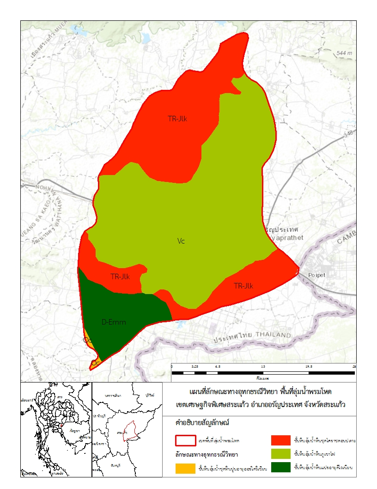

**ภาพที่ 4.11   แผนที่ลักษณะทางอุทกธรณีวิทยาที่ในการศึกษา**

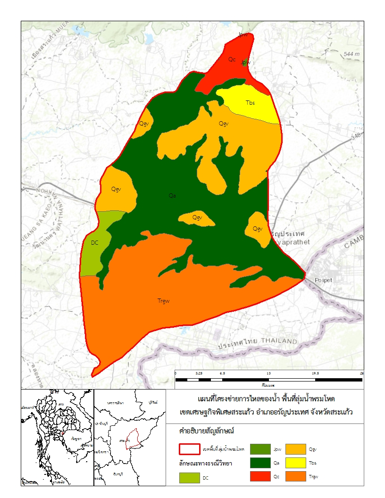

**ภาพที่ 4.12  แผนที่ลักษณะทางธรณีวิทยาที่ใช้ในการศึกษา**
5)  การใช้ประโยชน์ที่ดิน แผนที่การใช้ประโยชน์ที่ดินที่ใช้ในการศึกษาแสดงดังภาพที่ 4.13

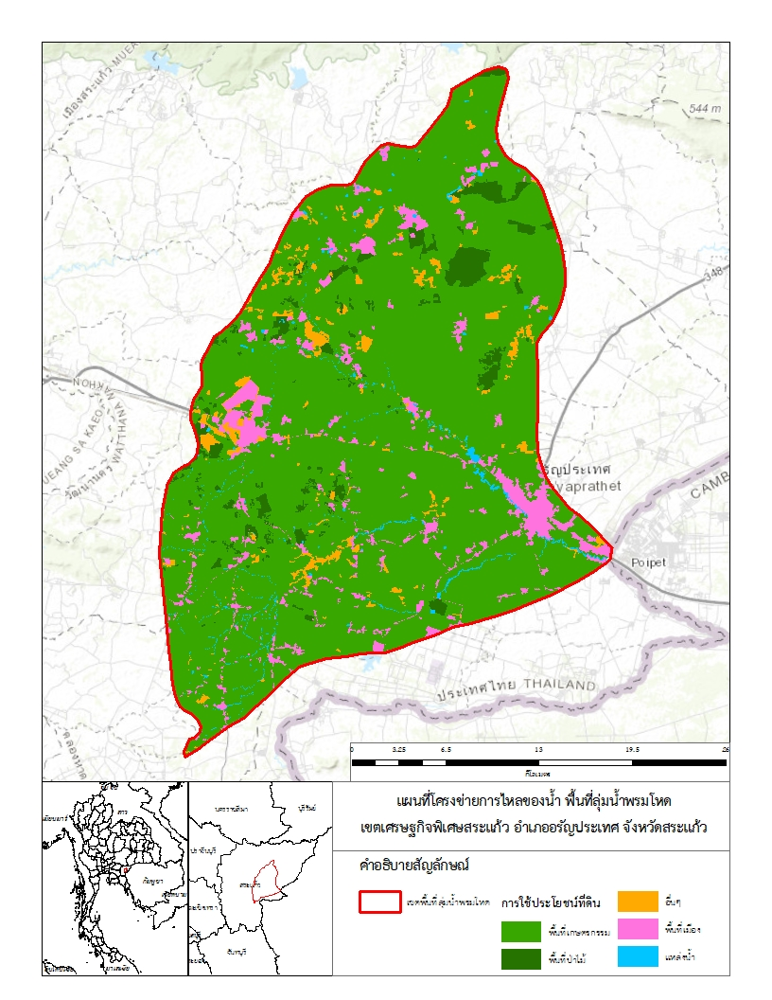

**ภาพที่ 4.13  แผนที่การใช้ประโยชน์ที่ดินที่ใช้ในการศึกษา**
พื้นที่ลุ่มน้ำพรมโหดและเขตเศรษฐกิจพิเศษสระแก้วมีการใช้ที่ดินหลากหลาย โดยส่วนใหญ่เป็นเกษตรกรรม เช่น ข้าว มันสำปะหลัง และอ้อย ซึ่งเป็นพืชเศรษฐกิจหลัก ขณะที่พื้นที่ป่าไม้มีบทบาทด้านนิเวศแต่มีแนวโน้มลดลงจากการขยายพื้นที่เกษตรและอุตสาหกรรม เขตเศรษฐกิจพิเศษมีการใช้ที่ดินเพิ่มขึ้นเพื่ออุตสาหกรรม การค้า และโลจิสติกส์ ส่งผลให้เกิดการเปลี่ยนแปลงจากพื้นที่เกษตรไปสู่การพัฒนาเมือง การเปลี่ยนแปลงนี้เพิ่มความต้องการใช้น้ำและความเสี่ยงต่อปัญหาน้ำท่วม–ภัยแล้ง หากขาดการวางแผนจัดการที่เหมาะสม

## 4.3 ผลการรวบรวมข้อมูล Big Data เกี่ยวกับระดับน้ำ และข่าว เพื่อใช้ประกอบการตัดสินใจในด้านนโยบายและการรับมือภัยพิบัติ

### 4.3.1 การสกัดลิงก์จากข่าว หน้าข่าวบนเว็บไซต์ไทยรัฐออนไลน์ที่เป็นแท็ก “น้ำท่วม 2567” มีลักษณะเป็นหน้าดัชนีที่รวบรวมเหตุการณ์ข่าวทั้งหมดที่เกี่ยวข้องกับแท็กดังกล่าว การสกัดลิงก์ (URL) เพื่อรวบรวมข้อมูลจึงเริ่มต้นจากหน้านี้ อย่างไรก็ตาม หน้าดังกล่าวแสดงข่าวเริ่มต้นเพียง 10 ข่าว และต้องกดปุ่ม “โหลดเพิ่มเติม” เพื่อดูข่าวเพิ่มเติม ซึ่งการโหลดข้อมูลเพิ่มเติมนี้ถูกดำเนินการผ่าน JavaScript ด้วยเหตุนี้ การใช้ Selenium จึงเหมาะสมกว่าการใช้ BeautifulSoup ในการจัดการเว็บไซต์ที่มีโครงสร้างแบบไดนามิกเช่นนี้ ดังนั้นการสกัดลิงก์ข่าวจึงเลือกใช้ Selenium แทน

### 4.3.2 การสกัดข้อมูลข่าวจากลิงก์ ข้อมูลข่าวจากแหล่งข้อมูล ข่าวน้ำท่วมออนไลน์ 555 รายการ ที่สกัดมาได้โดยใช้ BeautifulSoup และ Request ดึงข้อมูลจากลิงก์ที่ได้มาทำให้ได้ข้อความที่มาจากเนื้อข่าวโดยปราศจากโค้ด HTML และเนื้อหาเหล่านั้นจะถูกนำมาผ่านกระบวนการประมวลผลโดยใช้เทคนิค NER ด้วยโมเดล WangchanBERTa เพื่อสกัดสถานที่และเวลาที่ปรากฏในรายงานข่าว อย่างไรก็ตาม บางข่าวที่มีความยาวมากจำเป็นต้องแบ่งเป็น 2-5 ส่วน เนื่องจากข้อจำกัดด้านความยาวข้อความของ WangchanBERTa ซึ่งสามารถประมวลผลได้สูงสุดที่ 512 tokens ต่อข้อความตามการตั้งค่ามาตรฐานของ BERT โดยจำนวน characters ที่แท้จริงจะขึ้นอยู่กับกระบวนการ tokenization ซึ่งในกรณีของภาษาไทย การตัดคำที่ซับซ้อนอาจทำให้ข้อความที่มีจำนวนตัวอักษรมากแปลงเป็นจำนวน token ที่สูงกว่าภาษามาตรฐานเช่นภาษาอังกฤษ แต่ละข่าวที่ผ่านการประมวลผลจะใช้เวลาประมาณ 1-3 วินาที ข้อมูลที่สกัดมาได้ก็จะบันทึกลงฐานข้อมูลชั่วคราว

### 4.3.3 สรุปข้อมูลด้วย DataFrame และ PivotTable ข้อมูลเกี่ยวกับสถานที่และเวลาที่ได้จะถูกนำมาวิเคราะห์ต่อโดยใช้ Pandas DataFrame และ PivotTable หากข่าวบางรายการระบุสถานที่มากกว่าหนึ่งแห่ง จะต้องมีการเพิ่ม record ใน DataFrame เพื่อนำมาวิเคราะห์ ซึ่งจากข้อมูลที่ได้จะทำให้สามารถสรุปผลและจัดแสดงในตารางที่ 1 และจากตารางที่ 1 และ  2 ผลการวิเคราะห์พบว่าจังหวัดที่ได้รับผลกระทบจากน้ำท่วมมากที่สุดคือเชียงรายและเชียงใหม่ ซึ่งอยู่ทางภาคเหนือของประเทศไทย โดยทั้งสองจังหวัดมีการกล่าวถึงรวมกันถึง 29% ของข่าวทั้งหมด รายงานข่าวส่วนใหญ่ (79%) เกิดขึ้นในไตรมาสที่ 3 ของปี 2567 (กรกฎาคมถึงกันยายน) และอีก 20% เกิดขึ้นในไตรมาสที่ 4 (พฤศจิกายนถึงธันวาคม) ในขณะที่ไตรมาสที่ 2 (เมษายนถึงมิถุนายน) ไม่มีรายงานข่าวน้ำท่วมเลย ส่วนข่าวในไตรมาสที่ 1 เป็นข่าวสรุปเหตุการณ์น้ำท่วมในปีก่อนหน้า ภาคที่ได้รับผลกระทบจากน้ำท่วมมากที่สุดคือภาคเหนือและภาคกลาง คิดเป็น 41% และ 33% ของข่าวทั้งหมดตามลำดับ ในไตรมาสที่ 3 มีรายงานน้ำท่วมจากภาคเหนือ กลาง ตะวันออก และตะวันตก แต่ลดลงมากกว่า 50% ในไตรมาสที่ 4 ขณะที่ภาคใต้มีรายงานข่าวน้ำท่วมในไตรมาสที่ 3 และ 4 อย่างสมดุลกัน ส่วนภาคตะวันออกเฉียงเหนือมีรายงานน้ำท่วมเฉพาะในไตรมาสที่ 3 เท่านั้น ดังตารางที่ 4.7 และ ตารางที่ 4.8

**ตารางที่ 4.7 สรุปจังหวัดที่มีจำนวนเหตุการณ์น้ำท่วมที่รายงานในแหล่งออนไลน์ปี 2567 มากที่สุด**
10 อันดับแรกแบ่งตามภูมิภาคและรายไตรมาส

| จังหวัด | ภูมิภาค | ไตรมาส 1 | ไตรมาส 3 | ไตรมาส 4 | รวม |
| :--- | :--- | :--- | :--- | :--- | :--- |
| เชียงราย | ภาคเหนือ | 0 | 120 | 25 | 145 |
| เชียงใหม่ | ภาคเหนือ | 0 | 58 | 44 | 102 |
| สุโขทัย | ภาคกลาง | 0 | 34 | 5 | 39 |
| ชัยนาท | ภาคกลาง | 0 | 30 | 7 | 37 |
| พระนครศรีอยุธยา | ภาคกลาง | 0 | 24 | 9 | 33 |
| แพร่ | ภาคเหนือ | 0 | 30 | 0 | 30 |
| หนองคาย | ภาคตะวันออกเฉียงเหนือ | 0 | 29 | 0 | 29 |
| น่าน | ภาคเหนือ | 0 | 29 | 0 | 29 |
| พะเยา | ภาคเหนือ | 0 | 25 | 1 | 26 |
| อ่างทอง | ภาคกลาง | 0 | 20 | 4 | 24 |
| นนทบุรี | ภาคกลาง | 1 | 12 | 10 | 23 |
| ตาก | ภาคตะวันตก | 0 | 16 | 2 | 18 |
| นครสวรรค์ | ภาคกลาง | 0 | 11 | 5 | 16 |

**ตารางที่ 4.8 สรุปจำนวนเหตุการณ์น้ำท่วมที่รายงานในแหล่งออนไลน์ปี 2567 แบ่งตามภูมิภาคและ**
รายไตรมาส

| ภูมิภาค | ไตรมาส 1 | ไตรมาส 3 | ไตรมาส 4 | รวม |
| :--- | :--- | :--- | :--- | :--- |
| ภาคเหนือ | 0 | 277 | 71 | 348 |
| ภาคกลาง | 7 | 207 | 61 | 275 |
| ภาคตะวันออกเฉียงเหนือ | 0 | 112 | 0 | 112 |
| ภาคใต้ | 0 | 30 | 31 | 61 |
| ภาคตะวันตก | 0 | 17 | 5 | 22 |
| ภาคตะวันออก | 1 | 19 | 1 | 21 |
| รวมทั้งหมด | 8 | 662 | 169 | 839 |

### 4.3.4 สรุปและอธิบายข้อมูลด้วยแผนที่ความร้อน การสร้างแผนที่ความร้อน (Heatmap) ด้วย Python โดยใช้ Folium เริ่มจากการเตรียมข้อมูลในรูปแบบ List ที่ประกอบด้วยพิกัดละติจูด ลองจิจูด และค่าความร้อนที่สะท้อนจำนวนครั้งของรายงานน้ำท่วม เพื่อแสดงข้อมูลเชิงพื้นที่ เช่น ความหนาแน่นของเหตุการณ์หรือจุดที่น่าสนใจในพื้นที่ต่างๆ แผนที่ความร้อนที่สร้างขึ้นแสดงจำนวนรายงานน้ำท่วมในแต่ละไตรมาสของปี โดยพบว่าในไตรมาสที่ 1 มีรายงานเฉพาะในภาคกลาง ส่วนไตรมาสที่ 2 ไม่มีรายงานใดๆ ในขณะที่ไตรมาสที่ 3 และ 4 เหตุการณ์น้ำท่วมกลับมาแสดงความหนาแน่นอีกครั้ง โดยจุดที่น่าสนใจของเหตุการณ์น้ำท่วมอยู่ในภาคกลางตอนล่างและภาคเหนือตอนบน ขณะที่ภาคใต้มีการรายงานเหตุการณ์ตลอดในไตรมาสที่ 3 และ 4 ดังภาพที่ 4.14

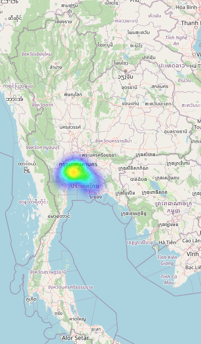

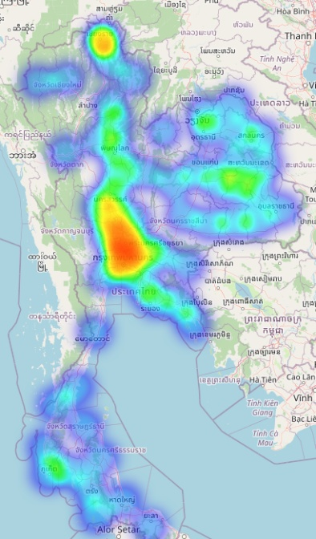

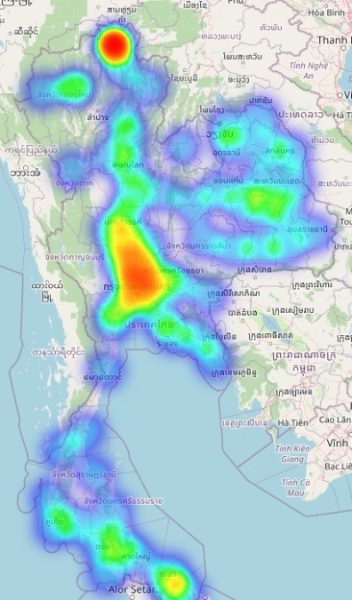

**ภาพที่ 4.14  แผนภาพความภูมิร้อนจำนวนรายงานน้ำท่วม (ซ้าย) รายงานไตรมาส 1 และ 2 (กลาง)**
รายงานไตรมาส 3 (ขวา) รายงานไตรมาส 4

### 4.3.5 ความเร็วในการสกัดข้อมูล	กระบวนการสกัดข้อมูลด้วยเว็บสแครปปิ้งเริ่มจากการสกัดลิงก์จากข่าวซึ่งใช้เวลาเพียง 2 วินาที ต่อมาข้อมูลข่าวจากลิงก์แต่ละรายการถูกสกัดออกมา โดยเฉลี่ยใช้เวลาประมาณไม่เกิน 10 วินาทีต่อข่าว รวมเวลาทั้งหมด 5550 วินาที หรือประมาณ 92 นาที หลังจากนั้น ข้อมูลที่รวบรวมได้ถูกสรุปด้วย DataFrame และ PivotTable ซึ่งใช้เวลาเพียง 8 วินาที และสุดท้าย การสร้างแผนที่ความร้อนเพื่อแสดงข้อมูลเชิงพื้นที่ใช้เวลาเพียง 1 วินาที รวมเป็นเวลาไม่เกิน 1 ชั่วโมง 33 นาที โดยเวลาทั้งหมด 99.99% หมดไปกับการสกัดข้อมูลจากหน้าแหล่งข่าวและสกัดข้อมูลด้วยเทคนิค NER
จากแหล่งข้อมูลข่าวน้ำท่วมออนไลน์ 555 รายการ และด้วยเทคนิคเว็บสแครปปิ้งพบว่าใช้เวลาในการรวบรวมข้อมูลไม่นานเมื่อเทียบกับการรวบรวมข้อมูลด้วยตนเองและสามารถดึงข้อมูลจากหลายแหล่งพร้อมกันได้อย่างมีประสิทธิภาพ นอกจากนี้ การใช้เทคนิค BeutifulSoup และ Selenium ยังช่วยเพิ่มความยืดหยุ่นในการเก็บข้อมูลจากเว็บไซต์ที่มีการแสดงผลด้วย JavaScript การวิเคราะห์ข้อมูลที่ได้จากเว็บสแครปปิ้งยังมีความละเอียดมากขึ้น (McKinney, 2022) เนื่องจากการประยุกต์ใช้เทคนิค NLP เช่น NER ช่วยในการสกัดข้อมูลสำคัญโดยอัตโนมัติ  ผลการทดลองนี้แสดงให้เห็นว่าเทคนิคเว็บสแครปปิ้งเป็นเครื่องมือที่มีประสิทธิภาพสูงสำหรับการรวบรวมและวิเคราะห์ข่าวสารเกี่ยวกับน้ำท่วมในประเทศไทย และสามารถนำไปประยุกต์ใช้ในการจัดการภัยพิบัติได้อย่างเหมาะสม

## 4.4  ผลการพัฒนาระบบแจ้งเตือนภัยและรายงานสถานการณ์ผ่านระบบเว็บไซต์และ 
      แอปพลิเคชันไลน์ OA

### 4.4.1 ผลการพัฒนาระบบแจ้งเตือนภัยและรายงานสถานการณ์ผ่านระบบเว็บไซต์
โครงสร้างระบบที่พัฒนาขึ้นในการวิจัยครั้งนี้มีองค์ประกอบหลัก 4 ส่วน ได้แก่ เว็บไซต์, แอปพลิเคชันไลน์ OA ฐานข้อมูลกลาง (Database) และกระบวนการทำงานอัตโนมัติ (Workflow) โดยทั้งสี่ส่วนถูกออกแบบให้ทำงานร่วมกันอย่างเป็นระบบ เพื่อให้สามารถรองรับการแจ้งเตือนภัยและรายงานสถานการณ์ได้อย่างมีประสิทธิภาพ

เว็บไซต์ทำหน้าที่เป็นศูนย์กลางในการบริหารจัดการข้อมูลและแสดงผลรายงานสถานการณ์ภัยพิบัติ โดยผู้ดูแลระบบสามารถเพิ่ม แก้ไข หรืออัปเดตข้อมูลข่าวสาร รวมถึงกำหนดข้อความแจ้งเตือนที่จะถูกส่งต่อไปยังผู้ใช้งานผ่าน LINE OA ได้ทันที นอกจากนี้ เว็บไซต์ยังทำหน้าที่เป็นแหล่งรวมข้อมูลย้อนหลัง พร้อมทั้งมีระบบ Dashboard ที่ช่วยให้ผู้ใช้สามารถเข้าถึงข้อมูลสถิติหรือแนวโน้มได้อย่างสะดวก

แอปพลิเคชันไลน์ OA (LINE Official Account หรือ LINE OA) ทำหน้าที่เป็นช่องทางสื่อสารหลักกับผู้ใช้งาน โดยเมื่อผู้ใช้ทำการเพิ่มเพื่อนเข้ากับ OA ระบบจะทำการบันทึกข้อมูลผู้ใช้ลงในฐานข้อมูล และเปิดให้ผู้ใช้สามารถรับข้อความแจ้งเตือนภัยในรูปแบบ Push Notification รวมถึงเข้าถึงข้อมูลรายงานสถานการณ์ล่าสุดผ่าน Rich Menu หรือ Chatbot ได้อย่างสะดวกในทุกเวลา

ฐานข้อมูลกลาง (Database) ถูกออกแบบเพื่อรองรับทั้งข้อมูลเชิงข้อความและข้อมูลเชิงเวลา (Time-series Data) เช่น ข้อมูลข่าวภัยพิบัติ, ข้อมูลผู้ใช้, ประวัติการแจ้งเตือน, และบันทึกเหตุการณ์ย้อนหลัง โดยใช้โครงสร้างแบบ Hybrid คือผสมผสานการเก็บข้อมูลเชิงโครงสร้าง (SQL) เพื่อการอ้างอิงที่ชัดเจน เช่น รายชื่อผู้ใช้งาน และการเก็บข้อมูลกึ่งโครงสร้าง (NoSQL) เพื่อรองรับข้อมูลข่าวสารและข้อความแจ้งเตือนที่มีรูปแบบหลากหลาย

กระบวนการทำงานอัตโนมัติ (Workflow) ทำหน้าที่เชื่อมโยงทุกองค์ประกอบเข้าด้วยกัน เช่น เมื่อผู้ดูแลเพิ่มข่าวหรือสถานการณ์ผ่านเว็บไซต์ ข้อมูลจะถูกประมวลผลและบันทึกเข้าสู่ฐานข้อมูล จากนั้นระบบ Workflow จะทำการ Trigger ให้ส่งข้อความแจ้งเตือนผ่าน LINE OA ไปยังผู้ใช้ตามเงื่อนไขที่กำหนดไว้ เช่น เขตพื้นที่ จังหวัด หรือระดับความรุนแรงของเหตุการณ์ การออกแบบ Workflow ในลักษณะนี้ช่วยลดภาระการทำงานซ้ำซ้อนของผู้ดูแล และเพิ่มความเร็วในการกระจายข้อมูลไปยังผู้ใช้ระบบที่พัฒนาขึ้นมีฟังก์ชันการทำงานหลัก (Core Functions) ดังต่อไปนี้

#### 4.4.1.1 การแจ้งเตือนเหตุการณ์ (Notification) ระบบที่พัฒนาขึ้นสามารถส่งการแจ้งเตือนภัยไปยังผู้ใช้งานได้อย่างรวดเร็วและตรงกลุ่มเป้าหมาย ผ่านช่องทางหลักคือ LINE Official Account (LINE OA) โดยมีทั้งรูปแบบข้อความ (Text) และรูปแบบเสริม เช่น รูปภาพ แผนที่ หรือปุ่มโต้ตอบ เพื่อช่วยให้ผู้ใช้งานรับทราบสถานการณ์ได้ชัดเจนยิ่งขึ้น การออกแบบฟังก์ชันนี้รองรับทั้งการส่งแบบอัตโนมัติ (Auto Push) ตาม Trigger ที่กำหนด เช่น เมื่อเกิดเหตุการณ์น้ำท่วมหรือฝนตกหนักเกินเกณฑ์ และการส่งแบบกำหนดเองโดยผู้ดูแลระบบ เพื่อให้การสื่อสารครอบคลุมทั้งเชิงป้องกันและเชิงตอบสนอง

#### 4.4.1.2 การรายงานสถานการณ์ (Reporting)ระบบรายงานสถานการณ์ทำหน้าที่รวบรวมและสรุปข้อมูลเหตุการณ์ภัยพิบัติ ทั้งจากฐานข้อมูลภายในและข้อมูลจากแหล่งภายนอก แล้วนำเสนอในรูปแบบที่เข้าใจง่าย เช่น แผนที่ความร้อน (Heatmap) กราฟสถิติ ไทม์ไลน์ และตารางสรุป เพื่อให้ผู้ใช้งานและผู้ดูแลสามารถมองเห็นภาพรวมของสถานการณ์ได้อย่างครบถ้วน การออกแบบฟังก์ชันนี้เน้นการใช้งานแบบ Interactive โดยผู้ใช้งานสามารถเลือกพื้นที่ จังหวัด หรือช่วงเวลาเพื่อเรียกดูข้อมูลที่ต้องการได้อย่างอิสระ

#### 4.1.1.3 การจัดการข้อมูลผู้ใช้ (User Management)ฟังก์ชันการจัดการข้อมูลผู้ใช้ช่วยให้ระบบสามารถบริหารจัดการข้อมูลของสมาชิกที่เชื่อมต่อผ่าน LINE OA ได้อย่างเป็นระบบ ข้อมูลผู้ใช้ เช่น ชื่อผู้ใช้ เขตพื้นที่ และประวัติการโต้ตอบ ถูกจัดเก็บในฐานข้อมูลเพื่อใช้ในการวิเคราะห์และปรับแต่งการแจ้งเตือนให้เหมาะสมกับแต่ละกลุ่มเป้าหมาย นอกจากนี้ ระบบยังสามารถจัดการสิทธิ์การเข้าถึงสำหรับผู้ดูแลระบบหลายระดับ เช่น ผู้ดูแลระดับจังหวัดและผู้ดูแลส่วนกลาง เพื่อเพิ่มความยืดหยุ่นและความปลอดภัยในการใช้งาน

#### 4.1.1.4 การเชื่อมโยงข้อมูลจากแหล่งภายนอก (External Data Integration)ระบบรองรับการเชื่อมต่อกับแหล่งข้อมูลภายนอกที่เกี่ยวข้อง เช่น ข้อมูลสภาพอากาศและปริมาณน้ำฝนจากกรมอุตุนิยมวิทยา ข้อมูลปริมาณน้ำจากกรมชลประทาน และข้อมูลพยากรณ์ภัยพิบัติจากแพลตฟอร์มภาครัฐและเอกชน การออกแบบฟังก์ชันนี้ใช้ API และ Workflow อัตโนมัติในการดึงข้อมูล ทำให้สามารถอัปเดตสถานการณ์แบบใกล้เคียงเรียลไทม์ได้ และช่วยเพิ่มความน่าเชื่อถือของการแจ้งเตือนที่ส่งไปยังผู้ใช้งาน

### 4.4.2  ผลการทำงานของระบบเว็บไซต์
เว็บไซต์ที่พัฒนาขึ้นถูกออกแบบโดยคำนึงถึงหลักการใช้งานที่ง่ายและเข้าถึงได้ของผู้ใช้ทั่วไป โดยมีเมนูและฟังก์ชันการทำงานที่จัดวางอย่างชัดเจน ทำให้ผู้ใช้งานสามารถเข้าถึงข้อมูลสำคัญ เช่น รายงานสถานการณ์น้ำท่วม การแจ้งเตือนภัย และสถิติย้อนหลัง ได้ภายในไม่กี่คลิก การออกแบบอินเทอร์เฟซเน้นความเรียบง่าย ใช้โทนสีและสัญลักษณ์ที่สื่อความหมายชัดเจน รวมทั้งรองรับการใช้งานทั้งบนคอมพิวเตอร์และอุปกรณ์พกพา (Responsive Design) เพื่อให้ผู้ใช้งานเข้าถึงข้อมูลได้สะดวกทุกที่ทุกเวลา โดยจดโดเมนเว็บไซต์ภายใต้ชื่อ https://promhodflood.org/  ระบบเว็บไซต์มีความสามารถในการจัดเก็บข้อมูลรายงานเหตุการณ์และการแจ้งเตือนภัยที่เกิดขึ้น โดยเก็บไว้ในฐานข้อมูลกลางที่เชื่อมโยงกับ LINE OA และแหล่งข้อมูลภายนอก ข้อมูลดังกล่าวสามารถเรียกดูย้อนหลังได้ตามช่วงเวลา พื้นที่ หรือประเภทของเหตุการณ์ ระบบรายงานถูกออกแบบให้นำเสนอในรูปแบบที่หลากหลาย เช่น ตารางสรุป กราฟ และแผนที่ เพื่อช่วยให้ผู้ใช้งานและผู้ดูแลระบบสามารถวิเคราะห์แนวโน้มและประเมินสถานการณ์ได้อย่างมีประสิทธิภาพ ผลการพัฒนาแสดงดังภาพที่ 4.15

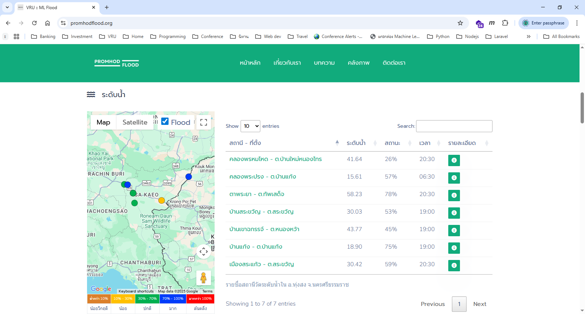

**ภาพที่ 4.15 เว็บแพลตฟอร์มรายงานสถานการณ์น้ำแลระบบคาดการณ์สถานการณ์อุทกภัย**

### 4.4.3  ผลการทำงานของระบบแอปพลิเคชันไลน์ OA (line official Account)
ผู้ใช้งานสามารถเข้าถึงระบบได้โดยการเพิ่มเพื่อน (Add Friend) ผ่าน QR Code หรือการค้นหาชื่อ LINE OA โดยตรง ซึ่งถือว่าสะดวกและไม่ต้องติดตั้งแอปพลิเคชันเพิ่มเติม เมื่อเพิ่มเพื่อนแล้ว ผู้ใช้งานสามารถลงทะเบียนข้อมูลเบื้องต้น เช่น ชื่อ จังหวัด หรือพื้นที่ที่ต้องการติดตาม เพื่อให้ระบบสามารถส่งการแจ้งเตือนและรายงานที่สอดคล้องกับบริบทของผู้ใช้แต่ละคนได้อย่างเหมาะสม

ระบบมีความสามารถในการส่งข้อความแจ้งเตือนแบบ Push Notification ไปยังผู้ใช้ทุกคนหรือเฉพาะกลุ่มเป้าหมายที่อยู่ในพื้นที่เสี่ยงภัย โดยข้อความที่ส่งออกมาประกอบด้วยรายละเอียดเหตุการณ์ เช่น ระดับน้ำฝน ระดับน้ำในลำน้ำสำคัญ และการคาดการณ์สถานการณ์ล่วงหน้า การประเมินพบว่าข้อความถูกส่งถึงผู้ใช้ได้อย่างรวดเร็ว และช่วยให้ประชาชนในพื้นที่มีเวลาตัดสินใจและเตรียมการรับมือได้ดีกว่าการรอฟังประกาศจากหน่วยงานภาครัฐเพียงอย่างเดียว

แอปพลิเคชัน LINE OA ได้ถูกพัฒนาให้มี Chatbot เพื่อโต้ตอบกับผู้ใช้ในลักษณะกึ่งอัตโนมัติ ผู้ใช้สามารถสอบถามข้อมูล เช่น ระดับน้ำในพื้นที่ รายงานสภาพอากาศ หรือแนวโน้มฝนตก ผ่านข้อความโต้ตอบ โดย Chatbot จะประมวลผลคำถามและดึงข้อมูลจากฐานข้อมูลหรือระบบภายนอกมาแสดงผลในรูปแบบข้อความและกราฟ การทดสอบพบว่า Chatbot สามารถตอบสนองได้อย่างแม่นยำในคำถามที่เกี่ยวข้องกับข้อมูลเชิงโครงสร้าง (Structured Data) และช่วยลดภาระงานเจ้าหน้าที่ในการตอบคำถามซ้ำ ๆ

ระบบ LINE OA ยังได้จัดทำเมนูหลัก (Rich Menu) ที่ช่วยให้ผู้ใช้สามารถเข้าถึงรายงานสถานการณ์ได้อย่างง่ายดาย ไม่ว่าจะเป็นการดูข้อมูลย้อนหลังในรูปแบบตาราง กราฟ หรือ Heatmap รวมถึงรายงานสรุประดับจังหวัดและพื้นที่เสี่ยง รายงานที่แสดงผลถูกออกแบบให้กระชับ 
เข้าใจง่าย และรองรับการใช้งานผ่านอุปกรณ์มือถือที่มีหน้าจอขนาดเล็ก ทำให้ประชาชนสามารถติดตามสถานการณ์ได้สะดวก รวดเร็ว และต่อเนื่อง ดังตารางที่ 4.9

**ตารางที่ 4.9 ตารางเปรียบเทียบผลการทำงาน: เว็บไซต์ vs LINE OA**

| มิติการใช้งาน | เว็บไซต์ (Website) | LINE OA |
| :--- | :--- | :--- |
| ข้อดี | - อินเทอร์เฟซออกแบบได้ยืดหยุ่น ปรับแต่งได้หลากหลาย - แสดงผลข้อมูลได้ครบถ้วน เช่น ตาราง กราฟ แผนที่ - รองรับการจัดเก็บและค้นหารายงานย้อนหลังได้สะดวก - เหมาะกับการใช้งานเชิงลึก (Detail-Oriented Use) | - เข้าถึงได้ง่ายผ่าน LINE ซึ่งผู้ใช้คุ้นเคยอยู่แล้ว - แจ้งเตือน (Push Notification) ได้ทันทีแบบเรียลไทม์ - ใช้งานสะดวกบนมือถือ ไม่ต้องติดตั้งแอปใหม่ - Chatbot ตอบสนองอัตโนมัติได้ |
| ข้อจำกัด | - ต้องเข้าผ่าน Browser และ Login ทุกครั้ง อาจไม่สะดวกบนมือถือ - แจ้งเตือนได้ไม่ทันที (ต้องพึ่งพาอีเมล/ระบบเสริม) - ผู้ใช้ทั่วไปอาจไม่คุ้นชินกับการเข้าเว็บเพื่อดูข้อมูล | - จำกัดรูปแบบการนำเสนอข้อมูล (ข้อความ รูป ปุ่มเมนู) - ฟังก์ชันการค้นหาและดูข้อมูลย้อนหลังไม่สะดวกเท่าเว็บไซต์ - การจัดการข้อมูลขนาดใหญ่ทำได้ไม่ดีเท่าบนเว็บไซต์ |

### 4.4.4  การทดสอบและประเมินประสิทธิภาพระบบ

#### 4.4.4.1 ความเร็วในการแจ้งเตือน (Notification Latency) 	จากการทดสอบระบบ พบว่าการส่งข้อความแจ้งเตือนผ่าน LINE OA มีความหน่วง (latency) ต่ำ โดยเฉลี่ยไม่เกิน 3–5 วินาทีหลังจากเหตุการณ์ถูกบันทึกในระบบ ขณะที่การแจ้งเตือนผ่าน เว็บไซต์ มีความล่าช้ากว่าเล็กน้อย เนื่องจากผู้ใช้จำเป็นต้องเข้าสู่ระบบด้วยตนเองเพื่อดูข้อมูล อย่างไรก็ตาม ในกรณีที่เชื่อมโยงเว็บไซต์เข้ากับระบบอีเมลหรือ Push API พบว่าสามารถลดเวลาในการกระจายข้อมูลได้อย่างมีนัยสำคัญ

#### 4.4.4.2  ความถูกต้องและครบถ้วนของข้อมูล (Accuracy & Completeness)
การตรวจสอบผลการบันทึกข้อมูลเหตุการณ์ และการสร้างรายงานสถานการณ์ พบว่าระบบทั้งสองสามารถแสดงข้อมูลที่ถูกต้องตามต้นทางได้เกิน 95% โดยกลไกการเชื่อมโยงข้อมูลจากแหล่งภายนอก เช่น ข้อมูลสภาพอากาศและข่าวสาร ช่วยเพิ่มความครบถ้วนของรายงาน อย่างไรก็ตาม ในบางกรณีที่มีการอัปเดตข้อมูลจากหลายแหล่งพร้อมกัน อาจเกิดความซ้ำซ้อน (duplication) ของข้อความใน LINE OA ได้ ซึ่งต้องแก้ไขด้วยการปรับปรุง Workflow การจัดการข้อมูล

### 4.4.5 ผลการประเมินประสิทธิภาพระบบแจ้งเตือนภัยและรายงานสถานการณ์ผ่านระบบเว็บไซต์และ แอปพลิเคชันไลน์ OA ดังตารางที่ 4.10

**ตารางที่ 4.10  ผลการประเมินประสิทธิภาพระบบแจ้งเตือนภัยและรายงานสถานการณ์ผ่านระบบ**
เว็บไซต์และ แอปพลิเคชันไลน์ OA

| ลำดับ | ลำดับ (2) | รายการประเมินการแสดงผลผ่านระบบเว็บไซต์ | คอลัมน์ 4 | . | แปลผล |
| :--- | :--- | :--- | :--- | :--- | :--- |
| **รายการประเมินด้านข้อมูล** |  |  |  |  |  |
| 1. | 1. | ความยากง่ายของข้อมูลและเนื้อหามีความเหมาะสมกับกลุ่มเป้าหมาย | 4.33 | 0.58 | มาก |
| 2. | 2. | การจัดลำดับข้อมูลเป็นขั้นตอนและต่อเนื่องอ่านแล้วเข้าใจง่าย | 4.67 | 0.58 | มากที่สุด |
| 3. | 3. | การนำเสนอข้อมูลมีความน่าสนใจทันสมัยและทันต่อเหตุการณ์ เนื้อหาทำให้เกิดความรู้ความเข้าใจ นำเสนอหลากหลายรูปแบบ | 4.67 | 0.58 | มากที่สุด |
| 4. | 4. | ความชัดเจนในการอธิบายข้อมูล กระชับ ภาษาเข้าใจง่าย อธิบายข้อมูลได้ชัดเจน | 4.67 | 0.58 | มากที่สุด |
| 5. | 5. | ข้อมูลในการนำเสนอมีความครบถ้วนสมบูรณ์ ถูกต้องสมบูรณ์ตรวจสอบได้ข้อมูลได้และเป็นประโยชน์ รับการแก้ไขปรับปรุงตามระยะเวลาที่เหมาะสม และแสดงวันที่ปรับปรุงข้อมูลครั้งล่าสุด ที่หน้าโฮมเพจ | 4.33 | 0.58 | มาก |
| 6. | 6. | ความสอดคล้องของมัลติมีเดียกับเนื้อหาภายในเว็บ และมัลติมีเดียมีความสอดคล้องกันช่วยสร้างความเข้าใจให้กับผู้ชมเว็บและช่วยทำให้เข้าใจข้อมูลได้ง่ายขึ้น | 4.33 | 0.58 | มาก |
| ผลการประเมินภาพรวมด้านข้อมูล | ผลการประเมินภาพรวมด้านข้อมูล | ผลการประเมินภาพรวมด้านข้อมูล | 4.50 | 0.58 | มาก |
| **รายการประเมินด้านระบบและการเชื่อมโยง** |  |  |  |  |  |
| 7. | ความเหมาะสมของชื่อโดเมนที่สื่อความหมายในการตั้งชื่อและมีโดเมนเนม (Domain name) ที่เป็นมาตรฐาน | ความเหมาะสมของชื่อโดเมนที่สื่อความหมายในการตั้งชื่อและมีโดเมนเนม (Domain name) ที่เป็นมาตรฐาน | 4.33 | 0.58 | มาก |
| 8. | เว็บอินเตอร์เฟสเชื่อมระหว่างผู้ใช้กับฟังก์ชันการทำงานของเว็บสามารถทำงานได้อย่างเหมาะสมและมีความรวดเร็วในการตอบสนองของระบบ | เว็บอินเตอร์เฟสเชื่อมระหว่างผู้ใช้กับฟังก์ชันการทำงานของเว็บสามารถทำงานได้อย่างเหมาะสมและมีความรวดเร็วในการตอบสนองของระบบ | 4.67 | 0.58 | มากที่สุด |
| 9. | ออกแบบเพื่อรองรับการทำงาน และการเข้าถึงเว็บไซต์ในทุกอุปกรณ์ | ออกแบบเพื่อรองรับการทำงาน และการเข้าถึงเว็บไซต์ในทุกอุปกรณ์ | 4.33 | 0.58 | มาก |
| 10. | เว็บมีฟังก์ชันช่วยเหลือการใช้งาน และระบบการเชื่อมโยงภายในเว็บเหมาะสม | เว็บมีฟังก์ชันช่วยเหลือการใช้งาน และระบบการเชื่อมโยงภายในเว็บเหมาะสม | 4.67 | 0.58 | มากที่สุด |
| 11. | ในการการเข้าถึงข้อมูล ความสามารถเว็บในการตอบสนองความต้องการผู้ใช้งานเว็บไซต์สามารถแสดงผลข้อมูล หรือปรากฏหน้าแรกได้อย่างรวดเร็ว | ในการการเข้าถึงข้อมูล ความสามารถเว็บในการตอบสนองความต้องการผู้ใช้งานเว็บไซต์สามารถแสดงผลข้อมูล หรือปรากฏหน้าแรกได้อย่างรวดเร็ว | 4.33 | 0.58 | มาก |
| 12. | ออกแบบการเชื่อมโยง เป็นแนวทางเดียวกันสอดคล้องกันในทุก ๆ เว็บเพจ การเชื่อมโยงไปยังส่วนต่าง ๆ เข้าใจง่ายและชัดเจนและการเชื่อมโยงในทุก ๆ หน้า สามารถกลับไปยังหน้าแรกได้ | ออกแบบการเชื่อมโยง เป็นแนวทางเดียวกันสอดคล้องกันในทุก ๆ เว็บเพจ การเชื่อมโยงไปยังส่วนต่าง ๆ เข้าใจง่ายและชัดเจนและการเชื่อมโยงในทุก ๆ หน้า สามารถกลับไปยังหน้าแรกได้ | 4.67 | 0.58 | มากที่สุด |

**ตารางที่ 4.10(ต่อ)**

| ลำดับ | ลำดับ (2) | รายการประเมินการแสดงผลผ่านระบบเว็บไซต์ | คอลัมน์ 4 | คอลัมน์ 5 | แปลผล |
| :--- | :--- | :--- | :--- | :--- | :--- |
| **รายการประเมินด้านระบบและการเชื่อมโยง** |  |  |  |  |  |
| 13. | 13. | มีระบบค้นหาข้อมูลต่าง ๆ เชื่อมโยงไว้อำนวยความสะดวกให้ค้นหา และมีทางเลือกในการเข้าถึงแหล่งข้อมูลอื่น ๆ | 4.67 | 0.58 | มากที่สุด |
| 14. | 14. | มีการจัดการระดับความปลอดภัยหรือกำหนดสิทธิ์ ในการเข้าถึงข้อมูลได้ก่อนใช้งานของผู้ใช้ระบบในระดับต่าง ๆ อย่างเหมาะสม | 4.67 | 0.58 | มากที่สุด |
| ผลการประเมินภาพรวมด้านระบบและการเชื่อมโยง | ผลการประเมินภาพรวมด้านระบบและการเชื่อมโยง | ผลการประเมินภาพรวมด้านระบบและการเชื่อมโยง | 4.54 | 0.58 | มากที่สุด |
| **รายการประเมินด้านการออกแบบและจัดรูปแบบ** |  |  |  |  |  |
| 15. | การออกแบบเลย์เอาต์เว็บไซต์เหมาะสมมีการวาง User Interface ที่ดี เรียบง่าย สม่ำเสมอ สวยงาม ทันสมัยและง่ายต่อการใช้งาน | การออกแบบเลย์เอาต์เว็บไซต์เหมาะสมมีการวาง User Interface ที่ดี เรียบง่าย สม่ำเสมอ สวยงาม ทันสมัยและง่ายต่อการใช้งาน | 4.67 | 0.58 | มากที่สุด |
| 16. | การออกแบบภายในเว็บไซต์ แบ่งหมวดหมู่เนื้อหา และลำดับเนื้อหาได้อย่างเหมาะสม | การออกแบบภายในเว็บไซต์ แบ่งหมวดหมู่เนื้อหา และลำดับเนื้อหาได้อย่างเหมาะสม | 4.33 | 0.58 | มาก |
| 17. | สีพื้นหลังกับสีตัวอักษรมีความเหมาะสมต่อการอ่าน | สีพื้นหลังกับสีตัวอักษรมีความเหมาะสมต่อการอ่าน | 4.00 | 1.00 | มาก |
| 18. | ขนาดตัวอักษร และรูปแบบตัวอักษร มีความชัดเจนง่ายต่อการอ่าน | ขนาดตัวอักษร และรูปแบบตัวอักษร มีความชัดเจนง่ายต่อการอ่าน | 4.00 | 1.00 | มาก |
| 19. | สีสันในการออกแบบเว็บไซต์มีความเหมาะสม | สีสันในการออกแบบเว็บไซต์มีความเหมาะสม | 4.67 | 0.58 | มากที่สุด |
| ผลการประเมินภาพรวมด้านการออกแบบและจัดรูปแบบ | ผลการประเมินภาพรวมด้านการออกแบบและจัดรูปแบบ | ผลการประเมินภาพรวมด้านการออกแบบและจัดรูปแบบ | 4.33 | 0.75 | มาก |
| **รายการประเมินแอปพลิเคชันไลน์ OA (line official Account)** |  |  |  |  |  |
| 20. | จัดหมวดหมู่ข้อมูล และการออกแบบใช้งานง่าย ไม่ซับซ้อนสะดวกมีหัวข้อและเมนูที่เข้าใจง่าย | จัดหมวดหมู่ข้อมูล และการออกแบบใช้งานง่าย ไม่ซับซ้อนสะดวกมีหัวข้อและเมนูที่เข้าใจง่าย | 4.33 | 0.58 | มาก |
| 21. | ภาษาอ่านเข้าใจง่าย รูปแบบตัวอักษร มีความชัดเจนง่ายต่อการอ่าน มีการนำเสนอข่าวสารด้วยรูปภาพที่สอดคล้องกัน | ภาษาอ่านเข้าใจง่าย รูปแบบตัวอักษร มีความชัดเจนง่ายต่อการอ่าน มีการนำเสนอข่าวสารด้วยรูปภาพที่สอดคล้องกัน | 4.67 | 0.58 | มากที่สุด |
| 22. | มีช่องทางการติดต่อ สามารถเข้าถึงข้อมูลระบบและบริการต่าง ๆ ได้อย่างรวดเร็ว | มีช่องทางการติดต่อ สามารถเข้าถึงข้อมูลระบบและบริการต่าง ๆ ได้อย่างรวดเร็ว | 4.67 | 0.58 | มากที่สุด |
| 23. | ข้อมูลและเนื้อหามีความถูกต้อง ครบถ้วน ทันต่อเหตุการณ์มีความเป็นปัจจุบันและมีความน่าเชื่อถือ แสดงผลถูกต้อง แม่นยำ และรวดเร็ว | ข้อมูลและเนื้อหามีความถูกต้อง ครบถ้วน ทันต่อเหตุการณ์มีความเป็นปัจจุบันและมีความน่าเชื่อถือ แสดงผลถูกต้อง แม่นยำ และรวดเร็ว | 4.67 | 0.58 | มากที่สุด |
| 24. | มีการเชื่อมโยงข่าวสารจากบัญชีอย่างเป็นทางการกับเว็บไซต์อื่น ๆ ที่เกี่ยวข้องหรือให้ข้อมูลเพิ่มเติม | มีการเชื่อมโยงข่าวสารจากบัญชีอย่างเป็นทางการกับเว็บไซต์อื่น ๆ ที่เกี่ยวข้องหรือให้ข้อมูลเพิ่มเติม | 4.33 | 0.58 | มาก |
| ผลการประเมินภาพรวมแอปพลิเคชันไลน์ OA (line official Account) | ผลการประเมินภาพรวมแอปพลิเคชันไลน์ OA (line official Account) | ผลการประเมินภาพรวมแอปพลิเคชันไลน์ OA (line official Account) | 4.53 | 0.58 | มากที่สุด |
จากตารางที่ 4.10 ผลการประเมินประสิทธิภาพระบบแจ้งเตือนภัยและรายงานสถานการณ์ผ่านเว็บไซต์และแอปพลิเคชันไลน์ OA พบว่า โดยภาพรวมอยู่ในระดับ “มาก” ถึง “มากที่สุด” ด้านข้อมูลได้รับค่าเฉลี่ย 4.50 แสดงถึงความเหมาะสม ความชัดเจน และความทันสมัยของเนื้อหา ส่วนด้านระบบและการเชื่อมโยงมีค่าเฉลี่ยสูงสุดที่ 4.54 อยู่ในระดับ “มากที่สุด” สะท้อนถึงการทำงานของระบบที่มีความรวดเร็ว ปลอดภัย และรองรับการใช้งานได้อย่างเหมาะสม สำหรับด้านการออกแบบและจัดรูปแบบได้ค่าเฉลี่ย 4.33 อยู่ในระดับ “มาก” แสดงให้เห็นถึงความสวยงาม ความเป็นระเบียบ และความง่ายต่อการใช้งาน แม้ในบางหัวข้อ เช่น สีพื้นหลังและขนาดตัวอักษร ได้ค่าเฉลี่ยต่ำกว่าหัวข้ออื่นเล็กน้อย ส่วนแอปพลิเคชันไลน์ OA ได้ค่าเฉลี่ย 4.53 อยู่ในระดับ “มากที่สุด” ชี้ให้เห็นว่ามีความสะดวก ใช้งานง่าย และเนื้อหามีความถูกต้องครบถ้วนและทันต่อเหตุการณ์ โดยสรุป ระบบทั้งหมดมีประสิทธิภาพสูง สามารถตอบสนองต่อผู้ใช้ได้อย่างเหมาะสมและน่าเชื่อถือ ทั้งในด้านข้อมูล ระบบ การออกแบบ และการเชื่อมโยง

### 4.4.6 ผลการประเมินความพึงพอใจการใช้งานระบบแจ้งเตือนภัยจากอุทกภัย-ภัยแล้งในพื้นที่ ลุ่มน้ำพรมโหด และเขตเศรษฐกิจพิเศษสระแก้ว ผ่านระบบเว็บไซต์ และแอปพลิเคชันไลน์ OA (line official Account) ดังตารางที่ 4.11

**ตารางที่ 4.11 ผลการประเมินความพึงพอใจที่มีต่อการใช้งานระบบแจ้งเตือนภัยจากอุทกภัย-ภัยแล้ง**
ในพื้นที่ลุ่มน้ำพรมโหดและเขตเศรษฐกิจพิเศษสระแก้วผ่านระบบเว็บไซต์

| ลำดับ | รายการประเมินความพึงพอใจต่อรูปแบบเว็บไซต์ | คอลัมน์ 3 | คอลัมน์ 4 | แปลผล |
| :--- | :--- | :--- | :--- | :--- |
| 1. | การจัดรูปแบบในเว็บไซต์มีความสวยงาม ทันสมัย น่าสนใจง่ายต่อการอ่านและการใช้งาน | 4.39 | 0.49 | มาก |
| 2. | การออกแบบเว็บไซต์มีความเหมาะสม สีพื้นหลังกับสีตัวอักษรเหมาะสมต่อการอ่าน | 4.72 | 0.46 | มากที่สุด |
| 3. | ขนาดตัวอักษร และรูปแบบตัวอักษร มีความสวยงามและอ่านได้ง่าย | 4.63 | 0.49 | มากที่สุด |
| 4. | ภาษาเข้าใจง่าย กระชับ อธิบายชี้แจงข้อมูลได้ชัดเจน | 4.67 | 0.47 | มากที่สุด |
| 5. | ภาพประกอบสามารถสื่อความหมายสอดคล้องกับข้อมูลที่นำเสนอ | 4.54 | 0.55 | มากที่สุด |
| 6. | ความถูกต้องในการเชื่อมโยงภายในเว็บไซต์และเชื่อมโยงไปยังเว็บไซต์อื่น ๆ มีความเหมาะสม | 4.61 | 0.49 | มากที่สุด |
| 7. | ความรวดเร็วในการแสดงภาพ ตัวอักษร และข้อมูลต่าง ๆมีความเหมาะสม | 4.67 | 0.47 | มากที่สุด |
| 8. | สามารถใช้งานได้โดยไม่ต้องจดจำขั้นตอนไม่ต้องใช้ความ พยายามในการใช้งานมากนัก | 4.54 | 0.55 | มากที่สุด |
| 9. | มีการออกแบบการปฏิสัมพันธ์ต่อผู้ใช้ ให้เข้าใจง่ายและมีคำอธิบายชัดเจน | 4.52 | 0.59 | มากที่สุด |
| 10. | การจัดลำดับข้อมูลเนื้อหาเป็นขั้นตอน มีความต่อเนื่อง อ่านแล้วเข้าใจได้ง่าย | 4.48 | 0.55 | มาก |
|  |  |  |  |  |

**ตารางที่ 4.11 (ต่อ)**

| ลำดับ | รายการประเมินความพึงพอใจต่อรูปแบบเว็บไซต์ | คอลัมน์ 3 | คอลัมน์ 4 | แปลผล |
| :--- | :--- | :--- | :--- | :--- |
| 11. | สามารถเป็นแหล่งความรู้ และแหล่งข้อมูลที่ตรงกับความต้องการของผู้ใช้งาน | 4.72 | 0.46 | มากที่สุด |
| 12. | ข้อมูลมีการจัดหมวดหมู่ให้ง่ายต่อการค้นหาและทำความเข้าใจ | 4.63 | 0.49 | มากที่สุด |
| 13. | ข้อมูลมีความชัดเจนถูกต้อง น่าเชื่อถือ และมีการปรับปรุงให้ทันต่อเหตุการณ์อยู่เสมอ | 4.65 | 0.53 | มากที่สุด |
| 14. | ข้อมูลมีประโยชน์ต่อผู้ใช้งาน สามารถนำไปประยุกต์ใช้และเป็นสื่อในการเผยแพร่ข่าวประชาสัมพันธ์ให้กับชุมชนได้ | 4.43 | 0.53 | มาก |
| 15. | โดยภาพรวมของเว็บไซต์ท่านได้รับประโยชน์ในระดับใด | 4.65 | 0.58 | มากที่สุด |
| ผลการประเมินความพึงพอใจที่มีต่อการใช้งานระบบภาพรวม | ผลการประเมินความพึงพอใจที่มีต่อการใช้งานระบบภาพรวม | 4.59 | 0.51 | มากที่สุด |
จากตารางที่ 4.11 ผลการประเมินความพึงพอใจต่อการใช้งานระบบแจ้งเตือนภัยจากอุทกภัย–ภัยแล้งผ่านเว็บไซต์ในพื้นที่ลุ่มน้ำพรมโหดและเขตเศรษฐกิจพิเศษสระแก้ว พบว่า ผู้ใช้งานมีความพึงพอใจในภาพรวมอยู่ในระดับมากที่สุด ค่าเฉลี่ยเท่ากับ 4.59, SD = 0.51) โดยเฉพาะด้านการออกแบบเว็บไซต์ที่มีความเหมาะสม อ่านง่าย สีพื้นหลังและตัวอักษรชัดเจน รวมถึงการจัดรูปแบบตัวอักษรและภาษา ซึ่งผู้ใช้เห็นว่ามีความเข้าใจง่าย กระชับ และสื่อสารข้อมูลได้อย่างชัดเจน นอกจากนี้ ภาพประกอบและการเชื่อมโยงข้อมูลในเว็บไซต์ยังมีความถูกต้องและเหมาะสม ตลอดจนการแสดงผลรวดเร็วและใช้งานง่าย ไม่ซับซ้อน อีกทั้งมีการออกแบบปฏิสัมพันธ์กับผู้ใช้อย่างเหมาะสมและเป็นขั้นตอน ส่งผลให้ผู้ใช้งานสามารถเข้าถึงข้อมูลที่ชัดเจน ถูกต้อง และเชื่อถือได้ รวมทั้งเป็นแหล่งความรู้ที่ตรงกับความต้องการและเป็นประโยชน์ต่อการนำไปประยุกต์ใช้หรือเผยแพร่ต่อชุมชนได้อย่างมีประสิทธิภาพ

ส่วนผลการประเมินแอปพลิเคชันไลน์ OA (line official Account) จากผลการประเมินความพึงพอใจต่อการใช้งานระบบแจ้งเตือนภัยจากอุทกภัย–ภัยแล้งผ่านแอปพลิเคชันไลน์ OA พบว่า โดยภาพรวมผู้ใช้งานมีความพึงพอใจอยู่ในระดับ มากที่สุด (ค่าเฉลี่ยรวม 4.56, SD = 0.55) โดยประเด็นที่ได้รับคะแนนสูงสุด ได้แก่ ความถูกต้อง รวดเร็ว และตรงตามความต้องการของข้อมูล (ค่าเฉลี่ย4.65) ความสะดวกในการค้นหาและเข้าถึงข้อมูล (ค่าเฉลี่ย= 4.63) และความครบถ้วน ทันสมัย และน่าเชื่อถือของข้อมูล (ค่าเฉลี่ย = 4.59) ส่วนด้านรูปแบบการใช้งานที่ง่ายและความสะดวกในการเรียนรู้ (ค่าเฉลี่ย 4.48) และการมีช่องทางติดต่อเจ้าหน้าที่ (ค่าเฉลี่ย = 4.43) อยู่ในระดับ “มาก” ทั้งนี้สะท้อนว่า แอปพลิเคชันไลน์ OA สามารถตอบสนองต่อความต้องการของผู้ใช้งานได้อย่างมีประสิทธิภาพ ทั้งในด้านความถูกต้อง ครอบคลุม และความสะดวกในการใช้งาน ส่งผลให้ผู้ใช้งานเกิดความเชื่อมั่นและยอมรับการใช้งานในระดับสูง แสดงดังตารางที่ 4.12

**ตารางที่ 4.12 ผลการประเมินความพึงพอใจที่มีต่อการใช้งานระบบแจ้งเตือนภัยจากอุทกภัย-ภัยแล้ง**
ในพื้นที่ลุ่มน้ำพรมโหดและเขตเศรษฐกิจพิเศษสระแก้วผ่านแอปพลิเคชันไลน์ OA (line

official Account)

| ลำดับ | ประเด็นความพึงพอใจการใช้งานของแอปพลิเคชันไลน์ OA (line official Account) | คอลัมน์ 3 | คอลัมน์ 4 | แปลผล |
| :--- | :--- | :--- | :--- | :--- |
| 1. | รูปแบบและการใช้งานเข้าถึงได้ง่าย สะดวกรวดเร็ว การทำงานไม่ยุ่งยากซับซ้อน ทำให้ผู้ใช้งานสามารถเรียนรู้และใช้งานได้ง่าย | 4.48 | 0.51 | มาก |
| 2. | ข้อมูลและเนื้อหาแสดงผลถูกต้อง แม่นยำรวดเร็วตอบสนองได้ตรงกับความต้องการของผู้ใช้งาน | 4.65 | 0.48 | มากที่สุด |
| 3. | ผู้ใช้งานส า ม า ร ถ ค้ น ห า ข้อมูล เข้าถึงข้อมูล และนำข้อมูลออกมาใช้ได้อย่างไม่ยุ่งยาก | 4.63 | 0.53 | มากที่สุด |
| 4. | ข้อมูลและเนื้อหาครบถ้วนมีความถูกต้อง ชัดเจน ครอบคลุม มีความเป็นปัจจุบัน ทันต่อสถานการณ์ และมีความน่าเชื่อถือ | 4.59 | 0.62 | มากที่สุด |
| 5. | มีีช่องทางการติดต่อเจ้าหน้าที่เพียงพอสามารถเข้าถึงข้อมูล ระบบ และบริการต่าง ๆ ได้อย่างรวดเร็วและตอบข้อสงสัยได้ตรงกับความต้องการ | 4.43 | 0.62 | มาก |
| ผลการประเมินความพึงพอใจที่มีแอปพลิเคชันไลน์ OA | ผลการประเมินความพึงพอใจที่มีแอปพลิเคชันไลน์ OA | 4.56 | 0.55 | มากที่สุด |

### 4.4.7  ผลการประเมินความพึงพอใจที่มีต่อการดำเนินการโครงการอบรมถ่ายทอดความรู้ เรื่องการใช้งานของระบบรวบรวมข้อมูลขนาดใหญ่ พยากรณ์และแจ้งเตือนภัยจากอุทกภัย-ภัยแล้งในพื้นที่ ลุ่มน้ำพรมโหด และเขตเศรษฐกิจพิเศษสระแก้ว ผ่านระบบเว็บไซต์ และแอปพลิเคชันไลน์ OA (line official Account)   พบว่า ผลการวิจัยจากการประเมินความพึงพอใจต่อการดำเนินการถ่ายทอดความรู้ พบว่า ผู้เข้าร่วมมีความพึงพอใจในระดับ มาก โดยค่าเฉลี่ยรวมอยู่ที่ 4.48 (S.D. = 0.61) ซึ่งสะท้อนถึงประสิทธิภาพของการจัดโครงการที่สามารถตอบสนองต่อความต้องการของกลุ่มเป้าหมายได้อย่างเหมาะสม รายการที่ได้รับความพึงพอใจสูงสุดในระดับ มากที่สุด ได้แก่ ความเหมาะสมของอาหารและอาหารว่าง (ค่าเฉลี่ย= 4.65) ความพร้อมของอุปกรณ์และสื่อโสตทัศนูปกรณ์ (ค่าเฉลี่ย= 4.63) ความเหมาะสมของสถานที่ (ค่าเฉลี่ย= 4.59) เอกสารประกอบการอบรมที่เข้าใจง่าย (ค่าเฉลี่ย= 4.61) และความรู้ที่สามารถนำไปประยุกต์ใช้ในการบริหารจัดการน้ำเพื่อแก้ไขปัญหาอุทกภัยในชุมชน (ค่าเฉลี่ย= 4.65) ขณะที่ด้านการถ่ายทอด การใช้ภาษา การตอบคำถาม และการจัดลำดับเนื้อหาก็ได้รับการประเมินในระดับ มาก เช่นกัน แสดงให้เห็นว่าโครงการถ่ายทอดความรู้มีคุณภาพทั้งด้านการจัดการ การสื่อสาร และประโยชน์ที่สามารถนำไปใช้จริงในชุมชนได้อย่างมีประสิทธิผลแสดงผลดังตารางที่ 4.13

**ตารางที่ 4.13	ผลการประเมินความพึงพอใจที่มีต่อการดำเนินการถ่ายทอดความรู้**

| ลำดับ | รายการประเมินความพึงพอใจ | คอลัมน์ 3 | คอลัมน์ 4 | แปลผล |
| :--- | :--- | :--- | :--- | :--- |
| 1. | การติดต่อประสานงานและการประชาสัมพันธ์ในการเข้าร่วมโครงการ | 4.39 | 0.54 | มาก |
| 2. | ใช้ภาษาได้อย่างเหมาะสมและเข้าใจง่าย | 4.52 | 0.62 | มาก |
| 3. | สามารถอธิบายเนื้อหาได้ชัดเจนและตรงประเด็น | 4.35 | 0.74 | มาก |
| 4. | เนื้อหาในการอบรมตรงกับวัตถุประสงค์ | 4.50 | 0.69 | มาก |
| 5. | ความสามารถในการถ่ายทอดและการสื่อสารมีความเหมาะสมกับกลุ่มเป้าหมาย | 4.30 | 0.70 | มาก |
| 6. | การเรียงลำดับเนื้อหาในการบรรยายมีความเหมาะสม | 4.39 | 0.65 | มาก |
| 7. | เอกสารประกอบการอบรมอธิบายรายละเอียดและเข้าใจง่าย | 4.61 | 0.58 | มากที่สุด |
| 8. | การเปิดโอกาสให้ซักถามและแสดงความคิดเห็น | 4.39 | 0.68 | มาก |
| 9. | การตอบคำถามตรงประเด็นและมีความชัดเจน | 4.46 | 0.66 | มาก |
| 10. | ระยะเวลาในการดำเนินโครงการมีความเหมาะสม | 4.39 | 0.58 | มาก |
| 11. | อาหาร /อาหารว่างมีความเหมาะสม | 4.65 | 0.53 | มากที่สุด |
| 12. | สถานที่ที่ใช้ดำเนินโครงการอบรม มีความเหมาะสม | 4.59 | 0.54 | มากที่สุด |
| 13. | ความพร้อมของอุปกรณ์โสตทัศนูปกรณ์/สื่อ มีความเหมาะสม | 4.63 | 0.53 | มากที่สุด |
| 14. | สามารถนำความรู้ไปเผยแพร่ / ถ่ายทอดแก่คนในชุมชนได้ | 4.43 | 0.58 | มาก |
| 15. | สามารถนำความรู้ที่ได้รับไปประยุกต์ใช้เป็นแนวทางเสริมสำหรับวางแผนการดำเนินการเกี่ยวกับการบริหารจัดการน้ำเพื่อแก้ไขปัญหาการเกิดอุทกภัยของพื้นที่หรือชุมชน | 4.65 | 0.48 | มากที่สุด |
| ผลการประเมินความพึงพอใจภาพรวม | ผลการประเมินความพึงพอใจภาพรวม | 4.48 | 0.61 | มาก |
